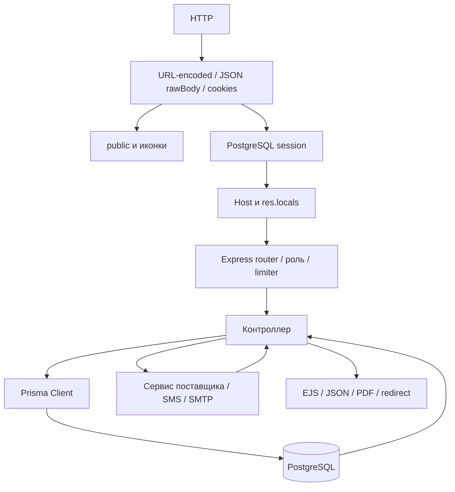

# ARCHITECTURE

Срез локального исходного кода: 2026-09-08. Корень ссылок — `/home/admin1/posa`; локальные незакоммиченные изменения включены. Источники — исполняемый код, схемы и конфигурация; существующая документация и комментарии не используются как доказательства. Статус фактов ниже: **подтверждено кодом**, если явно не указано «предположение на основе имени и использования». Статический анализ не подтверждает состояние рабочей БД или успешный запуск.

## HTTP → данные → ответ

Порядок diagram подтверждён регистрациями index.js, импортами контроллеров и Prisma-вызовами; статика может завершить запрос до сессии. `activation-system/index.js:38` `activation-system/index.js:98` `activation-system/index.js:109` `activation-system/controllers/merchant/saleController.js:156`.

## Точный порядок middleware

| Порядок | Действие | Источник |
| --- | --- | --- |
| 1 | dotenv.config; express; PORT fallback 4000; trust proxy = 1 | `activation-system/index.js:27` |
| 2 | express-ejs-layouts, layout layouts/main, engine ejs, views directory | `activation-system/index.js:38` |
| 3 | urlencoded extended true; JSON с verify → req.rawBody; cookieParser | `activation-system/index.js:44` |
| 4 | Иконки wallet, assetlinks, public с dotfiles allow, условный /vendor/zxing | `activation-system/index.js:60` `activation-system/index.js:98` |
| 5 | PgSession(session), createTableIfMissing; resave false; saveUninitialized false; sameSite lax; secure при production | `activation-system/index.js:108` |
| 6 | Обновление maxAge сессии: 6 часов / 30 дней; исправление locals.include | `activation-system/index.js:124` `activation-system/utils/authTokens.js:4` |
| 7 | checkSubdomain; locals user/appRole/isClient/appBaseUrl | `activation-system/index.js:139` |
| 8 | /auth /admin /merchant /vendor /kassa /api/client /api/v1; /receipts | `activation-system/index.js:177` |
| 9 | Wallet router на /; client router на /wallet и /client | `activation-system/index.js:187` |
| 10 | По Host wallet.* — прямой вызов clientRoutes; merchant/vendor без user → /auth/login | `activation-system/index.js:194` |
| 11 | Платежи → QR payment → store slug → public; затем app.listen | `activation-system/index.js:207` |

## Каталоги и ответственность

| Путь | Назначение | Основание |
| --- | --- | --- |
| activation-system/ | Node backend и серверный HTML | `activation-system/package.json:6` |
| controllers/admin/ | CRUD, финансы, каталоги поставщиков, ручная обработка | `activation-system/routes/adminRoutes.js:6` |
| controllers/merchant/ | Каталог продажи, сессионная корзина, выдача ваучера | `activation-system/routes/merchantRoutes.js:4` |
| controllers/client/ | OTP и страницы кошелька; api/ — JSON ваучеров | `activation-system/routes/clientRoutes.js:2` `activation-system/routes/clientApiRoutes.js:2` |
| controllers/vendor/ | Активации и финансовые выборки поставщика | `activation-system/routes/vendorRoutes.js:3` |
| controllers/kassa/ | Кассовые отчёты и выплаты | `activation-system/routes/kassaCabinetRoutes.js:3` |
| controllers/payment/ | Click prepare/complete, Payme RPC, Alif webhook | `activation-system/routes/paymentRoutes.js:2` |
| controllers/public/ | QR product/checkout/result/receipt | `activation-system/routes/qrPaymentRoutes.js:2` |
| routes/ | Регистрация Express endpoint и локальных middleware | `activation-system/index.js:11` |
| services/ | Dr.Web, Rokky, ManaStore, Telegram; оркестрация активаций | `activation-system/services/walletActivationService.js:1` |
| middleware/ | Роли, client session, Host, лимиты, Multer | `activation-system/middleware/auth.js:2` `activation-system/middleware/uploadMiddleware.js:1` |
| utils/payment/ | Подписи, URL, ошибки RPC, Alif HTTP client | `activation-system/utils/payment/clickSignature.js:9` `activation-system/utils/payment/alifClient.js:38` |
| utils/ | QR, телефон, refresh token, SMS, SMTP, receipt rendering | `activation-system/utils/qr.js:151` `activation-system/utils/receiptRenderer.js:1` |
| prisma/ и migrations/ | Схема, экземпляр клиента, SQL, seed кассы | `activation-system/prisma/client.js:1` `activation-system/prisma/seed-kassa.js:14` |
| views/ | EJS pages, layouts, partials, store | `activation-system/index.js:41` |
| public/ | Общедоступные браузерные скрипты, CSS, изображения, manifest, SW | `activation-system/index.js:98` |
| public/uploads/ | Загруженные logo и products; запись на диск | `activation-system/middleware/uploadMiddleware.js:6` `activation-system/middleware/uploadMiddleware.js:42` |
| resources/css/ | Вход Tailwind сборки | `activation-system/package.json:10` |
| receipts/ | PDF продаж, публикуемые статикой | `activation-system/index.js:184` `activation-system/controllers/merchant/saleController.js:94` |
| assets/fonts/ | Roboto.ttf для PDF при наличии | `activation-system/controllers/merchant/saleController.js:593` |
| passModels/storeCard.pass/ | Шаблон PassKit | `activation-system/routes/wallet.js:26` |
| certs/ | Каталог файлов сертификатов/ключей: фактические пути берутся из ENV, не фиксированы кодом | `activation-system/routes/wallet.js:30` |
| my-pwa/ | Android TWA, открывающая wallet.namo.uz/wallet | `my-pwa/app/build.gradle:23` |
| backups/, db-backups/ | Предположение на основе имени и использования: резервные артефакты. Автоматический backup-процесс в scripts не реализован | `activation-system/package.json:7` |

## Бизнес-операции

### Продажа мерчанта

Каталог фильтрует Product.status = on и считает active-ваучеры. addToCart заменяет корзину одним товаром; updateCart лишь перенаправляет. showCart генерирует checkoutToken; confirmCheckout требует paymentConfirmed = on и совпадение токена, затем обнуляет его до проверки ONLINE-телефона. `activation-system/controllers/merchant/cartController.js:5` `activation-system/controllers/merchant/cartController.js:43` `activation-system/controllers/merchant/cartController.js:61` `activation-system/controllers/merchant/cartController.js:88` `activation-system/controllers/merchant/saleController.js:56`.

В транзакции active → sold через условный updateMany и проверку count = 1; затем Sale, OnlineVoucher/WalletLog для ONLINE, VoucherTransaction и балансы. Формулы для цены P, merchantCommissionPercent M, vendorCommissionPercent V: merchantDebt = P×(1−M/100), vendorDebt = P×(1−V/100−M/100), kassaDebt = P×V/100. `activation-system/controllers/merchant/saleController.js:160` `activation-system/controllers/merchant/saleController.js:205`.

После commit OFFLINE создаёт PDF, ONLINE отправляет SMS. Ошибка PDF/SMS не откатывает уже созданную продажу. SMS helper возвращает success:false при ошибке, а sendVoucherSMS записывает rejected, не обязательно бросая исключение. `activation-system/controllers/merchant/saleController.js:251` `activation-system/controllers/merchant/saleController.js:297` `activation-system/controllers/merchant/saleController.js:672` `activation-system/utils/smsService.js:73`.

### QR-оплата

Checkout валидирует телефон и paymentMethod; создаёт QrPaymentAttempt с amount текущей цены и expiresAt через 15 минут. Click получает суммы в сумах, Payme — в тийинах; Alif invoice имеет диапазон 50000…20000000000 тийинов. `activation-system/controllers/public/qrPaymentController.js:111` `activation-system/controllers/public/qrPaymentController.js:150` `activation-system/utils/payment/alifClient.js:10`.

Общий processPaymentInternal находит active-ваучер и обновляет его без compare-and-set, создаёт Sale, привязку, проводку, балансы и PAID. После commit генерирует чек и отправляет SMS. Ошибка PDF после commit возвращает success:false при сохранённом PAID и проводках. SMS имеет отдельный catch и не отменяет успешный результат; FAILED устанавливается лишь для NO_VOUCHERS. `activation-system/controllers/public/qrPaymentController.js:245` `activation-system/controllers/public/qrPaymentController.js:274` `activation-system/controllers/public/qrPaymentController.js:442` `activation-system/controllers/public/qrPaymentController.js:462`.

Click использует MD5-подпись параметров; Payme — Basic с логином Paycom; Alif — HMAC-SHA256 точного rawBody, base64 и timingSafeEqual. Это транспортная проверка, но привязка attempt к выбранной кассе в этих обработчиках не проверяется. `activation-system/utils/payment/clickSignature.js:9` `activation-system/utils/payment/paymeHelpers.js:29` `activation-system/utils/payment/alifSignature.js:14` `activation-system/controllers/payment/alifController.js:54`.

### Активации

Кабинет поставщика принимает sold/pending только своего vendorId; ROKKY/DRWEB/MANASTORE запрещены этому пути. При успехе статус activated, VoucherActivation, удаление OnlineVoucher и WalletLog. `activation-system/services/voucherActivationService.js:13`.

Магазин использует req.session.clientId, OTP в AuthSmsLog, принадлежность Product.storeId и лимит 10 неудачных активаций за день по AuditLog. MANUAL создаёт заявку и уведомляет Telegram; ROKKY/DRWEB/MANASTORE создают заказ или получают ранее сохранённый результат. VOUCHER обновляет статус напрямую. `activation-system/controllers/storeController.js:148` `activation-system/controllers/storeController.js:213`.

Кошелёк использует req.session.client, проверяет владение OnlineVoucher и разрешённый тип поставщика плюс walletOnDemandEnabled. Статусы выдачи: ready/pending/error/idle. GET code-status только читает локальное состояние; для ManaStore запрос статуса поставщика находится в requestVoucherCode, а не в GET polling. `activation-system/services/walletActivationService.js:20` `activation-system/services/walletActivationService.js:58` `activation-system/services/walletActivationService.js:134` `activation-system/services/walletActivationService.js:340`.

Оператор завершает MANUAL непустым key либо отклоняет заявку. При on-demand привязка к клиенту сохраняется для просмотра кода; без on-demand удаляется. `activation-system/controllers/admin/manualActivationController.js:131` `activation-system/controllers/admin/manualActivationController.js:281`.

### Платежи между участниками

Платёж мерчанта и выплата поставщику записывают баланс до/после, уменьшают задолженность и последовательно гасят PENDING VoucherTransaction от старых к новым. Общий status COMPLETED используется для обеих сторон одной строки: закрытие одного долга влияет на выборку другого. `activation-system/controllers/admin/merchantController.js:245` `activation-system/controllers/admin/vendorController.js:229`.

Кассовая выплата создаёт KassaPayment и уменьшает кассу; для recipientType vendor дополнительно уменьшает Vendor.balance и vendorDebt. Проверки принадлежности получателя этой кассе и лимита баланса не реализованы. `activation-system/controllers/kassa/kassaCabinetController.js:167`.

## Внешние интеграции

| Интеграция | Запросы, авторизация, результат | Источник |
| --- | --- | --- |
| Dr.Web | POST /generate, Bearer; sku/source → serial; COMPLETED может содержать null key | `activation-system/services/drwebService.js:45` |
| Rokky | Всегда mock. Реальный POST /orders и GET /orders/:id/content есть в недостижимых ветках | `activation-system/services/rokkyService.js:8` `activation-system/services/rokkyService.js:62` |
| ManaStore | Bearer, wallet_id; POST /orders; GET /orders/:id; GET /orders/:id/get-codes; /products, /products/search, /products/:id, /wallets. Один повтор на сеть/5xx; timeout default 30s | `activation-system/services/manastoreService.js:67` `activation-system/services/manastoreService.js:119` |
| Telegram | POST bot-token/sendMessage (HTML); GET bot-token/getMe; получатели из authorizedUsers в БД | `activation-system/services/telegramService.js:11` `activation-system/services/telegramService.js:36` `activation-system/services/telegramService.js:166` |
| Eskiz | POST /auth/login и /message/sms/send; токен кэшируется в памяти без механизма обновления по сроку | `activation-system/utils/smsService.js:18` `activation-system/utils/smsService.js:48` |
| SMTP | Nodemailer secure=true; отправка html с ключом | `activation-system/utils/mailer.js:5` `activation-system/utils/mailer.js:15` |
| Apple Wallet | Генерация PKPass из модели и сертификатов; логирование добавления; публичная выдача по serial | `activation-system/routes/wallet.js:48` |

## Браузерный код и offline

SW кэширует shell, документы и GET /api/client; POST /api/client при сетевой ошибке сохраняет в IndexedDB, отдаёт 202 offline и повторяет до пяти раз с backoff. 4xx при повторе считается завершённым запросом и удаляется из очереди. `activation-system/public/sw.js:176` `activation-system/public/sw.js:197` `activation-system/public/sw.js:366` `activation-system/public/sw.js:393`.

API-кэш зависит от URL, а не clientId. Пользовательские данные сохраняются в browser IndexedDB; purge при серверном logout не реализован в logout-контроллере. Это требует отдельной проверки смены пользователя на одном устройстве. `activation-system/public/sw.js:267` `activation-system/public/js/wallet-offline-store.js:111` `activation-system/controllers/client/authController.js:300`.

### public/js/admin-session.js

| Функция | Действия / вызовы | Источник |
| --- | --- | --- |
| refreshSession | fetch | `activation-system/public/js/admin-session.js:22` |
| resetIdleTimer | document.cookie.includes, clearTimeout, setTimeout | `activation-system/public/js/admin-session.js:42` |

### public/js/client-app.js

| Функция | Действия / вызовы | Источник |
| --- | --- | --- |
| showOfflineQueueToast | document.getElementById, document.createElement, document.body.appendChild, clearTimeout, setTimeout | `activation-system/public/js/client-app.js:41` |
| setTheme | document.body.classList.toggle, selectors.themeToggleSun.classList.toggle, selectors.themeToggleMoon.classList.toggle, localStorage.setItem | `activation-system/public/js/client-app.js:92` |
| hydrateTheme | localStorage.getItem, setTheme, document.body.classList.contains, selectors.themeToggle.addEventListener | `activation-system/public/js/client-app.js:104` |
| renderMetrics | vouchers.filter | `activation-system/public/js/client-app.js:115` |
| cardThemeClass | Number | `activation-system/public/js/client-app.js:125` |
| createCard | document.createElement, cardThemeClass, `     <article class="wallet-card w-full ${theme}" data-voucher-id="${voucher.id}">       
         
           <h2 class="text-2xl font-semibold text-white">${voucher.productName}</h2>         
         
           
             
Получен
             
${voucher.assignedAt}
           
           <button class="wallet-card__show inline-flex items-center gap-2 rounded-full px-4 py-2 text-sm font-semibold" data-voucher-id="${voucher.id}">             <svg class="h-4 w-4" xmlns="http://www.w3.org/2000/svg" fill="none" viewBox="0 0 24 24" stroke="currentColor">               <path stroke-linecap="round" stroke-linejoin="round" stroke-width="1.5" d="M12 15a3 3 0 1 0 0-6 3 3 0 0 0 0 6Zm8.25-3c-1.5-3.5-4.75-6-8.25-6s-6.75 2.5-8.25 6c1.5 3.5 4.75 6 8.25 6s6.75-2.5 8.25-6Z" />             </svg>             Показать           </button>         
       
     </article>   `.trim | `activation-system/public/js/client-app.js:132` |
| renderVouchers | selectors.skeleton.classList.add, selectors.empty.classList.remove, selectors.list.classList.add, selectors.empty.classList.add, createCard, selectors.list.append, vouchers.forEach, selectors.list.classList.remove, renderMetrics | `activation-system/public/js/client-app.js:159` |
| loadFromCache | walletOfflineStore.loadVouchers, renderVouchers, renderMetrics | `activation-system/public/js/client-app.js:185` |
| fetchAndRender | selectors.skeleton.classList.remove, getVouchers, renderVouchers, walletOfflineStore.saveVouchers, walletOfflineStore.saveSyncInfo, walletOfflineStore.loadVouchers, selectors.empty.classList.remove, selectors.skeleton.classList.add | `activation-system/public/js/client-app.js:193` |
| openModal | selectors.modal.classList.remove | `activation-system/public/js/client-app.js:225` |
| closeModal | selectors.modal.classList.add | `activation-system/public/js/client-app.js:230` |
| bindModalControls | closeModal, selectors.modal.addEventListener, selectors.modalClose.addEventListener, selectors.modalCloseBottom.addEventListener | `activation-system/public/js/client-app.js:235` |
| bindModalAppleTracking | Number, logVoucherEvent, logVoucherEvent(voucherId, 'voucher.add_to_wallet', { device: 'ios' }, { keepalive: true }).catch, selectors.modalAddApple.addEventListener | `activation-system/public/js/client-app.js:250` |
| populateModal | window.openOndemandModal, window.openVoucherModal, selectors.modalStatus.classList.add, new Date(detail.lastSyncAt).toLocaleString, logVoucherEvent, logVoucherEvent(detail.id, 'voucher.add_to_wallet', { device: 'android' }, { keepalive: true }).catch, navigator.clipboard.writeText, logVoucherEvent(detail.id, 'voucher.share').catch, navigator.share | `activation-system/public/js/client-app.js:263` |
| bindAutoRefresh | fetchAndRender, document.addEventListener, window.addEventListener, setInterval | `activation-system/public/js/client-app.js:332` |
| handleCardClick | event.target.closest, Number, getVoucher, state.detailsCache.set, walletOfflineStore.save, state.detailsCache.get, walletOfflineStore.load, populateModal, openModal, logVoucherEvent, logVoucherEvent(voucherId, 'voucher.view').catch, alert | `activation-system/public/js/client-app.js:351` |
| bootstrap | hydrateTheme, bindModalControls, bindModalAppleTracking, bindAutoRefresh, renderVouchers, walletOfflineStore.saveVouchers, walletOfflineStore.saveVouchers({ vouchers: bootstrapData.vouchers }).catch, loadFromCache, fetchAndRender, selectors.list.addEventListener, selectors.refreshBtn.addEventListener, registerServiceWorker, registerPush | `activation-system/public/js/client-app.js:381` |

### public/js/client-auth.js

| Функция | Действия / вызовы | Источник |
| --- | --- | --- |
| sanitizePhone | value.replace, cleaned.startsWith, cleaned.slice, cleaned.slice(1).replace, cleaned.replace | `activation-system/public/js/client-auth.js:8` |
| normalizePhoneValue | sanitizePhone, sanitized.replace, digits.startsWith, digits.slice, suffixDigits.slice | `activation-system/public/js/client-auth.js:18` |
| setPhoneValidity | input.setCustomValidity | `activation-system/public/js/client-auth.js:26` |
| initPhoneInputs | document.querySelectorAll, input.value.startsWith, setPhoneValidity, input.setSelectionRange, requestAnimationFrame, input.addEventListener, event.preventDefault, normalizePhoneValue, target.setSelectionRange, document.querySelectorAll('input[name="phoneNumber"]').forEach | `activation-system/public/js/client-auth.js:32` |
| initOtp | document.getElementById, navigator.credentials.get, form.querySelector, form.submit, navigator.credentials.get({         otp: { transport: ['sms'] },         signal: abort.signal,       }).then, navigator.credentials.get({         otp: { transport: ['sms'] },         signal: abort.signal,       }).then((credential) => {         if (credential && credential.code) {           form.querySelector('input[name="otp"]').value = credential.code;           form.submit();         }       }).catch, fetch, setTimeout, resendBtn.addEventListener | `activation-system/public/js/client-auth.js:81` |
| bootstrap | initPhoneInputs, registerServiceWorker, initOtp | `activation-system/public/js/client-auth.js:123` |

### public/js/client-profile.js

| Функция | Действия / вызовы | Источник |
| --- | --- | --- |
| showOfflineQueueToast | document.getElementById, document.createElement, document.body.appendChild, clearTimeout, setTimeout | `activation-system/public/js/client-profile.js:14` |
| updateThemeIcon | themeSun.classList.toggle, themeMoon.classList.toggle | `activation-system/public/js/client-profile.js:50` |
| setThemeToggle | document.body.classList.toggle, localStorage.setItem, updateThemeIcon | `activation-system/public/js/client-profile.js:57` |
| initTheme | localStorage.getItem, setThemeToggle, themeToggle.addEventListener, document.body.classList.contains, topThemeToggle.addEventListener | `activation-system/public/js/client-profile.js:66` |
| initPush | localStorage.getItem, registerPush, localStorage.setItem, registration.pushManager.getSubscription, sub.unsubscribe, pushToggle.addEventListener | `activation-system/public/js/client-profile.js:84` |
| initClearCache | walletOfflineStore.saveVouchers, walletOfflineStore.clear, walletOfflineStore.clearScanHistory, alert, clearCacheBtn.addEventListener | `activation-system/public/js/client-profile.js:108` |
| initDeleteAccount | document.getElementById, deleteModal.classList.remove, deleteModal.classList.add, deleteBtn.addEventListener, cancelBtn.addEventListener, fetch, response.json, alert, confirmBtn.addEventListener | `activation-system/public/js/client-profile.js:118` |
| bootstrap | initTheme, initClearCache, initDeleteAccount, registerServiceWorker, initPush | `activation-system/public/js/client-profile.js:191` |

### public/js/client-scan.js

| Функция | Действия / вызовы | Источник |
| --- | --- | --- |
| showOfflineQueueToast | document.getElementById, document.createElement, document.body.appendChild, clearTimeout, setTimeout | `activation-system/public/js/client-scan.js:47` |
| loadScriptOnce | document.querySelector, existing.getAttribute, resolve, existing.addEventListener, reject, document.createElement, selector.match, c.toUpperCase, attrMatch[1].replace, script.addEventListener, document.head.appendChild | `activation-system/public/js/client-scan.js:83` |
| ensureZxing | loadScriptOnce, Promise.all, hints.set, zxingReader.setHints | `activation-system/public/js/client-scan.js:115` |
| ensureJsqr | loadScriptOnce | `activation-system/public/js/client-scan.js:145` |
| showOfflineMessage | alert | `activation-system/public/js/client-scan.js:157` |
| updateOfflineState | offlineNotice.classList.add, offlineNotice.classList.remove | `activation-system/public/js/client-scan.js:163` |
| updateHistoryList | document.createElement, new Date(item.scannedAt).toLocaleString, historyList.append, items.forEach | `activation-system/public/js/client-scan.js:172` |
| openModal | modal.classList.remove | `activation-system/public/js/client-scan.js:186` |
| closeModal | modal.classList.add, startScanner, setTimeout | `activation-system/public/js/client-scan.js:191` |
| populateModal | window.openVoucherModal, new Date(detail.lastSyncAt).toLocaleString, logVoucherEvent, logVoucherEvent(detail.id, 'voucher.add_to_wallet', { device: 'android' }, { keepalive: true }).catch | `activation-system/public/js/client-scan.js:199` |
| isIOSDevice | /iPhone&#124;iPad&#124;iPod/i.test | `activation-system/public/js/client-scan.js:235` |
| getActiveTrack | stream.getVideoTracks | `activation-system/public/js/client-scan.js:239` |
| trackSupportsTorch | track.getCapabilities, Boolean | `activation-system/public/js/client-scan.js:246` |
| updateTorchButton | getActiveTrack, trackSupportsTorch | `activation-system/public/js/client-scan.js:258` |
| resetTorchState | updateTorchButton | `activation-system/public/js/client-scan.js:266` |
| startVideo | alert, activeStream.getTracks, track.stop, activeStream.getTracks().forEach, navigator.mediaDevices.getUserMedia, video.setAttribute, video.play | `activation-system/public/js/client-scan.js:271` |
| decodeWithZxing | zxingReader.decode, result.getText, zxingReader.reset | `activation-system/public/js/client-scan.js:304` |
| decodeWithJsqr | fallbackCtx.getImageData, window.jsQR | `activation-system/public/js/client-scan.js:330` |
| stopFrameLoop | cancelAnimationFrame | `activation-system/public/js/client-scan.js:341` |
| stopScanner | stopFrameLoop, zxingReader.reset, activeStream.getTracks, track.stop, activeStream.getTracks().forEach, resetTorchState | `activation-system/public/js/client-scan.js:348` |
| loop | requestAnimationFrame, fallbackCtx.drawImage, decodeWithZxing, decodeWithJsqr, processPayload | `activation-system/public/js/client-scan.js:372` |
| startFrameLoop | stopFrameLoop, alert, requestAnimationFrame, fallbackCtx.drawImage, decodeWithZxing, decodeWithJsqr, processPayload | `activation-system/public/js/client-scan.js:365` |
| startScanner | updateOfflineState, showOfflineMessage, stopScanner, startVideo, resetTorchState, ensureZxing, ensureJsqr, Promise.all, startFrameLoop | `activation-system/public/js/client-scan.js:415` |
| stopAllAndStartAgain | startScanner | `activation-system/public/js/client-scan.js:445` |
| toggleTorch | getActiveTrack, alert, trackSupportsTorch, track.applyConstraints, updateTorchButton | `activation-system/public/js/client-scan.js:450` |
| processPayload | (rawPayload &#124;&#124; '').trim, showOfflineMessage, updateOfflineState, Date.now, stopScanner, claimVoucher, populateModal, openModal, isIOSDevice, resolvePassUrl, setTimeout, logVoucherEvent, logVoucherEvent(detail.id, 'voucher.qr_show').catch, new Date().toISOString, walletOfflineStore.appendScanHistory, walletOfflineStore.getScanHistory, updateHistoryList, refreshWalletCache, String, localStorage.setItem, alert, modal.classList.contains, startScanner | `activation-system/public/js/client-scan.js:472` |
| refreshWalletCache | getVouchers, walletOfflineStore.saveVouchers, walletOfflineStore.saveSyncInfo | `activation-system/public/js/client-scan.js:550` |
| initHistory | walletOfflineStore.getScanHistory, updateHistoryList | `activation-system/public/js/client-scan.js:560` |
| bindModalInteractions | closeModal, modal.addEventListener, modalClose.addEventListener, modalCloseBottom.addEventListener | `activation-system/public/js/client-scan.js:565` |
| bindAppleWalletTracking | Number, logVoucherEvent, logVoucherEvent(voucherId, 'voucher.add_to_wallet', { device: 'ios' }, { keepalive: true }).catch, modalAddApple.addEventListener | `activation-system/public/js/client-scan.js:579` |
| bootstrap | initHistory, updateOfflineState, startScanner, bindModalInteractions, bindAppleWalletTracking, stopAllAndStartAgain, switchCameraBtn.addEventListener, toggleTorchBtn.addEventListener, updateTorchButton, manualInput.value.trim, processPayload, manualSubmit.addEventListener, walletOfflineStore.clearScanHistory, updateHistoryList, historyClearBtn.addEventListener, window.addEventListener, stopScanner, registerServiceWorker | `activation-system/public/js/client-scan.js:592` |

### public/js/client-session.js

| Функция | Действия / вызовы | Источник |
| --- | --- | --- |
| clearRefreshRetry | window.removeEventListener, clearTimeout | `activation-system/public/js/client-session.js:13` |
| scheduleRefreshRetry | clearRefreshRetry, refreshSession, window.addEventListener, refreshReconnectHandler, scheduleRefreshRetry, setTimeout | `activation-system/public/js/client-session.js:25` |
| refreshSession | scheduleRefreshRetry, fetch, clearRefreshRetry | `activation-system/public/js/client-session.js:43` |
| resetIdleTimer | document.cookie.includes, clearTimeout, setTimeout | `activation-system/public/js/client-session.js:78` |

### public/js/merchant-checkout.js

| Функция | Действия / вызовы | Источник |
| --- | --- | --- |
| toggleConfirmButton |  | `activation-system/public/js/merchant-checkout.js:13` |
| togglePhoneSection | form.querySelector, phoneSection.classList.remove, phoneInput?.setAttribute, phoneSection.classList.add, phoneInput?.removeAttribute | `activation-system/public/js/merchant-checkout.js:17` |
| normalizePhoneInput | phoneInput.value.replace, digits.startsWith, digits.slice, phoneInput.setSelectionRange | `activation-system/public/js/merchant-checkout.js:33` |

### public/js/merchant-sell.js

| Функция | Действия / вызовы | Источник |
| --- | --- | --- |
| norm | String, String(v &#124;&#124; '').toLowerCase, String(v &#124;&#124; '').toLowerCase().trim | `activation-system/public/js/merchant-sell.js:7` |
| matches | card.dataset.name.includes, card.dataset.id.includes | `activation-system/public/js/merchant-sell.js:8` |
| filter | norm, matches, cards.forEach, empty.classList.toggle | `activation-system/public/js/merchant-sell.js:12` |

### public/js/register-sw.js

| Функция | Действия / вызовы | Источник |
| --- | --- | --- |
| ensureUpdateMonitoring | monitorServiceWorkerUpdates | `activation-system/public/js/register-sw.js:9` |
| postMessageToActive | navigator.serviceWorker.controller.postMessage, registration.active?.postMessage, navigator.serviceWorker.ready     .then, navigator.serviceWorker.ready     .then((registration) => {       registration.active?.postMessage(message);     })     .catch | `activation-system/public/js/register-sw.js:17` |
| ensureNetworkListeners | postMessageToActive, window.addEventListener, window.setInterval | `activation-system/public/js/register-sw.js:32` |
| registerServiceWorker | ensureUpdateMonitoring, navigator.serviceWorker.register, registration.waiting.postMessage, registration.waiting?.postMessage, worker.addEventListener, registration.addEventListener, ensureNetworkListeners, postMessageToActive, navigator.serviceWorker.ready.then, navigator.serviceWorker.ready.then(() => ensureNetworkListeners()).catch, clearInterval | `activation-system/public/js/register-sw.js:51` |

### public/js/script.js

| Функция | Действия / вызовы | Источник |
| --- | --- | --- |
| increase | document.getElementById, parseInt | `activation-system/public/js/script.js:1` |
| decrease | document.getElementById, parseInt | `activation-system/public/js/script.js:6` |

### public/js/sw-update.js

| Функция | Действия / вызовы | Источник |
| --- | --- | --- |
| requestSkipWaiting | registration.waiting.postMessage | `activation-system/public/js/sw-update.js:3` |
| listenForControllerChange | Boolean, window.location.reload, navigator.serviceWorker.addEventListener | `activation-system/public/js/sw-update.js:9` |
| schedulePeriodicCheck | navigator.serviceWorker.getRegistration, registration.update, setInterval | `activation-system/public/js/sw-update.js:20` |
| monitorServiceWorkerUpdates | listenForControllerChange, schedulePeriodicCheck, navigator.serviceWorker.getRegistration, requestSkipWaiting, worker.addEventListener, registration.addEventListener, navigator.serviceWorker.getRegistration().then | `activation-system/public/js/sw-update.js:33` |

### public/js/test-delete-elements.js

| Функция | Действия / вызовы | Источник |
| --- | --- | --- |

### public/js/voucher-modal.js

| Функция | Действия / вызовы | Источник |
| --- | --- | --- |
| showModal | modal.classList.remove, panel?.classList.remove, modal.classList.add, panel?.classList.add | `activation-system/public/js/voucher-modal.js:9` |
| hideModal | modal.classList.add | `activation-system/public/js/voucher-modal.js:20` |
| openInBrowser | window.Capacitor.Plugins.Browser.open | `activation-system/public/js/voucher-modal.js:29` |

### public/js/voucher-ondemand.js

| Функция | Действия / вызовы | Источник |
| --- | --- | --- |
| setStatus |  | `activation-system/public/js/voucher-ondemand.js:27` |
| stopPolling | clearTimeout | `activation-system/public/js/voucher-ondemand.js:33` |
| openModal | modal.classList.remove, panel?.classList.remove, modal.classList.add, panel?.classList.add | `activation-system/public/js/voucher-ondemand.js:38` |
| closeModal | modal.classList.add, stopPolling | `activation-system/public/js/voucher-ondemand.js:49` |
| renderIdle | setStatus, escapeHtml, document.getElementById, document.getElementById('odRequestBtn').addEventListener | `activation-system/public/js/voucher-ondemand.js:60` |
| renderConfirm | document.getElementById, document.getElementById('odCancelBtn').addEventListener, document.getElementById('odConfirmBtn').addEventListener | `activation-system/public/js/voucher-ondemand.js:80` |
| renderLoading |  | `activation-system/public/js/voucher-ondemand.js:94` |
| renderPending | setStatus, schedulePoll | `activation-system/public/js/voucher-ondemand.js:103` |
| renderError | setStatus, escapeHtml, document.getElementById, document.getElementById('odRetryBtn').addEventListener | `activation-system/public/js/voucher-ondemand.js:122` |
| renderReady | setStatus, stopPolling, escapeHtml, document.getElementById, navigator.clipboard.writeText, logVoucherEvent, logVoucherEvent(current.id, 'voucher.share').catch, document.getElementById('odCopyBtn').addEventListener | `activation-system/public/js/voucher-ondemand.js:134` |
| escapeHtml | String, String(str ?? '').replace | `activation-system/public/js/voucher-ondemand.js:155` |
| doRequestCode | renderLoading, requestVoucherCode, renderReady, renderPending, renderError | `activation-system/public/js/voucher-ondemand.js:159` |
| schedulePoll | stopPolling, getVoucherCodeStatus, renderReady, renderPending, renderError, schedulePoll, setTimeout | `activation-system/public/js/voucher-ondemand.js:175` |

### public/js/wallet-api.js

| Функция | Действия / вызовы | Источник |
| --- | --- | --- |
| fetchJson | fetch, response.json, response.json().catch, window.dispatchEvent | `activation-system/public/js/wallet-api.js:3` |
| getVouchers | fetchJson | `activation-system/public/js/wallet-api.js:51` |
| getVoucher | fetchJson | `activation-system/public/js/wallet-api.js:55` |
| logVoucherEvent | encodeURIComponent, JSON.stringify, fetchJson | `activation-system/public/js/wallet-api.js:59` |
| subscribePush | JSON.stringify, fetchJson | `activation-system/public/js/wallet-api.js:68` |
| registerPush | registration.pushManager.getSubscription, existing.toJSON, subscribePush, vapidPublicKey.replace, vapidPublicKey.replace(/-/g, '+').replace, '='.repeat, window.atob, c.charCodeAt, Uint8Array.from, registration.pushManager.subscribe, subscription.toJSON | `activation-system/public/js/wallet-api.js:75` |
| requestVoucherCode | fetchJson | `activation-system/public/js/wallet-api.js:105` |
| getVoucherCodeStatus | fetchJson | `activation-system/public/js/wallet-api.js:109` |
| claimVoucher | JSON.stringify, fetchJson | `activation-system/public/js/wallet-api.js:113` |

### public/js/wallet-offline-store.js

| Функция | Действия / вызовы | Источник |
| --- | --- | --- |
| warnFallback |  | `activation-system/public/js/wallet-offline-store.js:8` |
| enableMemoryFallback | warnFallback | `activation-system/public/js/wallet-offline-store.js:19` |
| cloneValue | structuredClone, JSON.stringify, JSON.parse | `activation-system/public/js/wallet-offline-store.js:30` |
| writeMemory | cloneValue, memoryStore.set | `activation-system/public/js/wallet-offline-store.js:51` |
| readMemory | memoryStore.has, memoryStore.get, cloneValue | `activation-system/public/js/wallet-offline-store.js:56` |
| deleteMemory | memoryStore.delete | `activation-system/public/js/wallet-offline-store.js:60` |
| openDb | Promise.reject, enableMemoryFallback, indexedDB.open, reject, db.objectStoreNames.contains, db.createObjectStore, resolve | `activation-system/public/js/wallet-offline-store.js:65` |
| withStore | openDb, db.transaction, handler, reject, resolve | `activation-system/public/js/wallet-offline-store.js:89` |
| save | writeMemory, store.put, withStore, enableMemoryFallback | `activation-system/public/js/wallet-offline-store.js:111` |
| load | readMemory, Promise.resolve, store.get, withStore, resolve, enableMemoryFallback | `activation-system/public/js/wallet-offline-store.js:126` |
| clear | deleteMemory, store.delete, withStore, enableMemoryFallback | `activation-system/public/js/wallet-offline-store.js:141` |

### public/js/wallet-pass.js

| Функция | Действия / вызовы | Источник |
| --- | --- | --- |
| normalizeBaseUrl | candidate.trim, /^https?:\/\//i.test, prefixed.replace | `activation-system/public/js/wallet-pass.js:3` |
| resolveAppBaseUrl | normalizeBaseUrl | `activation-system/public/js/wallet-pass.js:15` |
| resolvePassUrl | /^https?:\/\//i.test, detail.passSerial.trim, detail.value.trim, resolveAppBaseUrl, encodeURIComponent | `activation-system/public/js/wallet-pass.js:24` |

## Контроллеры и сервисы: карта операций

Для каждого экспортируемого контроллера и метода сервиса ниже перечислены конкретные обращения к БД и вызовы. Условия, body и ответы вынесены в API_REFERENCE; поля и связи — в DATA_MODEL.

### controllers/admin/clientController.js

| Функция | БД | Вызовы | Источник |
| --- | --- | --- | --- |
| showAllClients | prisma.client.findMany `activation-system/controllers/admin/clientController.js:30`; prisma.client.count `activation-system/controllers/admin/clientController.js:47` | parseInt | `activation-system/controllers/admin/clientController.js:4` |
| showClientDetails | prisma.client.findUnique `activation-system/controllers/admin/clientController.js:77` | parseInt | `activation-system/controllers/admin/clientController.js:73` |
| deleteClient | prisma.client.delete `activation-system/controllers/admin/clientController.js:107` | parseInt | `activation-system/controllers/admin/clientController.js:103` |

### controllers/admin/dashboardController.js

| Функция | БД | Вызовы | Источник |
| --- | --- | --- | --- |
| showAdminDashboard | Прямых вызовов Prisma нет | showFinanceDashboard, showContentDashboard, showSupportDashboard, showSuperAdminDashboard | `activation-system/controllers/admin/dashboardController.js:6` |
| showSuperAdminDashboard | prisma.user.count `activation-system/controllers/admin/dashboardController.js:31`; prisma.merchant.count `activation-system/controllers/admin/dashboardController.js:32`; prisma.sale.count `activation-system/controllers/admin/dashboardController.js:33`; prisma.voucher.count `activation-system/controllers/admin/dashboardController.js:34`; prisma.client.count `activation-system/controllers/admin/dashboardController.js:35` |  | `activation-system/controllers/admin/dashboardController.js:29` |
| showFinanceDashboard | prisma.voucherTransaction.aggregate `activation-system/controllers/admin/dashboardController.js:59`; prisma.voucherTransaction.aggregate `activation-system/controllers/admin/dashboardController.js:64` | Promise.all | `activation-system/controllers/admin/dashboardController.js:55` |
| showContentDashboard | prisma.product.count `activation-system/controllers/admin/dashboardController.js:88`; prisma.store.count `activation-system/controllers/admin/dashboardController.js:89`; prisma.product.findMany `activation-system/controllers/admin/dashboardController.js:91` | Promise.all, lowStockProducts       .filter, lowStockProducts       .filter(p => p._count.vouchers < 10)       .map | `activation-system/controllers/admin/dashboardController.js:85` |
| showSupportDashboard | prisma.manualActivationRequest.count `activation-system/controllers/admin/dashboardController.js:123`; prisma.manualActivationRequest.findMany `activation-system/controllers/admin/dashboardController.js:124` | Promise.all | `activation-system/controllers/admin/dashboardController.js:120` |

### controllers/admin/drwebController.js

| Функция | БД | Вызовы | Источник |
| --- | --- | --- | --- |
| showDrWebDashboard | prisma.product.findMany `activation-system/controllers/admin/drwebController.js:5`; prisma.drWebSku.findMany `activation-system/controllers/admin/drwebController.js:18`; prisma.voucherActivation.count `activation-system/controllers/admin/drwebController.js:23`; prisma.drWebApiLog.findMany `activation-system/controllers/admin/drwebController.js:36` |  | `activation-system/controllers/admin/drwebController.js:4` |
| showDrWebSkus | prisma.drWebSku.findMany `activation-system/controllers/admin/drwebController.js:56` |  | `activation-system/controllers/admin/drwebController.js:55` |
| showAddSkuForm | Прямых вызовов Prisma нет |  | `activation-system/controllers/admin/drwebController.js:67` |
| handleAddSku | prisma.drWebSku.create `activation-system/controllers/admin/drwebController.js:79` | parseFloat | `activation-system/controllers/admin/drwebController.js:75` |
| showEditSkuForm | prisma.drWebSku.findUnique `activation-system/controllers/admin/drwebController.js:105` | Number | `activation-system/controllers/admin/drwebController.js:102` |
| handleEditSku | prisma.drWebSku.update `activation-system/controllers/admin/drwebController.js:128`; prisma.product.updateMany `activation-system/controllers/admin/drwebController.js:143` | Number, parseFloat | `activation-system/controllers/admin/drwebController.js:120` |
| showDrWebProducts | prisma.product.findMany `activation-system/controllers/admin/drwebController.js:158`; prisma.drWebSku.findMany `activation-system/controllers/admin/drwebController.js:171` |  | `activation-system/controllers/admin/drwebController.js:157` |
| handleBindSku | prisma.product.update `activation-system/controllers/admin/drwebController.js:189` | Number | `activation-system/controllers/admin/drwebController.js:184` |
| showDrWebActivations | prisma.voucherActivation.findMany `activation-system/controllers/admin/drwebController.js:230`; prisma.product.findMany `activation-system/controllers/admin/drwebController.js:249` | Number | `activation-system/controllers/admin/drwebController.js:204` |
| showDrWebFinance | prisma.sale.findMany `activation-system/controllers/admin/drwebController.js:285` | Number, sales.reduce | `activation-system/controllers/admin/drwebController.js:267` |

### controllers/admin/kassaController.js

| Функция | БД | Вызовы | Источник |
| --- | --- | --- | --- |
| showKassaList | prisma.kassa.findMany `activation-system/controllers/admin/kassaController.js:5` |  | `activation-system/controllers/admin/kassaController.js:4` |
| showCreateKassaForm | prisma.vendor.findMany `activation-system/controllers/admin/kassaController.js:18` |  | `activation-system/controllers/admin/kassaController.js:17` |
| handleCreateKassa | prisma.vendor.findMany `activation-system/controllers/admin/kassaController.js:38`; prisma.kassa.create `activation-system/controllers/admin/kassaController.js:44`; prisma.vendor.updateMany `activation-system/controllers/admin/kassaController.js:72` | parseInt, ids.map | `activation-system/controllers/admin/kassaController.js:26` |
| showEditKassaForm | prisma.kassa.findUnique `activation-system/controllers/admin/kassaController.js:90`; prisma.vendor.findMany `activation-system/controllers/admin/kassaController.js:96` | parseInt | `activation-system/controllers/admin/kassaController.js:89` |
| handleUpdateKassa | prisma.kassa.update `activation-system/controllers/admin/kassaController.js:118`; prisma.vendor.updateMany `activation-system/controllers/admin/kassaController.js:144`; prisma.vendor.updateMany `activation-system/controllers/admin/kassaController.js:151` | parseInt, ids.map | `activation-system/controllers/admin/kassaController.js:106` |

### controllers/admin/manastoreController.js

| Функция | БД | Вызовы | Источник |
| --- | --- | --- | --- |
| getWalletBalanceSafe | Прямых вызовов Prisma нет | manastoreService.getWalletBalance | `activation-system/controllers/admin/manastoreController.js:8` |
| toFloatFromPrice | Прямых вызовов Prisma нет | parseFloat, Number.isNaN | `activation-system/controllers/admin/manastoreController.js:19` |
| showManaStoreDashboard | prisma.product.findMany `activation-system/controllers/admin/manastoreController.js:31`; prisma.manaStoreSku.findMany `activation-system/controllers/admin/manastoreController.js:44`; prisma.voucherActivation.count `activation-system/controllers/admin/manastoreController.js:49`; prisma.manaStoreApiLog.findMany `activation-system/controllers/admin/manastoreController.js:62` | getWalletBalanceSafe | `activation-system/controllers/admin/manastoreController.js:30` |
| showManaStoreSkus | prisma.manaStoreSku.findMany `activation-system/controllers/admin/manastoreController.js:86` |  | `activation-system/controllers/admin/manastoreController.js:85` |
| showAddSkuForm | Прямых вызовов Prisma нет |  | `activation-system/controllers/admin/manastoreController.js:97` |
| handleAddSku | prisma.manaStoreSku.create `activation-system/controllers/admin/manastoreController.js:109` | parseInt, parseFloat | `activation-system/controllers/admin/manastoreController.js:105` |
| showEditSkuForm | prisma.manaStoreSku.findUnique `activation-system/controllers/admin/manastoreController.js:137` | Number | `activation-system/controllers/admin/manastoreController.js:134` |
| handleEditSku | prisma.manaStoreSku.findUnique `activation-system/controllers/admin/manastoreController.js:157`; prisma.manaStoreSku.update `activation-system/controllers/admin/manastoreController.js:165`; prisma.product.updateMany `activation-system/controllers/admin/manastoreController.js:182` | Number, parseFloat, parseInt | `activation-system/controllers/admin/manastoreController.js:152` |
| showManaStoreProducts | prisma.product.findMany `activation-system/controllers/admin/manastoreController.js:197`; prisma.manaStoreSku.findMany `activation-system/controllers/admin/manastoreController.js:210` |  | `activation-system/controllers/admin/manastoreController.js:196` |
| handleBindSku | prisma.product.update `activation-system/controllers/admin/manastoreController.js:228` | Number, parseInt | `activation-system/controllers/admin/manastoreController.js:223` |
| showManaStoreActivations | prisma.voucherActivation.findMany `activation-system/controllers/admin/manastoreController.js:272`; prisma.product.findMany `activation-system/controllers/admin/manastoreController.js:295`; prisma.store.findMany `activation-system/controllers/admin/manastoreController.js:304` | Number, activations.filter | `activation-system/controllers/admin/manastoreController.js:243` |
| showManaStoreFinance | prisma.sale.findMany `activation-system/controllers/admin/manastoreController.js:336`; prisma.manaStoreSku.findMany `activation-system/controllers/admin/manastoreController.js:351` | sales.map, sales.map((s) => s.product.manastoreVariantId).filter, skus.map, Number, sales.reduce, costByVariantId.get, getWalletBalanceSafe | `activation-system/controllers/admin/manastoreController.js:318` |
| handleSyncSkuCatalog | prisma.manaStoreSku.upsert `activation-system/controllers/admin/manastoreController.js:394` | manastoreService.listProducts, toFloatFromPrice | `activation-system/controllers/admin/manastoreController.js:380` |

### controllers/admin/manualActivationController.js

| Функция | БД | Вызовы | Источник |
| --- | --- | --- | --- |
| listRequests | prisma.manualActivationRequest.findMany `activation-system/controllers/admin/manualActivationController.js:42`; prisma.store.findMany `activation-system/controllers/admin/manualActivationController.js:73` | parseInt | `activation-system/controllers/admin/manualActivationController.js:11` |
| showRequestDetails | prisma.manualActivationRequest.findUnique `activation-system/controllers/admin/manualActivationController.js:94` | parseInt | `activation-system/controllers/admin/manualActivationController.js:90` |
| completeRequest | prisma.manualActivationRequest.findUnique `activation-system/controllers/admin/manualActivationController.js:145`; tx.manualActivationRequest.update `activation-system/controllers/admin/manualActivationController.js:188`; tx.voucher.update `activation-system/controllers/admin/manualActivationController.js:198`; tx.voucherActivation.create `activation-system/controllers/admin/manualActivationController.js:204`; tx.onlineVoucher.deleteMany `activation-system/controllers/admin/manualActivationController.js:220`; tx.voucherWalletLog.create `activation-system/controllers/admin/manualActivationController.js:226`; prisma.$transaction `activation-system/controllers/admin/manualActivationController.js:186`; prisma.voucherSmsLog.create `activation-system/controllers/admin/manualActivationController.js:252` | parseInt, key.trim, sendSMS, String | `activation-system/controllers/admin/manualActivationController.js:131` |
| rejectRequest | prisma.manualActivationRequest.findUnique `activation-system/controllers/admin/manualActivationController.js:287`; tx.manualActivationRequest.update `activation-system/controllers/admin/manualActivationController.js:310`; tx.voucher.update `activation-system/controllers/admin/manualActivationController.js:320`; tx.onlineVoucher.deleteMany `activation-system/controllers/admin/manualActivationController.js:329`; prisma.$transaction `activation-system/controllers/admin/manualActivationController.js:308` | parseInt | `activation-system/controllers/admin/manualActivationController.js:281` |

### controllers/admin/merchantController.js

| Функция | БД | Вызовы | Источник |
| --- | --- | --- | --- |
| showMerchantsWithDebt | prisma.merchant.findMany `activation-system/controllers/admin/merchantController.js:7`; prisma.voucherTransaction.groupBy `activation-system/controllers/admin/merchantController.js:17`; prisma.voucherTransaction.aggregate `activation-system/controllers/admin/merchantController.js:25` | Promise.all, Number, txStatsPerMerchant.find, merchantsRaw.map, merchants.filter | `activation-system/controllers/admin/merchantController.js:5` |
| showAddMerchantForm | Прямых вызовов Prisma нет |  | `activation-system/controllers/admin/merchantController.js:63` |
| handleAddMerchant | tx.user.create `activation-system/controllers/admin/merchantController.js:99`; tx.merchant.create `activation-system/controllers/admin/merchantController.js:107`; prisma.$transaction `activation-system/controllers/admin/merchantController.js:98` | req.body.username?.trim, req.body.legalInfo?.trim, req.body.password?.trim, bcrypt.hash | `activation-system/controllers/admin/merchantController.js:75` |
| showEditMerchantForm | prisma.merchant.findUnique `activation-system/controllers/admin/merchantController.js:134` | Number | `activation-system/controllers/admin/merchantController.js:132` |
| handleEditMerchant | prisma.merchant.findUnique `activation-system/controllers/admin/merchantController.js:154`; tx.merchant.update `activation-system/controllers/admin/merchantController.js:183`; tx.user.updateMany `activation-system/controllers/admin/merchantController.js:193`; tx.user.updateMany `activation-system/controllers/admin/merchantController.js:201`; prisma.$transaction `activation-system/controllers/admin/merchantController.js:182` | Number, req.body.username?.trim, req.body.legalInfo?.trim, req.body.password?.trim, bcrypt.hash | `activation-system/controllers/admin/merchantController.js:152` |
| showPaymentForm | prisma.merchant.findUnique `activation-system/controllers/admin/merchantController.js:227`; prisma.voucherTransaction.aggregate `activation-system/controllers/admin/merchantController.js:229` | Number | `activation-system/controllers/admin/merchantController.js:225` |
| handleMerchantPayment | prisma.merchant.findUnique `activation-system/controllers/admin/merchantController.js:249`; prisma.voucherTransaction.aggregate `activation-system/controllers/admin/merchantController.js:254`; tx.merchantPayment.create `activation-system/controllers/admin/merchantController.js:272`; tx.merchant.update `activation-system/controllers/admin/merchantController.js:282`; tx.voucherTransaction.findMany `activation-system/controllers/admin/merchantController.js:289`; tx.voucherTransaction.update `activation-system/controllers/admin/merchantController.js:299`; tx.voucherTransaction.update `activation-system/controllers/admin/merchantController.js:308`; tx.voucherTransaction.update `activation-system/controllers/admin/merchantController.js:318`; prisma.$transaction `activation-system/controllers/admin/merchantController.js:271` | Number, parseFloat, isNaN | `activation-system/controllers/admin/merchantController.js:245` |
| showMerchantTransactions | prisma.merchant.findUnique `activation-system/controllers/admin/merchantController.js:333`; prisma.voucherTransaction.findMany `activation-system/controllers/admin/merchantController.js:337` | Number | `activation-system/controllers/admin/merchantController.js:330` |
| showMerchantPaymentHistory | prisma.merchant.findUnique `activation-system/controllers/admin/merchantController.js:353` | Number | `activation-system/controllers/admin/merchantController.js:350` |

### controllers/admin/passwordController.js

| Функция | БД | Вызовы | Источник |
| --- | --- | --- | --- |
| showChangePasswordForm | prisma.user.findUnique `activation-system/controllers/admin/passwordController.js:7` | Number | `activation-system/controllers/admin/passwordController.js:5` |
| changeUserPassword | prisma.user.update `activation-system/controllers/admin/passwordController.js:19` | Number, bcrypt.hash | `activation-system/controllers/admin/passwordController.js:13` |

### controllers/admin/productController.js

| Функция | БД | Вызовы | Источник |
| --- | --- | --- | --- |
| showAllProducts | prisma.product.findMany `activation-system/controllers/admin/productController.js:13`; prisma.voucher.groupBy `activation-system/controllers/admin/productController.js:21` | products.map, voucherCounts.forEach | `activation-system/controllers/admin/productController.js:12` |
| showAddProductForm | prisma.vendor.findMany `activation-system/controllers/admin/productController.js:48` |  | `activation-system/controllers/admin/productController.js:47` |
| handleAddProduct | prisma.product.create `activation-system/controllers/admin/productController.js:57`; prisma.vendor.findMany `activation-system/controllers/admin/productController.js:75` | parseFloat, parseInt | `activation-system/controllers/admin/productController.js:53` |
| showEditProductForm | prisma.product.findUnique `activation-system/controllers/admin/productController.js:84` | Number, parseReceiptSchema | `activation-system/controllers/admin/productController.js:83` |
| handleEditProduct | prisma.product.findUnique `activation-system/controllers/admin/productController.js:121`; prisma.product.update `activation-system/controllers/admin/productController.js:157` | Number, parseFloat, parseReceiptSchema, WALLET_ONDEMAND_PRODUCT_TYPES.includes, redeemInstructions?.trim, redeemInstructions.trim, parseInt | `activation-system/controllers/admin/productController.js:113` |
| handleDeleteProduct | prisma.product.delete `activation-system/controllers/admin/productController.js:182`; prisma.product.findMany `activation-system/controllers/admin/productController.js:196`; prisma.voucher.groupBy `activation-system/controllers/admin/productController.js:198` | Number, products.map, voucherCounts.forEach | `activation-system/controllers/admin/productController.js:179` |
| previewProductReceiptTemplate | prisma.product.findUnique `activation-system/controllers/admin/productController.js:222` | Number, parseReceiptSchema, buildSampleReceiptData, renderReceiptPreview | `activation-system/controllers/admin/productController.js:220` |

### controllers/admin/productImageController.js

| Функция | БД | Вызовы | Источник |
| --- | --- | --- | --- |
| showProductImagesList | prisma.product.findMany `activation-system/controllers/admin/productImageController.js:7` |  | `activation-system/controllers/admin/productImageController.js:6` |
| showManageProductImages | prisma.product.findUnique `activation-system/controllers/admin/productImageController.js:27` | Number | `activation-system/controllers/admin/productImageController.js:25` |
| uploadProductImage | prisma.product.findUnique `activation-system/controllers/admin/productImageController.js:49`; prisma.productImage.count `activation-system/controllers/admin/productImageController.js:58`; prisma.productImage.aggregate `activation-system/controllers/admin/productImageController.js:59`; prisma.productImage.create `activation-system/controllers/admin/productImageController.js:64` | Number | `activation-system/controllers/admin/productImageController.js:46` |
| setPrimaryImage | prisma.productImage.findUnique `activation-system/controllers/admin/productImageController.js:80`; prisma.productImage.updateMany `activation-system/controllers/admin/productImageController.js:86`; prisma.productImage.update `activation-system/controllers/admin/productImageController.js:90`; prisma.$transaction `activation-system/controllers/admin/productImageController.js:85` | Number | `activation-system/controllers/admin/productImageController.js:77` |
| deleteProductImage | prisma.productImage.findUnique `activation-system/controllers/admin/productImageController.js:103`; prisma.productImage.delete `activation-system/controllers/admin/productImageController.js:110`; prisma.productImage.findFirst `activation-system/controllers/admin/productImageController.js:120`; prisma.productImage.update `activation-system/controllers/admin/productImageController.js:125` | Number, process.cwd, image.url.replace, path.join, fs.unlink | `activation-system/controllers/admin/productImageController.js:100` |

### controllers/admin/qrLinkController.js

| Функция | БД | Вызовы | Источник |
| --- | --- | --- | --- |
| showQrLinksPage | prisma.merchant.findMany `activation-system/controllers/admin/qrLinkController.js:8`; prisma.product.findMany `activation-system/controllers/admin/qrLinkController.js:13` |  | `activation-system/controllers/admin/qrLinkController.js:6` |
| generateLink | prisma.merchantProductLink.findUnique `activation-system/controllers/admin/qrLinkController.js:36`; prisma.merchantProductLink.create `activation-system/controllers/admin/qrLinkController.js:51` | parseInt, uuidv4, QRCode.toDataURL | `activation-system/controllers/admin/qrLinkController.js:31` |
| downloadQr | prisma.merchantProductLink.findUnique `activation-system/controllers/admin/qrLinkController.js:94` | parseInt, QRCode.toBuffer | `activation-system/controllers/admin/qrLinkController.js:92` |

### controllers/admin/rokkyController.js

| Функция | БД | Вызовы | Источник |
| --- | --- | --- | --- |
| showRokkyDashboard | prisma.product.findMany `activation-system/controllers/admin/rokkyController.js:5`; prisma.rokkySku.findMany `activation-system/controllers/admin/rokkyController.js:18`; prisma.voucherActivation.count `activation-system/controllers/admin/rokkyController.js:23`; prisma.rokkyApiLog.findMany `activation-system/controllers/admin/rokkyController.js:36` |  | `activation-system/controllers/admin/rokkyController.js:4` |
| showRokkySkus | prisma.rokkySku.findMany `activation-system/controllers/admin/rokkyController.js:56` |  | `activation-system/controllers/admin/rokkyController.js:55` |
| showAddSkuForm | Прямых вызовов Prisma нет |  | `activation-system/controllers/admin/rokkyController.js:67` |
| handleAddSku | prisma.rokkySku.create `activation-system/controllers/admin/rokkyController.js:79` | parseFloat | `activation-system/controllers/admin/rokkyController.js:75` |
| showEditSkuForm | prisma.rokkySku.findUnique `activation-system/controllers/admin/rokkyController.js:105` | Number | `activation-system/controllers/admin/rokkyController.js:102` |
| handleEditSku | prisma.rokkySku.update `activation-system/controllers/admin/rokkyController.js:128`; prisma.product.updateMany `activation-system/controllers/admin/rokkyController.js:143` | Number, parseFloat | `activation-system/controllers/admin/rokkyController.js:120` |
| showRokkyProducts | prisma.product.findMany `activation-system/controllers/admin/rokkyController.js:158`; prisma.rokkySku.findMany `activation-system/controllers/admin/rokkyController.js:171` |  | `activation-system/controllers/admin/rokkyController.js:157` |
| handleBindSku | prisma.product.update `activation-system/controllers/admin/rokkyController.js:189` | Number | `activation-system/controllers/admin/rokkyController.js:184` |
| showRokkyActivations | prisma.voucherActivation.findMany `activation-system/controllers/admin/rokkyController.js:230`; prisma.product.findMany `activation-system/controllers/admin/rokkyController.js:249` | Number | `activation-system/controllers/admin/rokkyController.js:204` |
| showRokkyFinance | prisma.sale.findMany `activation-system/controllers/admin/rokkyController.js:285` | Number, sales.reduce | `activation-system/controllers/admin/rokkyController.js:267` |

### controllers/admin/saleController.js

| Функция | БД | Вызовы | Источник |
| --- | --- | --- | --- |
| showSales | prisma.sale.findMany `activation-system/controllers/admin/saleController.js:6`; prisma.sale.count `activation-system/controllers/admin/saleController.js:18`; prisma.sale.aggregate `activation-system/controllers/admin/saleController.js:19`; prisma.sale.count `activation-system/controllers/admin/saleController.js:20`; prisma.voucherTransaction.aggregate `activation-system/controllers/admin/saleController.js:21`; prisma.vendor.aggregate `activation-system/controllers/admin/saleController.js:29` | Promise.all, Number | `activation-system/controllers/admin/saleController.js:4` |
| confirmCheckout | prisma.product.findUnique `activation-system/controllers/admin/saleController.js:79`; prisma.voucher.findMany `activation-system/controllers/admin/saleController.js:81`; prisma.voucher.update `activation-system/controllers/admin/saleController.js:96`; prisma.sale.create `activation-system/controllers/admin/saleController.js:101`; prisma.merchant.findUnique `activation-system/controllers/admin/saleController.js:120`; prisma.voucherTransaction.create `activation-system/controllers/admin/saleController.js:126`; prisma.vendor.update `activation-system/controllers/admin/saleController.js:142`; prisma.merchant.update `activation-system/controllers/admin/saleController.js:152`; prisma.kassa.update `activation-system/controllers/admin/saleController.js:163` |  | `activation-system/controllers/admin/saleController.js:66` |

### controllers/admin/storeController.js

| Функция | БД | Вызовы | Источник |
| --- | --- | --- | --- |
| showStores | prisma.store.findMany `activation-system/controllers/admin/storeController.js:7` |  | `activation-system/controllers/admin/storeController.js:6` |
| showAddStoreForm | prisma.vendor.findMany `activation-system/controllers/admin/storeController.js:22`; prisma.product.findMany `activation-system/controllers/admin/storeController.js:23` |  | `activation-system/controllers/admin/storeController.js:21` |
| handleAddStore | prisma.store.create `activation-system/controllers/admin/storeController.js:44`; prisma.vendor.findMany `activation-system/controllers/admin/storeController.js:58`; prisma.product.findMany `activation-system/controllers/admin/storeController.js:59` | productIds.map, Number, productIdArray.map | `activation-system/controllers/admin/storeController.js:36` |
| showEditStoreForm | prisma.store.findUnique `activation-system/controllers/admin/storeController.js:74`; prisma.product.findMany `activation-system/controllers/admin/storeController.js:83` | Number | `activation-system/controllers/admin/storeController.js:71` |
| handleEditStore | prisma.store.update `activation-system/controllers/admin/storeController.js:123` | Number, productIds.map, productIdArray.map | `activation-system/controllers/admin/storeController.js:95` |

### controllers/admin/telegramBotController.js

| Функция | БД | Вызовы | Источник |
| --- | --- | --- | --- |
| listBots | prisma.telegramBot.findMany `activation-system/controllers/admin/telegramBotController.js:7` |  | `activation-system/controllers/admin/telegramBotController.js:5` |
| showCreateForm | prisma.store.findMany `activation-system/controllers/admin/telegramBotController.js:31` |  | `activation-system/controllers/admin/telegramBotController.js:29` |
| createBot | prisma.store.findMany `activation-system/controllers/admin/telegramBotController.js:55`; prisma.telegramBot.create `activation-system/controllers/admin/telegramBotController.js:71`; prisma.storeTelegramBot.create `activation-system/controllers/admin/telegramBotController.js:85` | telegramService.validateBotToken, authorizedUsers.split, id.trim, authorizedUsers.split(',').map, authorizedUsers.split(',').map(id => id.trim()).filter, parseInt, storeIdsArray.map, Promise.all | `activation-system/controllers/admin/telegramBotController.js:48` |
| showEditForm | prisma.telegramBot.findUnique `activation-system/controllers/admin/telegramBotController.js:113`; prisma.store.findMany `activation-system/controllers/admin/telegramBotController.js:128` | parseInt, users.join | `activation-system/controllers/admin/telegramBotController.js:109` |
| updateBot | prisma.telegramBot.findUnique `activation-system/controllers/admin/telegramBotController.js:162`; prisma.store.findMany `activation-system/controllers/admin/telegramBotController.js:163`; prisma.telegramBot.update `activation-system/controllers/admin/telegramBotController.js:179`; prisma.storeTelegramBot.deleteMany `activation-system/controllers/admin/telegramBotController.js:190`; prisma.storeTelegramBot.create `activation-system/controllers/admin/telegramBotController.js:199` | parseInt, telegramService.validateBotToken, authorizedUsers.split, id.trim, authorizedUsers.split(',').map, authorizedUsers.split(',').map(id => id.trim()).filter, storeIdsArray.map, Promise.all | `activation-system/controllers/admin/telegramBotController.js:154` |
| deleteBot | prisma.telegramBot.delete `activation-system/controllers/admin/telegramBotController.js:222` | parseInt | `activation-system/controllers/admin/telegramBotController.js:217` |
| testBot | Прямых вызовов Prisma нет | parseInt, telegramService.sendNotificationToBot | `activation-system/controllers/admin/telegramBotController.js:234` |

### controllers/admin/userController.js

| Функция | БД | Вызовы | Источник |
| --- | --- | --- | --- |
| showCreateUserForm | prisma.kassa.findMany `activation-system/controllers/admin/userController.js:6` |  | `activation-system/controllers/admin/userController.js:5` |
| handleCreateUser | prisma.kassa.findMany `activation-system/controllers/admin/userController.js:13`; prisma.user.create `activation-system/controllers/admin/userController.js:27`; prisma.merchant.create `activation-system/controllers/admin/userController.js:30` | bcrypt.hash, parseInt | `activation-system/controllers/admin/userController.js:11` |
| showUsersList | prisma.user.findMany `activation-system/controllers/admin/userController.js:41` |  | `activation-system/controllers/admin/userController.js:40` |
| deleteUser | prisma.user.delete `activation-system/controllers/admin/userController.js:48` | Number | `activation-system/controllers/admin/userController.js:46` |
| showChangePasswordForm | prisma.user.findUnique `activation-system/controllers/admin/userController.js:57` | Number | `activation-system/controllers/admin/userController.js:56` |
| changeUserPassword | prisma.user.update `activation-system/controllers/admin/userController.js:64` | bcrypt.hash, Number | `activation-system/controllers/admin/userController.js:62` |

### controllers/admin/vendorController.js

| Функция | БД | Вызовы | Источник |
| --- | --- | --- | --- |
| showVendors | prisma.vendor.findMany `activation-system/controllers/admin/vendorController.js:15`; prisma.voucherTransaction.aggregate `activation-system/controllers/admin/vendorController.js:16`; prisma.vendorPayment.aggregate `activation-system/controllers/admin/vendorController.js:24` | Promise.all, Number, vendorsRaw.map, vendors.reduce | `activation-system/controllers/admin/vendorController.js:13` |
| showAddVendorForm | Прямых вызовов Prisma нет |  | `activation-system/controllers/admin/vendorController.js:65` |
| handleAddVendor | prisma.vendor.create `activation-system/controllers/admin/vendorController.js:74` | buildDefaultReceiptSchema, Number | `activation-system/controllers/admin/vendorController.js:70` |
| showEditVendorForm | prisma.vendor.findUnique `activation-system/controllers/admin/vendorController.js:95` | Number, parseReceiptSchema | `activation-system/controllers/admin/vendorController.js:94` |
| handleEditVendor | prisma.vendor.update `activation-system/controllers/admin/vendorController.js:141`; prisma.vendor.findUnique `activation-system/controllers/admin/vendorController.js:158` | Number, parseReceiptSchema, buildDefaultReceiptSchema, redeemInstructions?.trim | `activation-system/controllers/admin/vendorController.js:120` |
| showAddVendorUserForm | prisma.vendor.findMany `activation-system/controllers/admin/vendorController.js:187` |  | `activation-system/controllers/admin/vendorController.js:186` |
| createVendorUser | prisma.user.findUnique `activation-system/controllers/admin/vendorController.js:195`; prisma.user.create `activation-system/controllers/admin/vendorController.js:202` | bcrypt.hash, parseInt | `activation-system/controllers/admin/vendorController.js:192` |
| showVendorPaymentForm | prisma.vendor.findUnique `activation-system/controllers/admin/vendorController.js:218` | Number | `activation-system/controllers/admin/vendorController.js:216` |
| handleVendorPayment | prisma.vendor.findUnique `activation-system/controllers/admin/vendorController.js:233`; tx.vendorPayment.create `activation-system/controllers/admin/vendorController.js:249`; tx.vendor.update `activation-system/controllers/admin/vendorController.js:259`; tx.voucherTransaction.findMany `activation-system/controllers/admin/vendorController.js:266`; tx.voucherTransaction.update `activation-system/controllers/admin/vendorController.js:275`; tx.voucherTransaction.update `activation-system/controllers/admin/vendorController.js:284`; tx.voucherTransaction.update `activation-system/controllers/admin/vendorController.js:294`; prisma.$transaction `activation-system/controllers/admin/vendorController.js:248` | Number, parseFloat, isNaN | `activation-system/controllers/admin/vendorController.js:229` |
| showVendorTransactions | prisma.vendor.findUnique `activation-system/controllers/admin/vendorController.js:309`; prisma.vendorPayment.findMany `activation-system/controllers/admin/vendorController.js:311` | Number | `activation-system/controllers/admin/vendorController.js:306` |
| previewReceiptTemplate | prisma.vendor.findUnique `activation-system/controllers/admin/vendorController.js:325` | Number, parseReceiptSchema, buildSampleReceiptData, renderReceiptPreview | `activation-system/controllers/admin/vendorController.js:323` |

### controllers/admin/voucherController.js

| Функция | БД | Вызовы | Источник |
| --- | --- | --- | --- |
| showAllVouchers | prisma.voucher.findMany `activation-system/controllers/admin/voucherController.js:5` |  | `activation-system/controllers/admin/voucherController.js:4` |
| showAddVoucherForm | prisma.product.findMany `activation-system/controllers/admin/voucherController.js:11` |  | `activation-system/controllers/admin/voucherController.js:10` |
| handleAddVoucher | prisma.product.findUnique `activation-system/controllers/admin/voucherController.js:18`; prisma.voucher.create `activation-system/controllers/admin/voucherController.js:20` | Number | `activation-system/controllers/admin/voucherController.js:16` |
| showAddVouchersPage | prisma.product.findMany `activation-system/controllers/admin/voucherController.js:35` |  | `activation-system/controllers/admin/voucherController.js:34` |
| addVouchers | prisma.product.findUnique `activation-system/controllers/admin/voucherController.js:46`; prisma.voucher.createMany `activation-system/controllers/admin/voucherController.js:76` | Number, req.file.buffer.toString, [voucherList &#124;&#124; '', fileText].join, combinedText         .split, v.trim, combinedText         .split(/\r?\n/)         .map, combinedText         .split(/\r?\n/)         .map(v => v.trim())         .filter, uniqueValues.map | `activation-system/controllers/admin/voucherController.js:43` |
| generateCode | Прямых вызовов Prisma нет |  | `activation-system/controllers/admin/voucherController.js:102` |
| generateVouchers | prisma.voucher.findUnique `activation-system/controllers/admin/voucherController.js:115`; prisma.product.findUnique `activation-system/controllers/admin/voucherController.js:117`; prisma.voucher.create `activation-system/controllers/admin/voucherController.js:118` | parseInt, series.toUpperCase, generateCode, createdCodes.has, Number, createdCodes.add | `activation-system/controllers/admin/voucherController.js:93` |

### controllers/adminController.js

| Функция | БД | Вызовы | Источник |
| --- | --- | --- | --- |
| showAdminDashboard | prisma.user.count `activation-system/controllers/adminController.js:7`; prisma.merchant.count `activation-system/controllers/adminController.js:14`; prisma.sale.count `activation-system/controllers/adminController.js:17`; prisma.voucher.count `activation-system/controllers/adminController.js:20` |  | `activation-system/controllers/adminController.js:4` |

### controllers/authController.js

| Функция | БД | Вызовы | Источник |
| --- | --- | --- | --- |
| showLoginForm | Прямых вызовов Prisma нет |  | `activation-system/controllers/authController.js:16` |
| handleLogin | prisma.user.findUnique `activation-system/controllers/authController.js:23` | parseRememberMe, bcrypt.compare, issueRefreshToken, setRememberCookies, revokeRefreshTokens, clearRememberCookies | `activation-system/controllers/authController.js:20` |
| logout | Прямых вызовов Prisma нет | revokeRefreshTokenByToken, revokeRefreshTokenByToken(token).catch, clearRememberCookies, revokeRefreshTokens, revokeRefreshTokens({ subjectType: 'user', subjectId: userId, role }).catch, req.session.destroy | `activation-system/controllers/authController.js:69` |
| showRegisterForm | Прямых вызовов Prisma нет |  | `activation-system/controllers/authController.js:87` |
| handleRegister | prisma.user.create `activation-system/controllers/authController.js:96` | bcrypt.hash | `activation-system/controllers/authController.js:91` |
| refreshSession | prisma.user.findUnique `activation-system/controllers/authController.js:122` | findRefreshToken, revokeRefreshTokenByToken, clearRememberCookies, rotateRefreshToken, setRememberCookies, req.session.regenerate | `activation-system/controllers/authController.js:109` |

### controllers/client/api/voucherController.js

| Функция | БД | Вызовы | Источник |
| --- | --- | --- | --- |
| resolveDisplayMode | Прямых вызовов Prisma нет |  | `activation-system/controllers/client/api/voucherController.js:17` |
| ensureClient | prisma.client.findUnique `activation-system/controllers/client/api/voucherController.js:49`; prisma.client.findUnique `activation-system/controllers/client/api/voucherController.js:54`; prisma.client.update `activation-system/controllers/client/api/voucherController.js:56`; prisma.client.create `activation-system/controllers/client/api/voucherController.js:61` | phone.replace | `activation-system/controllers/client/api/voucherController.js:46` |
| formatSummary | Прямых вызовов Prisma нет | raw.voucher.value.slice, raw.assignedAt.toLocaleDateString, raw.assignedAt.toISOString | `activation-system/controllers/client/api/voucherController.js:64` |
| buildDetail | Прямых вызовов Prisma нет | formatSummary, resolveDisplayMode, resolveRedeemInstructions, resolveStatusPayload, new Date().toISOString, buildVoucherQrUrl, buildPassDownloadUrl, QRCode.toDataURL, bwipjs.toBuffer, png.toString | `activation-system/controllers/client/api/voucherController.js:80` |
| list | prisma.onlineVoucher.findMany `activation-system/controllers/client/api/voucherController.js:158` | ensureClient, ['used', 'deleted'].includes, onlineVouchers       .filter, onlineVouchers       .filter((item) => {         const status = item.voucher.status;         if (['used', 'deleted'].includes(status)) return false;                                                                                                                                                                                                                                                                                                                                   if (status === 'activated' && !item.voucher.product?.walletOnDemandEnabled) return false;         return true;       })       .map, new Date().toISOString | `activation-system/controllers/client/api/voucherController.js:150` |
| show | prisma.onlineVoucher.findFirst `activation-system/controllers/client/api/voucherController.js:200` | Number, Number.isInteger, ensureClient, resolveRequestOrigin, buildDetail | `activation-system/controllers/client/api/voucherController.js:187` |
| requestCode | Прямых вызовов Prisma нет | Number, Number.isInteger, ensureClient, requestVoucherCode | `activation-system/controllers/client/api/voucherController.js:224` |
| codeStatus | Прямых вызовов Prisma нет | Number, Number.isInteger, ensureClient, getVoucherCodeStatus | `activation-system/controllers/client/api/voucherController.js:249` |
| logEvent | prisma.onlineVoucher.findFirst `activation-system/controllers/client/api/voucherController.js:288`; prisma.voucherWalletLog.create `activation-system/controllers/client/api/voucherController.js:297` | Number, allowed.has, ensureClient | `activation-system/controllers/client/api/voucherController.js:273` |
| subscribePush | prisma.$executeRawUnsafe `activation-system/controllers/client/api/voucherController.js:328` | ensureClient | `activation-system/controllers/client/api/voucherController.js:314` |
| claim | prisma.voucher.findUnique `activation-system/controllers/client/api/voucherController.js:377`; tx.onlineVoucher.findUnique `activation-system/controllers/client/api/voucherController.js:398`; tx.onlineVoucher.update `activation-system/controllers/client/api/voucherController.js:409`; tx.onlineVoucher.create `activation-system/controllers/client/api/voucherController.js:417`; tx.voucherWalletLog.create `activation-system/controllers/client/api/voucherController.js:427`; prisma.$transaction `activation-system/controllers/client/api/voucherController.js:397`; prisma.onlineVoucher.findFirst `activation-system/controllers/client/api/voucherController.js:438` | resolveRequestOrigin, extractVoucherCode, ensureClient, ['sold', 'pending'].includes, buildDetail | `activation-system/controllers/client/api/voucherController.js:361` |
| resolveRequestOrigin | Прямых вызовов Prisma нет | req.get | `activation-system/controllers/client/api/voucherController.js:465` |
| normalizeBaseUrl | Прямых вызовов Prisma нет | candidate.trim, /^https?:\/\//i.test, prefixed.replace | `activation-system/controllers/client/api/voucherController.js:471` |
| resolveAppBaseUrl | Прямых вызовов Prisma нет | normalizeBaseUrl | `activation-system/controllers/client/api/voucherController.js:483` |
| buildPassDownloadUrl | Прямых вызовов Prisma нет | serial.trim, resolveAppBaseUrl, normalizeBaseUrl, encodeURIComponent | `activation-system/controllers/client/api/voucherController.js:496` |

### controllers/client/authController.js

| Функция | БД | Вызовы | Источник |
| --- | --- | --- | --- |
| generateOtp | Прямых вызовов Prisma нет |  | `activation-system/controllers/client/authController.js:17` |
| setOtpSessionAndSend | Прямых вызовов Prisma нет | generateOtp, Date.now, sendOtpSms | `activation-system/controllers/client/authController.js:22` |
| tryRestoreSessionFromRefreshToken | prisma.client.findUnique `activation-system/controllers/client/authController.js:55` | findRefreshToken, revokeRefreshTokenByToken, clearRememberCookies | `activation-system/controllers/client/authController.js:38` |
| showLogin | Прямых вызовов Prisma нет | tryRestoreSessionFromRefreshToken, rotateRefreshToken, setRememberCookies, req.session.save, req.session.regenerate | `activation-system/controllers/client/authController.js:75` |
| handleLogin | prisma.client.findUnique `activation-system/controllers/client/authController.js:131`; prisma.client.findUnique `activation-system/controllers/client/authController.js:136`; prisma.client.update `activation-system/controllers/client/authController.js:138` | normalizePhone, normalizedPhone.trim, normalizedPhone.replace, setOtpSessionAndSend, req.session.save | `activation-system/controllers/client/authController.js:117` |
| showOtpPage | Прямых вызовов Prisma нет |  | `activation-system/controllers/client/authController.js:171` |
| verifyOtp | prisma.client.findUnique `activation-system/controllers/client/authController.js:203` | Date.now, revokeRefreshTokens, revokeRefreshTokens({ subjectType: 'client', subjectId: clientId, role: 'client' }).catch, clearRememberCookies, Boolean, issueRefreshToken, setRememberCookies, revokeRefreshTokens({ subjectType: 'client', subjectId: client.id, role: 'client' }).catch, req.session.save | `activation-system/controllers/client/authController.js:180` |
| showRegister | Прямых вызовов Prisma нет |  | `activation-system/controllers/client/authController.js:249` |
| handleRegister | prisma.client.findUnique `activation-system/controllers/client/authController.js:270`; prisma.client.findUnique `activation-system/controllers/client/authController.js:274`; prisma.client.create `activation-system/controllers/client/authController.js:281` | normalizePhone, normalizedPhone.trim, name.trim, normalizedPhone.replace, setOtpSessionAndSend, req.session.save | `activation-system/controllers/client/authController.js:257` |
| logout | Прямых вызовов Prisma нет | revokeRefreshTokenByToken, revokeRefreshTokenByToken(token).catch, clearRememberCookies, revokeRefreshTokens, revokeRefreshTokens({ subjectType: 'client', subjectId: clientId, role: 'client' }).catch, req.session.destroy | `activation-system/controllers/client/authController.js:300` |
| deleteAccount | prisma.client.findUnique `activation-system/controllers/client/authController.js:335`; prisma.client.update `activation-system/controllers/client/authController.js:348`; prisma.auditLog.create `activation-system/controllers/client/authController.js:363` | Date.now, revokeRefreshTokens, clearRememberCookies, new Date().toISOString, req.session.destroy | `activation-system/controllers/client/authController.js:326` |
| refreshSession | prisma.client.findUnique `activation-system/controllers/client/authController.js:408` | findRefreshToken, revokeRefreshTokenByToken, clearRememberCookies, rotateRefreshToken, setRememberCookies, req.session.regenerate | `activation-system/controllers/client/authController.js:395` |

### controllers/client/dashboardController.js

| Функция | БД | Вызовы | Источник |
| --- | --- | --- | --- |
| showDashboard | prisma.client.findUnique `activation-system/controllers/client/dashboardController.js:36`; prisma.client.create `activation-system/controllers/client/dashboardController.js:53` | ['used', 'deleted'].includes, (client.onlineVouchers &#124;&#124; [])       .filter, (client.onlineVouchers &#124;&#124; [])       .filter((item) => {         const status = item.voucher.status;         if (['used', 'deleted'].includes(status)) return false;         if (status === 'activated' && !item.voucher.product?.walletOnDemandEnabled) return false;         return true;       })       .map | `activation-system/controllers/client/dashboardController.js:28` |

### controllers/kassa/kassaCabinetController.js

| Функция | БД | Вызовы | Источник |
| --- | --- | --- | --- |
| showDashboard | prisma.kassa.findUnique `activation-system/controllers/kassa/kassaCabinetController.js:7`; prisma.voucherTransaction.findMany `activation-system/controllers/kassa/kassaCabinetController.js:15`; prisma.voucherTransaction.aggregate `activation-system/controllers/kassa/kassaCabinetController.js:24` | Date.now, Number | `activation-system/controllers/kassa/kassaCabinetController.js:4` |
| showTransactions | prisma.voucherTransaction.findMany `activation-system/controllers/kassa/kassaCabinetController.js:60`; prisma.voucherTransaction.count `activation-system/controllers/kassa/kassaCabinetController.js:67`; prisma.vendor.findMany `activation-system/controllers/kassa/kassaCabinetController.js:68` | parseInt, Promise.all | `activation-system/controllers/kassa/kassaCabinetController.js:48` |
| showObligations | prisma.voucherTransaction.groupBy `activation-system/controllers/kassa/kassaCabinetController.js:93`; prisma.vendor.findMany `activation-system/controllers/kassa/kassaCabinetController.js:102`; prisma.kassaAdjustment.findMany `activation-system/controllers/kassa/kassaCabinetController.js:109` | vendorStats.map, vendors.map | `activation-system/controllers/kassa/kassaCabinetController.js:88` |
| showPayouts | prisma.kassaPayment.findMany `activation-system/controllers/kassa/kassaCabinetController.js:137`; prisma.kassa.findUnique `activation-system/controllers/kassa/kassaCabinetController.js:142`; prisma.vendor.findMany `activation-system/controllers/kassa/kassaCabinetController.js:146` | Promise.all | `activation-system/controllers/kassa/kassaCabinetController.js:132` |
| createPayout | prisma.kassa.findUnique `activation-system/controllers/kassa/kassaCabinetController.js:182`; tx.kassaPayment.create `activation-system/controllers/kassa/kassaCabinetController.js:187`; tx.kassa.update `activation-system/controllers/kassa/kassaCabinetController.js:200`; tx.vendor.update `activation-system/controllers/kassa/kassaCabinetController.js:212`; tx.voucherTransaction.findMany `activation-system/controllers/kassa/kassaCabinetController.js:219`; tx.voucherTransaction.update `activation-system/controllers/kassa/kassaCabinetController.js:228`; tx.voucherTransaction.update `activation-system/controllers/kassa/kassaCabinetController.js:237`; tx.voucherTransaction.update `activation-system/controllers/kassa/kassaCabinetController.js:242`; prisma.$transaction `activation-system/controllers/kassa/kassaCabinetController.js:185` | parseFloat, parseInt, Number | `activation-system/controllers/kassa/kassaCabinetController.js:167` |
| showSettings | prisma.kassa.findUnique `activation-system/controllers/kassa/kassaCabinetController.js:263` |  | `activation-system/controllers/kassa/kassaCabinetController.js:260` |

### controllers/merchant/cartController.js

| Функция | БД | Вызовы | Источник |
| --- | --- | --- | --- |
| showProductsForSale | prisma.product.findMany `activation-system/controllers/merchant/cartController.js:6`; prisma.voucher.groupBy `activation-system/controllers/merchant/cartController.js:17` | products.map, voucherCounts.forEach | `activation-system/controllers/merchant/cartController.js:5` |
| addToCart | prisma.product.findUnique `activation-system/controllers/merchant/cartController.js:47` | Number | `activation-system/controllers/merchant/cartController.js:43` |
| showCart | Прямых вызовов Prisma нет | cart.map, enrichedCart.reduce, crypto.randomUUID | `activation-system/controllers/merchant/cartController.js:61` |
| updateCart | Прямых вызовов Prisma нет |  | `activation-system/controllers/merchant/cartController.js:88` |
| removeFromCart | Прямых вызовов Prisma нет |  | `activation-system/controllers/merchant/cartController.js:93` |

### controllers/merchant/dashboardController.js

| Функция | БД | Вызовы | Источник |
| --- | --- | --- | --- |
| maskVoucher | Прямых вызовов Prisma нет | String, val.replace, val.slice | `activation-system/controllers/merchant/dashboardController.js:52` |
| showMerchantDashboard | prisma.merchant.findUnique `activation-system/controllers/merchant/dashboardController.js:7`; prisma.sale.findMany `activation-system/controllers/merchant/dashboardController.js:12`; prisma.voucherTransaction.aggregate `activation-system/controllers/merchant/dashboardController.js:26` | String, val.replace, val.slice, maskVoucher, sales.map, Number | `activation-system/controllers/merchant/dashboardController.js:4` |
| showMerchantSales | prisma.sale.findMany `activation-system/controllers/merchant/dashboardController.js:47` | String, val.replace, val.slice, maskVoucher, sales.map | `activation-system/controllers/merchant/dashboardController.js:44` |

### controllers/merchant/saleController.js

| Функция | БД | Вызовы | Источник |
| --- | --- | --- | --- |
| buildReceiptQrUrl | Прямых вызовов Prisma нет | serial.trim, buildVoucherTokenUrl, buildVoucherQrUrl, encodeURIComponent | `activation-system/controllers/merchant/saleController.js:12` |
| confirmCheckout | prisma.merchant.findUnique `activation-system/controllers/merchant/saleController.js:32`; prisma.client.findFirst `activation-system/controllers/merchant/saleController.js:98`; prisma.client.findFirst `activation-system/controllers/merchant/saleController.js:105`; prisma.client.update `activation-system/controllers/merchant/saleController.js:107`; prisma.client.create `activation-system/controllers/merchant/saleController.js:115`; prisma.product.findUnique `activation-system/controllers/merchant/saleController.js:129`; prisma.voucher.findFirst `activation-system/controllers/merchant/saleController.js:138`; tx.voucher.updateMany `activation-system/controllers/merchant/saleController.js:156`; tx.sale.create `activation-system/controllers/merchant/saleController.js:165`; tx.onlineVoucher.create `activation-system/controllers/merchant/saleController.js:180`; tx.voucherWalletLog.create `activation-system/controllers/merchant/saleController.js:188`; tx.voucherTransaction.create `activation-system/controllers/merchant/saleController.js:203`; tx.vendor.update `activation-system/controllers/merchant/saleController.js:219`; tx.merchant.update `activation-system/controllers/merchant/saleController.js:225`; tx.kassa.update `activation-system/controllers/merchant/saleController.js:233`; prisma.$transaction `activation-system/controllers/merchant/saleController.js:152` | (req.body.saleType &#124;&#124; 'OFFLINE').toString, (req.body.saleType &#124;&#124; 'OFFLINE').toString().toUpperCase, normalizePhone, normalizedPhone.match, now.toLocaleDateString, now.toLocaleTimeString, now.toISOString, now.toISOString().replace, path.join, process.cwd, req.get, normalizedPhone.replace, resolveReceiptTemplate, String, formatCurrencyUz, buildReceiptQrUrl, generatePDFReceipt, sendVoucherSMS, receiptPath.replace | `activation-system/controllers/merchant/saleController.js:30` |
| resolveReceiptPlaceholders | Прямых вызовов Prisma нет | resolver, String, match.slice, match.slice(2, -2).trim, text.replace | `activation-system/controllers/merchant/saleController.js:439` |
| formatCurrencyUz | Прямых вызовов Prisma нет | Number.isNaN, new Intl.NumberFormat('ru-RU', {     style: 'currency',     currency: 'UZS',     minimumFractionDigits: 0,     maximumFractionDigits: 0,   }).format, new Intl.NumberFormat('ru-RU', {     style: 'currency',     currency: 'UZS',     minimumFractionDigits: 0,     maximumFractionDigits: 0,   }).format(Math.round(amount)).replace, new Intl.NumberFormat('ru-RU', {     style: 'currency',     currency: 'UZS',     minimumFractionDigits: 0,     maximumFractionDigits: 0,   }).format(Math.round(amount)).replace('UZS', 'сум').trim | `activation-system/controllers/merchant/saleController.js:451` |
| maskVoucherCode | Прямых вызовов Prisma нет | String, String(value ?? '').replace, raw.replace, cleaned.replace, cleaned.slice, '*'.repeat | `activation-system/controllers/merchant/saleController.js:461` |
| drawReceiptElement | Прямых вызовов Prisma нет | resolveReceiptPlaceholders, doc.fontSize, doc.fontSize(16).fillColor, doc.fontSize(16).fillColor('#0f172a').text, doc.moveDown, doc.fontSize(10).fillColor, doc.fontSize(10).fillColor('#1e293b').text, doc.moveTo, doc.moveTo(layout.x, y).lineTo, doc.dash, doc.undash, doc.strokeColor, doc.strokeColor('#cbd5f5').stroke, doc.fontSize(11).fillColor, doc.fontSize(11).fillColor('#1e293b').text, metaParts.push, formatCurrencyUz, metaParts.join, doc.text, doc.fontSize(12).fillColor, QRCode.toBuffer, doc.image, doc.fontSize(9).fillColor, doc.fontSize(9).fillColor('#475569').text | `activation-system/controllers/merchant/saleController.js:472` |
| registerFont | Прямых вызовов Prisma нет | fs.existsSync, doc.registerFont, doc.font | `activation-system/controllers/merchant/saleController.js:594` |
| drawLegalInfo | Прямых вызовов Prisma нет | doc.fontSize, doc.fontSize(9).fillColor, doc.fontSize(9).fillColor('#475569').text, doc.moveDown | `activation-system/controllers/merchant/saleController.js:608` |
| generatePDFReceipt | Прямых вызовов Prisma нет | process.cwd, path.join, fs.existsSync, doc.registerFont, doc.font, registerFont, fs.createWriteStream, doc.pipe, doc.fontSize, doc.fontSize(9).fillColor, doc.fontSize(9).fillColor('#475569').text, doc.moveDown, drawLegalInfo, doc.addPage, doc.strokeColor, doc.strokeColor('#e2e8f0')           .moveTo, doc.strokeColor('#e2e8f0')           .moveTo(doc.page.margins.left, doc.y)           .lineTo, doc.strokeColor('#e2e8f0')           .moveTo(doc.page.margins.left, doc.y)           .lineTo(doc.page.width - doc.page.margins.right, doc.y)           .stroke, parseReceiptSchema, formatCurrencyUz, drawReceiptElement, doc.end, writeStream.on | `activation-system/controllers/merchant/saleController.js:587` |
| sendVoucherSMS | prisma.voucherSmsLog.create `activation-system/controllers/merchant/saleController.js:681` | messageLines.join, sendSMS | `activation-system/controllers/merchant/saleController.js:672` |
| showMerchantSales | prisma.merchant.findUnique `activation-system/controllers/merchant/saleController.js:703`; prisma.sale.findMany `activation-system/controllers/merchant/saleController.js:708`; prisma.voucherTransaction.aggregate `activation-system/controllers/merchant/saleController.js:720` | maskVoucherCode, sales.map, Number | `activation-system/controllers/merchant/saleController.js:700` |

### controllers/payment/alifController.js

| Функция | БД | Вызовы | Источник |
| --- | --- | --- | --- |
| handleWebhook | prisma.kassa.findUnique `activation-system/controllers/payment/alifController.js:23`; prisma.qrPaymentAttempt.findUnique `activation-system/controllers/payment/alifController.js:54`; prisma.qrPaymentAttempt.findFirst `activation-system/controllers/payment/alifController.js:60`; prisma.qrPaymentAttempt.update `activation-system/controllers/payment/alifController.js:78` | parseInt, verifyAlifSignature, ALIF_NON_FINAL_STATUSES.includes, processPaymentInternal | `activation-system/controllers/payment/alifController.js:12` |

### controllers/payment/clickController.js

| Функция | БД | Вызовы | Источник |
| --- | --- | --- | --- |
| handlePrepare | prisma.kassa.findUnique `activation-system/controllers/payment/clickController.js:19`; prisma.qrPaymentAttempt.findUnique `activation-system/controllers/payment/clickController.js:37`; prisma.qrPaymentAttempt.update `activation-system/controllers/payment/clickController.js:86` | parseInt, verifyClickSign, parseFloat, params.click_trans_id.toString | `activation-system/controllers/payment/clickController.js:8` |
| handleComplete | prisma.kassa.findUnique `activation-system/controllers/payment/clickController.js:130`; prisma.qrPaymentAttempt.findUnique `activation-system/controllers/payment/clickController.js:148`; prisma.qrPaymentAttempt.update `activation-system/controllers/payment/clickController.js:184` | parseInt, verifyClickSign, processPaymentInternal | `activation-system/controllers/payment/clickController.js:119` |

### controllers/payment/paymeController.js

| Функция | БД | Вызовы | Источник |
| --- | --- | --- | --- |
| handlePayme | prisma.kassa.findUnique `activation-system/controllers/payment/paymeController.js:19` | parseInt, checkPaymeAuth, CheckPerformTransaction, CreateTransaction, PerformTransaction, CancelTransaction, CheckTransaction, GetStatement | `activation-system/controllers/payment/paymeController.js:8` |
| CheckPerformTransaction | prisma.qrPaymentAttempt.findUnique `activation-system/controllers/payment/paymeController.js:99` | parseInt, isNaN | `activation-system/controllers/payment/paymeController.js:83` |
| CreateTransaction | prisma.qrPaymentAttempt.findFirst `activation-system/controllers/payment/paymeController.js:149`; prisma.qrPaymentAttempt.findUnique `activation-system/controllers/payment/paymeController.js:163`; prisma.qrPaymentAttempt.update `activation-system/controllers/payment/paymeController.js:195` | parseInt, isNaN, Date.now, existing.createdAt.getTime, existing.id.toString, updated.createdAt.getTime, updated.id.toString | `activation-system/controllers/payment/paymeController.js:128` |
| PerformTransaction | prisma.qrPaymentAttempt.findFirst `activation-system/controllers/payment/paymeController.js:219`; prisma.qrPaymentAttempt.findUnique `activation-system/controllers/payment/paymeController.js:264` | attempt.id.toString, attempt.paidAt.getTime, processPaymentInternal, updated.id.toString, updated.paidAt.getTime | `activation-system/controllers/payment/paymeController.js:215` |
| CancelTransaction | prisma.qrPaymentAttempt.findFirst `activation-system/controllers/payment/paymeController.js:283`; prisma.qrPaymentAttempt.update `activation-system/controllers/payment/paymeController.js:306` | attempt.id.toString, attempt.cancelTime.getTime, now.getTime, updated.id.toString | `activation-system/controllers/payment/paymeController.js:280` |
| CheckTransaction | prisma.qrPaymentAttempt.findFirst `activation-system/controllers/payment/paymeController.js:330` | attempt.createdAt.getTime, attempt.paidAt.getTime, attempt.cancelTime.getTime, attempt.id.toString | `activation-system/controllers/payment/paymeController.js:327` |
| GetStatement | prisma.qrPaymentAttempt.findMany `activation-system/controllers/payment/paymeController.js:368` | attempt.createdAt.getTime, attempt.id.toString, attempt.paidAt.getTime, attempt.cancelTime.getTime, attempts.map | `activation-system/controllers/payment/paymeController.js:363` |

### controllers/public/qrPaymentController.js

| Функция | БД | Вызовы | Источник |
| --- | --- | --- | --- |
| showProductPage | prisma.merchantProductLink.findUnique `activation-system/controllers/public/qrPaymentController.js:20`; prisma.voucher.count `activation-system/controllers/public/qrPaymentController.js:55` |  | `activation-system/controllers/public/qrPaymentController.js:16` |
| showCheckoutPage | prisma.merchantProductLink.findUnique `activation-system/controllers/public/qrPaymentController.js:86` |  | `activation-system/controllers/public/qrPaymentController.js:82` |
| processCheckout | prisma.merchantProductLink.findUnique `activation-system/controllers/public/qrPaymentController.js:133`; prisma.qrPaymentAttempt.create `activation-system/controllers/public/qrPaymentController.js:150`; prisma.qrPaymentAttempt.update `activation-system/controllers/public/qrPaymentController.js:181`; prisma.qrPaymentAttempt.update `activation-system/controllers/public/qrPaymentController.js:214`; prisma.qrPaymentAttempt.update `activation-system/controllers/public/qrPaymentController.js:223` | phoneRegex.test, ['click', 'payme', 'alif'].includes, Date.now, attempt.id.toString, generateClickUrl, generatePaymeUrl, isAmountInAlifRange, baseUrl.replace, returnUrl.replace, createInvoice, getCheckoutUrl | `activation-system/controllers/public/qrPaymentController.js:111` |
| processPaymentInternal | prisma.qrPaymentAttempt.findUnique `activation-system/controllers/public/qrPaymentController.js:248`; tx.voucher.findFirst `activation-system/controllers/public/qrPaymentController.js:282`; tx.voucher.update `activation-system/controllers/public/qrPaymentController.js:291`; tx.sale.create `activation-system/controllers/public/qrPaymentController.js:297`; tx.client.findUnique `activation-system/controllers/public/qrPaymentController.js:311`; tx.client.create `activation-system/controllers/public/qrPaymentController.js:315`; tx.onlineVoucher.create `activation-system/controllers/public/qrPaymentController.js:321`; tx.voucherWalletLog.create `activation-system/controllers/public/qrPaymentController.js:326`; tx.voucherTransaction.create `activation-system/controllers/public/qrPaymentController.js:344`; tx.vendor.update `activation-system/controllers/public/qrPaymentController.js:360`; tx.merchant.update `activation-system/controllers/public/qrPaymentController.js:365`; tx.kassa.update `activation-system/controllers/public/qrPaymentController.js:373`; tx.qrPaymentAttempt.update `activation-system/controllers/public/qrPaymentController.js:386`; prisma.$transaction `activation-system/controllers/public/qrPaymentController.js:280`; prisma.merchant.findUnique `activation-system/controllers/public/qrPaymentController.js:437`; prisma.qrPaymentAttempt.update `activation-system/controllers/public/qrPaymentController.js:466` | now.toLocaleDateString, now.toLocaleTimeString, now.toISOString, now.toISOString().replace, path.join, process.cwd, fs.existsSync, fs.mkdirSync, resolveReceiptTemplate, String, formatCurrencyUz, buildReceiptQrUrl, generatePDFReceipt, sendVoucherSMS | `activation-system/controllers/public/qrPaymentController.js:245` |
| showResultPage | prisma.qrPaymentAttempt.findUnique `activation-system/controllers/public/qrPaymentController.js:482` | parseInt, attempt.status.toLowerCase | `activation-system/controllers/public/qrPaymentController.js:478` |
| downloadReceipt | prisma.qrPaymentAttempt.findUnique `activation-system/controllers/public/qrPaymentController.js:539` | parseInt, process.cwd, path.join, fs.existsSync, fs.createReadStream, fileStream.pipe | `activation-system/controllers/public/qrPaymentController.js:535` |

### controllers/publicController.js

| Функция | БД | Вызовы | Источник |
| --- | --- | --- | --- |
| showEmailForm | Прямых вызовов Prisma нет |  | `activation-system/controllers/publicController.js:7` |
| handleEmailForm | Прямых вызовов Prisma нет |  | `activation-system/controllers/publicController.js:12` |
| showVoucherForm | Прямых вызовов Prisma нет |  | `activation-system/controllers/publicController.js:25` |
| handleVoucherSubmit | prisma.voucher.findUnique `activation-system/controllers/publicController.js:52`; prisma.voucher.update `activation-system/controllers/publicController.js:72`; prisma.sale.create `activation-system/controllers/publicController.js:78` | fetchActivationKeyFromTelegram, sendActivationKeyEmail | `activation-system/controllers/publicController.js:41` |
| showClientRegister | Прямых вызовов Prisma нет |  | `activation-system/controllers/publicController.js:99` |
| handleClientRegister | Прямых вызовов Prisma нет |  | `activation-system/controllers/publicController.js:103` |
| handleVoucherActivation | prisma.voucher.findUnique `activation-system/controllers/publicController.js:167` | (req.query.voucher &#124;&#124; '').toString, (req.query.voucher &#124;&#124; '').toString().trim, activateVoucherForVendor | `activation-system/controllers/publicController.js:119` |

### controllers/storeController.js

| Функция | БД | Вызовы | Источник |
| --- | --- | --- | --- |
| generateOtp | Прямых вызовов Prisma нет |  | `activation-system/controllers/storeController.js:10` |
| getStorePage | prisma.store.findUnique `activation-system/controllers/storeController.js:16`; prisma.client.findUnique `activation-system/controllers/storeController.js:31`; prisma.voucherActivation.findMany `activation-system/controllers/storeController.js:34` |  | `activation-system/controllers/storeController.js:12` |
| sendOtp | prisma.authSmsLog.create `activation-system/controllers/storeController.js:101`; prisma.authSmsLog.update `activation-system/controllers/storeController.js:115`; prisma.authSmsLog.update `activation-system/controllers/storeController.js:129` | generateOtp, sendOtpSms, String | `activation-system/controllers/storeController.js:81` |
| verifyOtp | prisma.authSmsLog.findFirst `activation-system/controllers/storeController.js:177`; prisma.authSmsLog.update `activation-system/controllers/storeController.js:187`; prisma.client.findUnique `activation-system/controllers/storeController.js:193`; prisma.client.create `activation-system/controllers/storeController.js:195` | Date.now, req.session.save | `activation-system/controllers/storeController.js:148` |
| activateVoucher | prisma.store.findUnique `activation-system/controllers/storeController.js:220`; prisma.auditLog.count `activation-system/controllers/storeController.js:227`; prisma.voucher.findUnique `activation-system/controllers/storeController.js:245`; prisma.rokkyOrder.findUnique `activation-system/controllers/storeController.js:284`; prisma.drWebOrder.findUnique `activation-system/controllers/storeController.js:292`; prisma.manaStoreOrder.findUnique `activation-system/controllers/storeController.js:300`; prisma.manualActivationRequest.findUnique `activation-system/controllers/storeController.js:310`; prisma.auditLog.create `activation-system/controllers/storeController.js:326`; prisma.onlineVoucher.findUnique `activation-system/controllers/storeController.js:340`; prisma.onlineVoucher.create `activation-system/controllers/storeController.js:347`; prisma.voucher.update `activation-system/controllers/storeController.js:356`; prisma.manualActivationRequest.findUnique `activation-system/controllers/storeController.js:368`; prisma.manualActivationRequest.create `activation-system/controllers/storeController.js:374`; prisma.client.findUnique `activation-system/controllers/storeController.js:382`; prisma.voucher.update `activation-system/controllers/storeController.js:408`; prisma.rokkyOrder.upsert `activation-system/controllers/storeController.js:425`; prisma.rokkyOrder.upsert `activation-system/controllers/storeController.js:445`; prisma.voucherActivation.create `activation-system/controllers/storeController.js:466`; prisma.voucher.update `activation-system/controllers/storeController.js:475`; prisma.drWebOrder.upsert `activation-system/controllers/storeController.js:495`; prisma.drWebOrder.upsert `activation-system/controllers/storeController.js:515`; prisma.manaStoreOrder.update `activation-system/controllers/storeController.js:565`; prisma.manaStoreOrder.update `activation-system/controllers/storeController.js:578`; prisma.manaStoreOrder.upsert `activation-system/controllers/storeController.js:596`; prisma.manaStoreOrder.upsert `activation-system/controllers/storeController.js:637`; prisma.voucher.update `activation-system/controllers/storeController.js:684`; prisma.voucherActivation.create `activation-system/controllers/storeController.js:690` | startOfDay.setHours, ['sold', 'pending'].includes, telegramService.formatActivationNotification, telegramService.sendNotificationToStore, String, rokkyService.createOrder, drwebService.createOrder, manastoreService.getOrderStatus, manastoreService.getOrderContent, manastoreService.createOrder | `activation-system/controllers/storeController.js:213` |
| logout | Прямых вызовов Prisma нет |  | `activation-system/controllers/storeController.js:717` |
| getHistoryStatus | prisma.store.findUnique `activation-system/controllers/storeController.js:732`; prisma.voucherActivation.findMany `activation-system/controllers/storeController.js:735` | history.map | `activation-system/controllers/storeController.js:725` |

### controllers/vendor/activationController.js

| Функция | БД | Вызовы | Источник |
| --- | --- | --- | --- |
| buildViewModel | Прямых вызовов Prisma нет |  | `activation-system/controllers/vendor/activationController.js:3` |
| showActivationForm | Прямых вызовов Prisma нет | buildViewModel | `activation-system/controllers/vendor/activationController.js:14` |
| handleActivation | Прямых вызовов Prisma нет | (req.body?.code &#124;&#124; '').trim, buildViewModel, activateVoucherForVendor | `activation-system/controllers/vendor/activationController.js:19` |

### controllers/vendor/dashboardController.js

| Функция | БД | Вызовы | Источник |
| --- | --- | --- | --- |
| maskVoucherValue | Прямых вызовов Prisma нет | String, String(value &#124;&#124; '').trim, raw.replace, raw.slice, '*'.repeat | `activation-system/controllers/vendor/dashboardController.js:5` |
| startOfDay | Прямых вызовов Prisma нет | d.setHours | `activation-system/controllers/vendor/dashboardController.js:15` |
| formatChartLabel | Прямых вызовов Prisma нет | date.toLocaleDateString | `activation-system/controllers/vendor/dashboardController.js:21` |
| showDashboard | prisma.vendor.findUnique `activation-system/controllers/vendor/dashboardController.js:37`; prisma.voucherActivation.findMany `activation-system/controllers/vendor/dashboardController.js:46`; prisma.voucher.count `activation-system/controllers/vendor/dashboardController.js:63`; prisma.voucher.count `activation-system/controllers/vendor/dashboardController.js:71`; prisma.voucherActivation.count `activation-system/controllers/vendor/dashboardController.js:79`; prisma.voucherActivation.findMany `activation-system/controllers/vendor/dashboardController.js:82`; prisma.voucher.findMany `activation-system/controllers/vendor/dashboardController.js:95` | Date.now, startOfDay, Promise.all, fromDate.getDate, date.setDate, date.toISOString, date.toISOString().slice, trendMap.set, startOfDay(record.activatedAt).toISOString, startOfDay(record.activatedAt).toISOString().slice, trendMap.has, trendMap.get, activationsRaw.forEach, trendMap.entries, formatChartLabel, Number, maskVoucherValue, pendingQueue.map | `activation-system/controllers/vendor/dashboardController.js:25` |

### controllers/vendor/settingsController.js

| Функция | БД | Вызовы | Источник |
| --- | --- | --- | --- |
| showSettings | prisma.vendor.findUnique `activation-system/controllers/vendor/settingsController.js:13`; prisma.user.findMany `activation-system/controllers/vendor/settingsController.js:43` | Number, parseReceiptSchema, buildSampleReceiptData, renderReceiptPreview | `activation-system/controllers/vendor/settingsController.js:4` |

### controllers/vendor/transactionController.js

| Функция | БД | Вызовы | Источник |
| --- | --- | --- | --- |
| maskVoucherValue | Прямых вызовов Prisma нет | String, String(value &#124;&#124; '').trim, raw.replace, raw.slice, '*'.repeat | `activation-system/controllers/vendor/transactionController.js:3` |
| showTransactions | prisma.voucherTransaction.findMany `activation-system/controllers/vendor/transactionController.js:30`; prisma.vendorPayment.findMany `activation-system/controllers/vendor/transactionController.js:43`; prisma.voucherTransaction.aggregate `activation-system/controllers/vendor/transactionController.js:48`; prisma.voucherTransaction.aggregate `activation-system/controllers/vendor/transactionController.js:57`; prisma.voucherTransaction.aggregate `activation-system/controllers/vendor/transactionController.js:63` | Promise.all, Number, maskVoucherValue, transactions.map | `activation-system/controllers/vendor/transactionController.js:13` |

### controllers/vendor/voucherController.js

| Функция | БД | Вызовы | Источник |
| --- | --- | --- | --- |
| maskVoucherValue | Прямых вызовов Prisma нет | String, String(value &#124;&#124; '').trim, raw.replace, raw.slice, '*'.repeat | `activation-system/controllers/vendor/voucherController.js:6` |
| makeUrl | Прямых вызовов Prisma нет | String, params.set, params.toString | `activation-system/controllers/vendor/voucherController.js:20` |
| buildPagination | Прямых вызовов Prisma нет | String, params.set, params.toString, makeUrl | `activation-system/controllers/vendor/voucherController.js:16` |
| listVouchers | prisma.product.findMany `activation-system/controllers/vendor/voucherController.js:74`; prisma.voucher.count `activation-system/controllers/vendor/voucherController.js:82`; prisma.voucher.findMany `activation-system/controllers/vendor/voucherController.js:83` | parseInt, STATUS_OPTIONS.includes, Number, Number.isNaN, Promise.all, buildPagination, maskVoucherValue, vouchers.map | `activation-system/controllers/vendor/voucherController.js:36` |

### services/drwebService.js

| Функция | БД | Вызовы | Источник |
| --- | --- | --- | --- |
| constructor | Прямых вызовов Prisma нет |  | `activation-system/services/drwebService.js:9` |
| createOrder | Прямых вызовов Prisma нет | Date.now, crypto.randomBytes, crypto.randomBytes(4).toString, crypto.randomBytes(4).toString('hex').toUpperCase, this.logApiCall, axios.post | `activation-system/services/drwebService.js:17` |
| logApiCall | prisma.drWebApiLog.create `activation-system/services/drwebService.js:89` |  | `activation-system/services/drwebService.js:86` |

### services/manastoreService.js

| Функция | БД | Вызовы | Источник |
| --- | --- | --- | --- |
| normalizeStatus | Прямых вызовов Prisma нет |  | `activation-system/services/manastoreService.js:22` |
| constructor | Прямых вызовов Prisma нет | (process.env.MANASTORE_ENV &#124;&#124; 'staging').toLowerCase, this.environment.toUpperCase, axios.create | `activation-system/services/manastoreService.js:29` |
| request | Прямых вызовов Prisma нет | Date.now, method.toUpperCase, String, this.client.request, this.logApiCall | `activation-system/services/manastoreService.js:67` |
| createOrder | Прямых вызовов Prisma нет | Date.now, String, this.logApiCall, this.request, normalizeStatus | `activation-system/services/manastoreService.js:119` |
| getOrderStatus | Прямых вызовов Prisma нет | this.request, normalizeStatus | `activation-system/services/manastoreService.js:168` |
| getOrderContent | Прямых вызовов Prisma нет | crypto.randomBytes, crypto.randomBytes(4).toString, crypto.randomBytes(4).toString('hex').toUpperCase, this.request, items.every, (item.codes &#124;&#124; []).map, items.flatMap | `activation-system/services/manastoreService.js:199` |
| listProducts | Прямых вызовов Prisma нет | this.request | `activation-system/services/manastoreService.js:229` |
| searchProducts | Прямых вызовов Prisma нет | this.request | `activation-system/services/manastoreService.js:235` |
| getProduct | Прямых вызовов Prisma нет | String, this.request | `activation-system/services/manastoreService.js:244` |
| getWalletBalance | Прямых вызовов Prisma нет | this.request, wallets.find | `activation-system/services/manastoreService.js:253` |
| logApiCall | prisma.manaStoreApiLog.create `activation-system/services/manastoreService.js:270` |  | `activation-system/services/manastoreService.js:267` |

### services/rokkyService.js

| Функция | БД | Вызовы | Источник |
| --- | --- | --- | --- |
| constructor | Прямых вызовов Prisma нет |  | `activation-system/services/rokkyService.js:11` |
| createOrder | Прямых вызовов Prisma нет | Date.now, crypto.randomBytes, crypto.randomBytes(4).toString, crypto.randomBytes(4).toString('hex').toUpperCase, this.logApiCall, Buffer.from, Buffer.from(`${USERNAME}:${PASSWORD}`).toString, axios.post | `activation-system/services/rokkyService.js:21` |
| logApiCall | prisma.rokkyApiLog.create `activation-system/services/rokkyService.js:100` |  | `activation-system/services/rokkyService.js:97` |
| getOrderContent | Прямых вызовов Prisma нет | crypto.randomBytes, crypto.randomBytes(4).toString, crypto.randomBytes(4).toString('hex').toUpperCase, Buffer.from, Buffer.from(`${USERNAME}:${PASSWORD}`).toString, axios.get | `activation-system/services/rokkyService.js:110` |

### services/telegramService.js

| Функция | БД | Вызовы | Источник |
| --- | --- | --- | --- |
| sendMessage | Прямых вызовов Prisma нет | axios.post | `activation-system/services/telegramService.js:11` |
| sendNotificationToBot | prisma.telegramBot.findUnique `activation-system/services/telegramService.js:38` | bot.authorizedUsers.split, id.trim, bot.authorizedUsers.split(',').map, bot.authorizedUsers.split(',').map(id => id.trim()).filter, this.sendMessage, results.push, results.filter | `activation-system/services/telegramService.js:36` |
| sendNotificationToStore | prisma.storeTelegramBot.findMany `activation-system/services/telegramService.js:91` | this.sendNotificationToBot, results.push, results.filter | `activation-system/services/telegramService.js:88` |
| formatActivationNotification | Прямых вызовов Prisma нет | new Date().toLocaleString | `activation-system/services/telegramService.js:131` |
| validateBotToken | Прямых вызовов Prisma нет | axios.get | `activation-system/services/telegramService.js:166` |

### services/voucherActivationService.js

| Функция | БД | Вызовы | Источник |
| --- | --- | --- | --- |
| constructor | Прямых вызовов Prisma нет | super | `activation-system/services/voucherActivationService.js:5` |
| activateVoucherForVendor | prisma.voucher.findFirst `activation-system/services/voucherActivationService.js:23`; tx.voucher.update `activation-system/services/voucherActivationService.js:89`; tx.voucherActivation.create `activation-system/services/voucherActivationService.js:96`; tx.onlineVoucher.deleteMany `activation-system/services/voucherActivationService.js:106`; tx.voucherWalletLog.create `activation-system/services/voucherActivationService.js:110`; prisma.$transaction `activation-system/services/voucherActivationService.js:88` | voucherCode.trim, ['sold', 'pending'].includes, fetchActivationKeyFromTelegram, Boolean | `activation-system/services/voucherActivationService.js:13` |

### services/walletActivationService.js

| Функция | БД | Вызовы | Источник |
| --- | --- | --- | --- |
| constructor | Прямых вызовов Prisma нет | super | `activation-system/services/walletActivationService.js:12` |
| loadOnlineVoucher | prisma.onlineVoucher.findFirst `activation-system/services/walletActivationService.js:21` |  | `activation-system/services/walletActivationService.js:20` |
| assertOnDemandEligible | Прямых вызовов Prisma нет | ONDEMAND_TYPES.includes | `activation-system/services/walletActivationService.js:43` |
| resolveStatusPayload | Прямых вызовов Prisma нет |  | `activation-system/services/walletActivationService.js:58` |
| finalizeActivation | prisma.voucher.update `activation-system/services/walletActivationService.js:92`; prisma.voucherActivation.create `activation-system/services/walletActivationService.js:93`; prisma.$transaction `activation-system/services/walletActivationService.js:91` |  | `activation-system/services/walletActivationService.js:90` |
| notifyManualRequest | prisma.telegramBot.findMany `activation-system/services/walletActivationService.js:115` | telegramService.formatActivationNotification, telegramService.sendNotificationToStore, telegramService.sendNotificationToBot | `activation-system/services/walletActivationService.js:99` |
| requestVoucherCode | prisma.voucher.update `activation-system/services/walletActivationService.js:157`; prisma.manualActivationRequest.create `activation-system/services/walletActivationService.js:162`; prisma.manualActivationRequest.update `activation-system/services/walletActivationService.js:170`; prisma.rokkyOrder.upsert `activation-system/services/walletActivationService.js:186`; prisma.rokkyOrder.upsert `activation-system/services/walletActivationService.js:192`; prisma.drWebOrder.upsert `activation-system/services/walletActivationService.js:214`; prisma.drWebOrder.upsert `activation-system/services/walletActivationService.js:220`; prisma.manaStoreOrder.update `activation-system/services/walletActivationService.js:247`; prisma.manaStoreOrder.update `activation-system/services/walletActivationService.js:260`; prisma.manaStoreOrder.upsert `activation-system/services/walletActivationService.js:271`; prisma.manaStoreOrder.upsert `activation-system/services/walletActivationService.js:308` | loadOnlineVoucher, assertOnDemandEligible, resolveStatusPayload, ['sold', 'pending'].includes, notifyManualRequest, String, rokkyService.createOrder, finalizeActivation, drwebService.createOrder, manastoreService.getOrderStatus, manastoreService.getOrderContent, manastoreService.createOrder | `activation-system/services/walletActivationService.js:134` |
| getVoucherCodeStatus | Прямых вызовов Prisma нет | loadOnlineVoucher, assertOnDemandEligible, resolveStatusPayload | `activation-system/services/walletActivationService.js:340` |

## Чеки и инструкции

Шаблон выбирается Product.receiptTemplate → Vendor.receiptTemplate → buildDefaultReceiptSchema. Redeem instructions выбираются Product → Vendor → null. Поддерживаемые PDF элементы heading, text, divider, line-items, total, qr; неизвестный тип пропускается. Placeholder-словарь подставляет данные продажи и variables, отсутствующая переменная даёт пустую строку. `activation-system/utils/receiptRenderer.js:98` `activation-system/utils/receiptRenderer.js:122` `activation-system/controllers/merchant/saleController.js:419` `activation-system/controllers/merchant/saleController.js:472`.
