# DATA_MODEL

Срез локального исходного кода: 2026-09-08. Корень ссылок — `/home/admin1/posa`; локальные незакоммиченные изменения включены. Источники — исполняемый код, схемы и конфигурация; существующая документация и комментарии не используются как доказательства. Статус фактов ниже: **подтверждено кодом**, если явно не указано «предположение на основе имени и использования». Статический анализ не подтверждает состояние рабочей БД или успешный запуск.

## Источник схемы

PostgreSQL; Prisma Client создаётся один раз в модуле. `activation-system/prisma/schema.prisma:5` `activation-system/prisma/client.js:3`.

`?` — nullable, `[]` — отношение-коллекция, `@id` — первичный ключ, `@unique`/`@@unique` — уникальность, `@@index` — явный индекс; `@default` и `@updatedAt` приведены дословно. Для отношений `@relation(fields..., references...)` указывает FK. Тип и ограничения описывают Prisma-схему; наличие их в рабочей БД не проверялось.

## User

| Поле | Тип / nullable | Default, связь, ограничения | Источник |
| --- | --- | --- | --- |
| id | Int | @id @default(autoincrement()) | `activation-system/prisma/schema.prisma:11` |
| username | String | @unique | `activation-system/prisma/schema.prisma:12` |
| password | String |  | `activation-system/prisma/schema.prisma:13` |
| role | Role |  | `activation-system/prisma/schema.prisma:14` |
| vendorId | Int? |  | `activation-system/prisma/schema.prisma:16` |
| vendor | Vendor? | @relation(fields: [vendorId], references: [id]) | `activation-system/prisma/schema.prisma:17` |
| kassaId | Int? |  | `activation-system/prisma/schema.prisma:19` |
| kassa | Kassa? | @relation(fields: [kassaId], references: [id]) | `activation-system/prisma/schema.prisma:20` |
| note | String? |  | `activation-system/prisma/schema.prisma:22` |
| activations | VoucherActivation[] | @relation("UserActivations") | `activation-system/prisma/schema.prisma:24` |
| refreshTokens | RefreshToken[] |  | `activation-system/prisma/schema.prisma:25` |
| manualActivations | ManualActivationRequest[] | @relation("ManualActivationOperator") | `activation-system/prisma/schema.prisma:26` |

## Merchant

| Поле | Тип / nullable | Default, связь, ограничения | Источник |
| --- | --- | --- | --- |
| id | Int | @id @default(autoincrement()) | `activation-system/prisma/schema.prisma:49` |
| username | String | @unique | `activation-system/prisma/schema.prisma:50` |
| status | MerchantStatus | @default(active) | `activation-system/prisma/schema.prisma:51` |
| legalInfo | String |  | `activation-system/prisma/schema.prisma:52` |
| balance | Float | @default(0) | `activation-system/prisma/schema.prisma:53` |
| transactions | VoucherTransaction[] | @relation("MerchantToTransactions") | `activation-system/prisma/schema.prisma:55` |
| payments | MerchantPayment[] | @relation("MerchantToPayments") | `activation-system/prisma/schema.prisma:56` |
| productLinks | MerchantProductLink[] |  | `activation-system/prisma/schema.prisma:57` |

## Product

| Поле | Тип / nullable | Default, связь, ограничения | Источник |
| --- | --- | --- | --- |
| id | Int | @id @default(autoincrement()) | `activation-system/prisma/schema.prisma:66` |
| name | String |  | `activation-system/prisma/schema.prisma:67` |
| price | Float |  | `activation-system/prisma/schema.prisma:68` |
| status | String |  | `activation-system/prisma/schema.prisma:69` |
| vendorId | Int |  | `activation-system/prisma/schema.prisma:70` |
| vendor | Vendor | @relation(fields: [vendorId], references: [id]) | `activation-system/prisma/schema.prisma:71` |
| vouchers | Voucher[] | @relation("ProductVouchers") | `activation-system/prisma/schema.prisma:72` |
| sales | Sale[] |  | `activation-system/prisma/schema.prisma:73` |
| merchantCommissionPercent | Float |  | `activation-system/prisma/schema.prisma:75` |
| vendorCommissionPercent | Float |  | `activation-system/prisma/schema.prisma:76` |
| storeId | Int? |  | `activation-system/prisma/schema.prisma:78` |
| store | Store? | @relation(fields: [storeId], references: [id]) | `activation-system/prisma/schema.prisma:79` |
| rokkySku | String? |  | `activation-system/prisma/schema.prisma:80` |
| drwebSku | String? |  | `activation-system/prisma/schema.prisma:81` |
| manastoreVariantId | Int? |  | `activation-system/prisma/schema.prisma:82` |
| receiptTemplate | String? |  | `activation-system/prisma/schema.prisma:83` |
| merchantLinks | MerchantProductLink[] |  | `activation-system/prisma/schema.prisma:84` |
| images | ProductImage[] |  | `activation-system/prisma/schema.prisma:85` |
| walletOnDemandEnabled | Boolean | @default(false) | `activation-system/prisma/schema.prisma:88` |
| redeemInstructions | String? | @db.Text | `activation-system/prisma/schema.prisma:89` |

## ProductImage

| Поле | Тип / nullable | Default, связь, ограничения | Источник |
| --- | --- | --- | --- |
| id | Int | @id @default(autoincrement()) | `activation-system/prisma/schema.prisma:93` |
| productId | Int |  | `activation-system/prisma/schema.prisma:94` |
| product | Product | @relation(fields: [productId], references: [id], onDelete: Cascade) | `activation-system/prisma/schema.prisma:95` |
| url | String |  | `activation-system/prisma/schema.prisma:96` |
| isPrimary | Boolean | @default(false) | `activation-system/prisma/schema.prisma:97` |
| sortOrder | Int | @default(0) | `activation-system/prisma/schema.prisma:98` |
| createdAt | DateTime | @default(now()) | `activation-system/prisma/schema.prisma:99` |
| @@index([productId]) | ограничение модели | @@index([productId]) | `activation-system/prisma/schema.prisma:101` |

## Store

| Поле | Тип / nullable | Default, связь, ограничения | Источник |
| --- | --- | --- | --- |
| id | Int | @id @default(autoincrement()) | `activation-system/prisma/schema.prisma:105` |
| slug | String | @unique | `activation-system/prisma/schema.prisma:106` |
| name | String |  | `activation-system/prisma/schema.prisma:107` |
| isActive | Boolean | @default(true) | `activation-system/prisma/schema.prisma:108` |
| logoUrl | String? |  | `activation-system/prisma/schema.prisma:109` |
| themeColor | String? | @default("#4F46E5") | `activation-system/prisma/schema.prisma:110` |
| backgroundColor | String? | @default("#F8FAFC") | `activation-system/prisma/schema.prisma:111` |
| activationSmsTemplate | String? | @default("Vash vaucher aktivirovan &#124; Sizning vaucheringiz faollashtirildi https: | `activation-system/prisma/schema.prisma:112` |
| products | Product[] |  | `activation-system/prisma/schema.prisma:113` |
| telegramBots | StoreTelegramBot[] |  | `activation-system/prisma/schema.prisma:114` |

## RokkyOrder

| Поле | Тип / nullable | Default, связь, ограничения | Источник |
| --- | --- | --- | --- |
| id | Int | @id @default(autoincrement()) | `activation-system/prisma/schema.prisma:118` |
| voucherId | Int | @unique | `activation-system/prisma/schema.prisma:119` |
| rokkyOrderId | String |  | `activation-system/prisma/schema.prisma:120` |
| sku | String |  | `activation-system/prisma/schema.prisma:121` |
| status | String |  | `activation-system/prisma/schema.prisma:122` |
| key | String? |  | `activation-system/prisma/schema.prisma:123` |
| errorMessage | String? |  | `activation-system/prisma/schema.prisma:124` |
| createdAt | DateTime | @default(now()) | `activation-system/prisma/schema.prisma:125` |
| updatedAt | DateTime | @updatedAt | `activation-system/prisma/schema.prisma:126` |
| voucher | Voucher | @relation(fields: [voucherId], references: [id]) | `activation-system/prisma/schema.prisma:128` |

## RokkyApiLog

| Поле | Тип / nullable | Default, связь, ограничения | Источник |
| --- | --- | --- | --- |
| id | Int | @id @default(autoincrement()) | `activation-system/prisma/schema.prisma:132` |
| method | String |  | `activation-system/prisma/schema.prisma:133` |
| sku | String? |  | `activation-system/prisma/schema.prisma:134` |
| referenceId | String? |  | `activation-system/prisma/schema.prisma:135` |
| requestData | String? | @db.Text | `activation-system/prisma/schema.prisma:136` |
| responseData | String? | @db.Text | `activation-system/prisma/schema.prisma:137` |
| statusCode | Int? |  | `activation-system/prisma/schema.prisma:138` |
| success | Boolean |  | `activation-system/prisma/schema.prisma:139` |
| errorMessage | String? | @db.Text | `activation-system/prisma/schema.prisma:140` |
| duration | Int? |  | `activation-system/prisma/schema.prisma:141` |
| createdAt | DateTime | @default(now()) | `activation-system/prisma/schema.prisma:142` |

## RokkySku

| Поле | Тип / nullable | Default, связь, ограничения | Источник |
| --- | --- | --- | --- |
| id | Int | @id @default(autoincrement()) | `activation-system/prisma/schema.prisma:146` |
| sku | String | @unique | `activation-system/prisma/schema.prisma:147` |
| name | String |  | `activation-system/prisma/schema.prisma:148` |
| description | String? |  | `activation-system/prisma/schema.prisma:149` |
| category | String? |  | `activation-system/prisma/schema.prisma:150` |
| costPrice | Float? |  | `activation-system/prisma/schema.prisma:151` |
| retailPrice | Float? |  | `activation-system/prisma/schema.prisma:152` |
| isActive | Boolean | @default(true) | `activation-system/prisma/schema.prisma:153` |
| createdAt | DateTime | @default(now()) | `activation-system/prisma/schema.prisma:154` |
| updatedAt | DateTime | @updatedAt | `activation-system/prisma/schema.prisma:155` |

## ManaStoreOrder

| Поле | Тип / nullable | Default, связь, ограничения | Источник |
| --- | --- | --- | --- |
| id | Int | @id @default(autoincrement()) | `activation-system/prisma/schema.prisma:159` |
| voucherId | Int | @unique | `activation-system/prisma/schema.prisma:160` |
| environment | String |  | `activation-system/prisma/schema.prisma:161` |
| manaOrderId | String |  | `activation-system/prisma/schema.prisma:162` |
| manaOrderNumber | String? |  | `activation-system/prisma/schema.prisma:163` |
| variantId | Int |  | `activation-system/prisma/schema.prisma:164` |
| fulfillmentStatus | String? |  | `activation-system/prisma/schema.prisma:165` |
| paymentStatus | String? |  | `activation-system/prisma/schema.prisma:166` |
| status | String |  | `activation-system/prisma/schema.prisma:167` |
| key | String? |  | `activation-system/prisma/schema.prisma:168` |
| codes | String? | @db.Text | `activation-system/prisma/schema.prisma:169` |
| rawContent | String? | @db.Text | `activation-system/prisma/schema.prisma:170` |
| errorMessage | String? |  | `activation-system/prisma/schema.prisma:171` |
| createdAt | DateTime | @default(now()) | `activation-system/prisma/schema.prisma:172` |
| updatedAt | DateTime | @updatedAt | `activation-system/prisma/schema.prisma:173` |
| voucher | Voucher | @relation(fields: [voucherId], references: [id]) | `activation-system/prisma/schema.prisma:175` |

## ManaStoreApiLog

| Поле | Тип / nullable | Default, связь, ограничения | Источник |
| --- | --- | --- | --- |
| id | Int | @id @default(autoincrement()) | `activation-system/prisma/schema.prisma:179` |
| method | String |  | `activation-system/prisma/schema.prisma:180` |
| environment | String |  | `activation-system/prisma/schema.prisma:181` |
| variantId | String? |  | `activation-system/prisma/schema.prisma:182` |
| referenceId | String? |  | `activation-system/prisma/schema.prisma:183` |
| requestData | String? | @db.Text | `activation-system/prisma/schema.prisma:184` |
| responseData | String? | @db.Text | `activation-system/prisma/schema.prisma:185` |
| statusCode | Int? |  | `activation-system/prisma/schema.prisma:186` |
| success | Boolean |  | `activation-system/prisma/schema.prisma:187` |
| errorMessage | String? | @db.Text | `activation-system/prisma/schema.prisma:188` |
| duration | Int? |  | `activation-system/prisma/schema.prisma:189` |
| createdAt | DateTime | @default(now()) | `activation-system/prisma/schema.prisma:190` |

## ManaStoreSku

| Поле | Тип / nullable | Default, связь, ограничения | Источник |
| --- | --- | --- | --- |
| id | Int | @id @default(autoincrement()) | `activation-system/prisma/schema.prisma:194` |
| variantId | Int | @unique | `activation-system/prisma/schema.prisma:195` |
| productId | Int? |  | `activation-system/prisma/schema.prisma:196` |
| sku | String? |  | `activation-system/prisma/schema.prisma:197` |
| name | String |  | `activation-system/prisma/schema.prisma:198` |
| description | String? |  | `activation-system/prisma/schema.prisma:199` |
| category | String? |  | `activation-system/prisma/schema.prisma:200` |
| costPrice | Float? |  | `activation-system/prisma/schema.prisma:201` |
| retailPrice | Float? |  | `activation-system/prisma/schema.prisma:202` |
| faceValue | Float? |  | `activation-system/prisma/schema.prisma:203` |
| currency | String? |  | `activation-system/prisma/schema.prisma:204` |
| meta | String? | @db.Text | `activation-system/prisma/schema.prisma:205` |
| isActive | Boolean | @default(true) | `activation-system/prisma/schema.prisma:206` |
| createdAt | DateTime | @default(now()) | `activation-system/prisma/schema.prisma:207` |
| updatedAt | DateTime | @updatedAt | `activation-system/prisma/schema.prisma:208` |

## DrWebOrder

| Поле | Тип / nullable | Default, связь, ограничения | Источник |
| --- | --- | --- | --- |
| id | Int | @id @default(autoincrement()) | `activation-system/prisma/schema.prisma:212` |
| voucherId | Int | @unique | `activation-system/prisma/schema.prisma:213` |
| drwebOrderId | String? |  | `activation-system/prisma/schema.prisma:214` |
| sku | String |  | `activation-system/prisma/schema.prisma:215` |
| status | String |  | `activation-system/prisma/schema.prisma:216` |
| key | String? |  | `activation-system/prisma/schema.prisma:217` |
| errorMessage | String? |  | `activation-system/prisma/schema.prisma:218` |
| createdAt | DateTime | @default(now()) | `activation-system/prisma/schema.prisma:219` |
| updatedAt | DateTime | @updatedAt | `activation-system/prisma/schema.prisma:220` |
| voucher | Voucher | @relation(fields: [voucherId], references: [id]) | `activation-system/prisma/schema.prisma:222` |

## DrWebApiLog

| Поле | Тип / nullable | Default, связь, ограничения | Источник |
| --- | --- | --- | --- |
| id | Int | @id @default(autoincrement()) | `activation-system/prisma/schema.prisma:226` |
| method | String |  | `activation-system/prisma/schema.prisma:227` |
| sku | String? |  | `activation-system/prisma/schema.prisma:228` |
| referenceId | String? |  | `activation-system/prisma/schema.prisma:229` |
| requestData | String? | @db.Text | `activation-system/prisma/schema.prisma:230` |
| responseData | String? | @db.Text | `activation-system/prisma/schema.prisma:231` |
| statusCode | Int? |  | `activation-system/prisma/schema.prisma:232` |
| success | Boolean |  | `activation-system/prisma/schema.prisma:233` |
| errorMessage | String? | @db.Text | `activation-system/prisma/schema.prisma:234` |
| duration | Int? |  | `activation-system/prisma/schema.prisma:235` |
| createdAt | DateTime | @default(now()) | `activation-system/prisma/schema.prisma:236` |

## DrWebSku

| Поле | Тип / nullable | Default, связь, ограничения | Источник |
| --- | --- | --- | --- |
| id | Int | @id @default(autoincrement()) | `activation-system/prisma/schema.prisma:240` |
| sku | String | @unique | `activation-system/prisma/schema.prisma:241` |
| name | String |  | `activation-system/prisma/schema.prisma:242` |
| description | String? |  | `activation-system/prisma/schema.prisma:243` |
| category | String? |  | `activation-system/prisma/schema.prisma:244` |
| costPrice | Float? |  | `activation-system/prisma/schema.prisma:245` |
| retailPrice | Float? |  | `activation-system/prisma/schema.prisma:246` |
| isActive | Boolean | @default(true) | `activation-system/prisma/schema.prisma:247` |
| createdAt | DateTime | @default(now()) | `activation-system/prisma/schema.prisma:248` |
| updatedAt | DateTime | @updatedAt | `activation-system/prisma/schema.prisma:249` |

## Voucher

| Поле | Тип / nullable | Default, связь, ограничения | Источник |
| --- | --- | --- | --- |
| id | Int | @id @default(autoincrement()) | `activation-system/prisma/schema.prisma:258` |
| value | String | @unique | `activation-system/prisma/schema.prisma:259` |
| status | VoucherStatus | @default(active) | `activation-system/prisma/schema.prisma:260` |
| productId | Int |  | `activation-system/prisma/schema.prisma:261` |
| productName | String |  | `activation-system/prisma/schema.prisma:262` |
| type | VoucherType |  | `activation-system/prisma/schema.prisma:263` |
| product | Product | @relation("ProductVouchers", fields: [productId], references: [id]) | `activation-system/prisma/schema.prisma:264` |
| voucherActivations | VoucherActivation[] |  | `activation-system/prisma/schema.prisma:265` |
| onlineVouchers | OnlineVoucher[] |  | `activation-system/prisma/schema.prisma:266` |
| smsLogs | VoucherSmsLog[] |  | `activation-system/prisma/schema.prisma:267` |
| walletLogs | VoucherWalletLog[] |  | `activation-system/prisma/schema.prisma:268` |
| rokkyOrder | RokkyOrder? |  | `activation-system/prisma/schema.prisma:269` |
| drwebOrder | DrWebOrder? |  | `activation-system/prisma/schema.prisma:270` |
| manastoreOrder | ManaStoreOrder? |  | `activation-system/prisma/schema.prisma:271` |
| manualActivationRequest | ManualActivationRequest? |  | `activation-system/prisma/schema.prisma:272` |

## Sale

| Поле | Тип / nullable | Default, связь, ограничения | Источник |
| --- | --- | --- | --- |
| id | Int | @id @default(autoincrement()) | `activation-system/prisma/schema.prisma:289` |
| voucherValue | String |  | `activation-system/prisma/schema.prisma:290` |
| price | Float |  | `activation-system/prisma/schema.prisma:291` |
| status | SaleStatus | @default(COMPLETED) | `activation-system/prisma/schema.prisma:292` |
| productId | Int |  | `activation-system/prisma/schema.prisma:293` |
| product | Product | @relation(fields: [productId], references: [id]) | `activation-system/prisma/schema.prisma:294` |
| productName | String |  | `activation-system/prisma/schema.prisma:295` |
| merchantUsername | String |  | `activation-system/prisma/schema.prisma:296` |
| date | DateTime | @default(now()) | `activation-system/prisma/schema.prisma:297` |
| receiptPath | String? |  | `activation-system/prisma/schema.prisma:298` |
| saleType | SaleType | @default(OFFLINE) | `activation-system/prisma/schema.prisma:299` |
| customerPhone | String? |  | `activation-system/prisma/schema.prisma:300` |
| qrPaymentAttempt | QrPaymentAttempt? |  | `activation-system/prisma/schema.prisma:301` |

## Vendor

| Поле | Тип / nullable | Default, связь, ограничения | Источник |
| --- | --- | --- | --- |
| id | Int | @id @default(autoincrement()) | `activation-system/prisma/schema.prisma:316` |
| name | String |  | `activation-system/prisma/schema.prisma:317` |
| category | String |  | `activation-system/prisma/schema.prisma:318` |
| productType | VendorProductType |  | `activation-system/prisma/schema.prisma:319` |
| description | String? |  | `activation-system/prisma/schema.prisma:320` |
| receiptTemplate | String? |  | `activation-system/prisma/schema.prisma:321` |
| balance | Float | @default(0) | `activation-system/prisma/schema.prisma:322` |
| products | Product[] |  | `activation-system/prisma/schema.prisma:323` |
| defaultCommissionPercent | Float | @default(20) | `activation-system/prisma/schema.prisma:324` |
| redeemInstructions | String? | @db.Text | `activation-system/prisma/schema.prisma:327` |
| kassaId | Int? |  | `activation-system/prisma/schema.prisma:329` |
| kassa | Kassa? | @relation(fields: [kassaId], references: [id]) | `activation-system/prisma/schema.prisma:330` |
| transactions | VoucherTransaction[] | @relation("VendorToTransactions") | `activation-system/prisma/schema.prisma:332` |
| users | User[] |  | `activation-system/prisma/schema.prisma:333` |
| voucherActivations | VoucherActivation[] |  | `activation-system/prisma/schema.prisma:334` |
| payments | VendorPayment[] | @relation("VendorToPayments") | `activation-system/prisma/schema.prisma:336` |

## VoucherTransaction

| Поле | Тип / nullable | Default, связь, ограничения | Источник |
| --- | --- | --- | --- |
| id | Int | @id @default(autoincrement()) | `activation-system/prisma/schema.prisma:340` |
| voucherValue | String |  | `activation-system/prisma/schema.prisma:341` |
| merchantId | Int |  | `activation-system/prisma/schema.prisma:342` |
| merchant | Merchant | @relation("MerchantToTransactions", fields: [merchantId], references: [id]) | `activation-system/prisma/schema.prisma:343` |
| vendorId | Int |  | `activation-system/prisma/schema.prisma:344` |
| vendor | Vendor | @relation("VendorToTransactions", fields: [vendorId], references: [id]) | `activation-system/prisma/schema.prisma:345` |
| productId | Int |  | `activation-system/prisma/schema.prisma:346` |
| productName | String |  | `activation-system/prisma/schema.prisma:347` |
| price | Float |  | `activation-system/prisma/schema.prisma:348` |
| merchantDebt | Float |  | `activation-system/prisma/schema.prisma:349` |
| kassaDebt | Float |  | `activation-system/prisma/schema.prisma:350` |
| vendorDebt | Float |  | `activation-system/prisma/schema.prisma:351` |
| kassaId | Int? |  | `activation-system/prisma/schema.prisma:352` |
| kassa | Kassa? | @relation(fields: [kassaId], references: [id]) | `activation-system/prisma/schema.prisma:353` |
| status | TransactionStatus | @default(PENDING) | `activation-system/prisma/schema.prisma:354` |
| createdAt | DateTime | @default(now()) | `activation-system/prisma/schema.prisma:355` |

## MerchantPayment

| Поле | Тип / nullable | Default, связь, ограничения | Источник |
| --- | --- | --- | --- |
| id | Int | @id @default(autoincrement()) | `activation-system/prisma/schema.prisma:365` |
| merchantId | Int |  | `activation-system/prisma/schema.prisma:366` |
| merchant | Merchant | @relation("MerchantToPayments", fields: [merchantId], references: [id]) | `activation-system/prisma/schema.prisma:367` |
| amount | Float |  | `activation-system/prisma/schema.prisma:368` |
| comment | String? |  | `activation-system/prisma/schema.prisma:369` |
| createdAt | DateTime | @default(now()) | `activation-system/prisma/schema.prisma:370` |
| balanceBefore | Float |  | `activation-system/prisma/schema.prisma:372` |
| balanceAfter | Float |  | `activation-system/prisma/schema.prisma:373` |

## VoucherActivation

| Поле | Тип / nullable | Default, связь, ограничения | Источник |
| --- | --- | --- | --- |
| id | Int | @id @default(autoincrement()) | `activation-system/prisma/schema.prisma:377` |
| voucherId | Int |  | `activation-system/prisma/schema.prisma:378` |
| voucher | Voucher | @relation(fields: [voucherId], references: [id]) | `activation-system/prisma/schema.prisma:379` |
| activatedBy | Int? |  | `activation-system/prisma/schema.prisma:381` |
| user | User? | @relation("UserActivations", fields: [activatedBy], references: [id]) | `activation-system/prisma/schema.prisma:382` |
| vendorId | Int |  | `activation-system/prisma/schema.prisma:384` |
| vendor | Vendor | @relation(fields: [vendorId], references: [id]) | `activation-system/prisma/schema.prisma:385` |
| activatedAt | DateTime | @default(now()) | `activation-system/prisma/schema.prisma:387` |
| clientId | Int? |  | `activation-system/prisma/schema.prisma:389` |
| client | Client? | @relation("ClientActivations", fields: [clientId], references: [id]) | `activation-system/prisma/schema.prisma:390` |

## VendorPayment

| Поле | Тип / nullable | Default, связь, ограничения | Источник |
| --- | --- | --- | --- |
| id | Int | @id @default(autoincrement()) | `activation-system/prisma/schema.prisma:394` |
| vendorId | Int |  | `activation-system/prisma/schema.prisma:395` |
| vendor | Vendor | @relation("VendorToPayments", fields: [vendorId], references: [id]) | `activation-system/prisma/schema.prisma:396` |
| amount | Float |  | `activation-system/prisma/schema.prisma:397` |
| comment | String? |  | `activation-system/prisma/schema.prisma:398` |
| createdAt | DateTime | @default(now()) | `activation-system/prisma/schema.prisma:399` |
| balanceBefore | Float |  | `activation-system/prisma/schema.prisma:401` |
| balanceAfter | Float |  | `activation-system/prisma/schema.prisma:402` |

## Client

| Поле | Тип / nullable | Default, связь, ограничения | Источник |
| --- | --- | --- | --- |
| id | Int | @id @default(autoincrement()) | `activation-system/prisma/schema.prisma:406` |
| phoneNumber | String | @unique | `activation-system/prisma/schema.prisma:407` |
| name | String? |  | `activation-system/prisma/schema.prisma:408` |
| createdAt | DateTime | @default(now()) | `activation-system/prisma/schema.prisma:409` |
| updatedAt | DateTime | @updatedAt | `activation-system/prisma/schema.prisma:410` |
| activations | VoucherActivation[] | @relation("ClientActivations") | `activation-system/prisma/schema.prisma:413` |
| onlineVouchers | OnlineVoucher[] |  | `activation-system/prisma/schema.prisma:414` |
| walletLogs | VoucherWalletLog[] |  | `activation-system/prisma/schema.prisma:415` |
| refreshTokens | RefreshToken[] |  | `activation-system/prisma/schema.prisma:416` |

## OnlineVoucher

| Поле | Тип / nullable | Default, связь, ограничения | Источник |
| --- | --- | --- | --- |
| id | Int | @id @default(autoincrement()) | `activation-system/prisma/schema.prisma:420` |
| clientId | Int |  | `activation-system/prisma/schema.prisma:421` |
| voucherId | Int | @unique | `activation-system/prisma/schema.prisma:422` |
| assignedAt | DateTime | @default(now()) | `activation-system/prisma/schema.prisma:423` |
| client | Client | @relation(fields: [clientId], references: [id]) | `activation-system/prisma/schema.prisma:425` |
| voucher | Voucher | @relation(fields: [voucherId], references: [id]) | `activation-system/prisma/schema.prisma:426` |

## VoucherWalletLog

| Поле | Тип / nullable | Default, связь, ограничения | Источник |
| --- | --- | --- | --- |
| id | Int | @id @default(autoincrement()) | `activation-system/prisma/schema.prisma:430` |
| voucherId | Int |  | `activation-system/prisma/schema.prisma:431` |
| clientId | Int |  | `activation-system/prisma/schema.prisma:432` |
| isAddedToWallet | Boolean | @default(false) | `activation-system/prisma/schema.prisma:433` |
| addedAt | DateTime | @default(now()) | `activation-system/prisma/schema.prisma:434` |
| pkpassId | String? |  | `activation-system/prisma/schema.prisma:435` |
| deviceInfo | DeviceType? |  | `activation-system/prisma/schema.prisma:436` |
| voucher | Voucher | @relation(fields: [voucherId], references: [id]) | `activation-system/prisma/schema.prisma:438` |
| client | Client | @relation(fields: [clientId], references: [id]) | `activation-system/prisma/schema.prisma:439` |

## VoucherSmsLog

| Поле | Тип / nullable | Default, связь, ограничения | Источник |
| --- | --- | --- | --- |
| id | Int | @id @default(autoincrement()) | `activation-system/prisma/schema.prisma:443` |
| voucherId | Int |  | `activation-system/prisma/schema.prisma:444` |
| phoneNumber | String |  | `activation-system/prisma/schema.prisma:445` |
| message | String |  | `activation-system/prisma/schema.prisma:446` |
| requestId | String |  | `activation-system/prisma/schema.prisma:447` |
| status | String |  | `activation-system/prisma/schema.prisma:448` |
| statusDate | DateTime? |  | `activation-system/prisma/schema.prisma:449` |
| createdAt | DateTime | @default(now()) | `activation-system/prisma/schema.prisma:450` |
| response | Json? |  | `activation-system/prisma/schema.prisma:451` |
| voucher | Voucher | @relation(fields: [voucherId], references: [id]) | `activation-system/prisma/schema.prisma:453` |

## RefreshToken

| Поле | Тип / nullable | Default, связь, ограничения | Источник |
| --- | --- | --- | --- |
| id | Int | @id @default(autoincrement()) | `activation-system/prisma/schema.prisma:457` |
| userId | Int? |  | `activation-system/prisma/schema.prisma:458` |
| clientId | Int? |  | `activation-system/prisma/schema.prisma:459` |
| role | String |  | `activation-system/prisma/schema.prisma:460` |
| token | String | @unique | `activation-system/prisma/schema.prisma:461` |
| expiresAt | DateTime |  | `activation-system/prisma/schema.prisma:462` |
| createdAt | DateTime | @default(now()) | `activation-system/prisma/schema.prisma:463` |
| updatedAt | DateTime | @updatedAt | `activation-system/prisma/schema.prisma:464` |
| user | User? | @relation(fields: [userId], references: [id]) | `activation-system/prisma/schema.prisma:466` |
| client | Client? | @relation(fields: [clientId], references: [id]) | `activation-system/prisma/schema.prisma:467` |
| @@unique([userId, | ограничение модели | @@unique([userId, role]) | `activation-system/prisma/schema.prisma:469` |
| @@unique([clientId, | ограничение модели | @@unique([clientId, role]) | `activation-system/prisma/schema.prisma:470` |

## AuthSmsLog

| Поле | Тип / nullable | Default, связь, ограничения | Источник |
| --- | --- | --- | --- |
| id | Int | @id @default(autoincrement()) | `activation-system/prisma/schema.prisma:474` |
| phoneNumber | String |  | `activation-system/prisma/schema.prisma:475` |
| code | String |  | `activation-system/prisma/schema.prisma:476` |
| requestId | String |  | `activation-system/prisma/schema.prisma:477` |
| status | String |  | `activation-system/prisma/schema.prisma:478` |
| statusDate | DateTime? |  | `activation-system/prisma/schema.prisma:479` |
| createdAt | DateTime | @default(now()) | `activation-system/prisma/schema.prisma:480` |
| response | Json? |  | `activation-system/prisma/schema.prisma:481` |
| verified | Boolean | @default(false) | `activation-system/prisma/schema.prisma:482` |
| verifiedAt | DateTime? |  | `activation-system/prisma/schema.prisma:483` |

## AuditLog

| Поле | Тип / nullable | Default, связь, ограничения | Источник |
| --- | --- | --- | --- |
| id | Int | @id @default(autoincrement()) | `activation-system/prisma/schema.prisma:492` |
| actorUserId | Int? |  | `activation-system/prisma/schema.prisma:493` |
| role | String |  | `activation-system/prisma/schema.prisma:494` |
| action | String |  | `activation-system/prisma/schema.prisma:495` |
| entityType | String? |  | `activation-system/prisma/schema.prisma:496` |
| details | Json? |  | `activation-system/prisma/schema.prisma:497` |
| ip | String? |  | `activation-system/prisma/schema.prisma:498` |
| createdAt | DateTime | @default(now()) | `activation-system/prisma/schema.prisma:499` |

## TelegramBot

| Поле | Тип / nullable | Default, связь, ограничения | Источник |
| --- | --- | --- | --- |
| id | Int | @id @default(autoincrement()) | `activation-system/prisma/schema.prisma:503` |
| name | String |  | `activation-system/prisma/schema.prisma:504` |
| token | String |  | `activation-system/prisma/schema.prisma:505` |
| authorizedUsers | String | @default("[]") | `activation-system/prisma/schema.prisma:506` |
| isActive | Boolean | @default(true) | `activation-system/prisma/schema.prisma:507` |
| createdAt | DateTime | @default(now()) | `activation-system/prisma/schema.prisma:508` |
| updatedAt | DateTime | @updatedAt | `activation-system/prisma/schema.prisma:509` |
| stores | StoreTelegramBot[] |  | `activation-system/prisma/schema.prisma:511` |

## StoreTelegramBot

| Поле | Тип / nullable | Default, связь, ограничения | Источник |
| --- | --- | --- | --- |
| id | Int | @id @default(autoincrement()) | `activation-system/prisma/schema.prisma:515` |
| storeId | Int |  | `activation-system/prisma/schema.prisma:516` |
| telegramBotId | Int |  | `activation-system/prisma/schema.prisma:517` |
| store | Store | @relation(fields: [storeId], references: [id], onDelete: Cascade) | `activation-system/prisma/schema.prisma:519` |
| telegramBot | TelegramBot | @relation(fields: [telegramBotId], references: [id], onDelete: Cascade) | `activation-system/prisma/schema.prisma:520` |
| @@unique([storeId, | ограничение модели | @@unique([storeId, telegramBotId]) | `activation-system/prisma/schema.prisma:522` |

## ManualActivationRequest

| Поле | Тип / nullable | Default, связь, ограничения | Источник |
| --- | --- | --- | --- |
| id | Int | @id @default(autoincrement()) | `activation-system/prisma/schema.prisma:526` |
| voucherId | Int | @unique | `activation-system/prisma/schema.prisma:527` |
| status | ManualActivationStatus | @default(PENDING) | `activation-system/prisma/schema.prisma:528` |
| key | String? |  | `activation-system/prisma/schema.prisma:529` |
| operatorId | Int? |  | `activation-system/prisma/schema.prisma:530` |
| createdAt | DateTime | @default(now()) | `activation-system/prisma/schema.prisma:531` |
| updatedAt | DateTime | @updatedAt | `activation-system/prisma/schema.prisma:532` |
| voucher | Voucher | @relation(fields: [voucherId], references: [id]) | `activation-system/prisma/schema.prisma:534` |
| operator | User? | @relation("ManualActivationOperator", fields: [operatorId], references: [id]) | `activation-system/prisma/schema.prisma:535` |

## MerchantProductLink

| Поле | Тип / nullable | Default, связь, ограничения | Источник |
| --- | --- | --- | --- |
| id | Int | @id @default(autoincrement()) | `activation-system/prisma/schema.prisma:550` |
| merchantId | Int |  | `activation-system/prisma/schema.prisma:551` |
| productId | Int |  | `activation-system/prisma/schema.prisma:552` |
| token | String | @unique | `activation-system/prisma/schema.prisma:553` |
| isActive | Boolean | @default(true) | `activation-system/prisma/schema.prisma:554` |
| createdAt | DateTime | @default(now()) | `activation-system/prisma/schema.prisma:555` |
| merchant | Merchant | @relation(fields: [merchantId], references: [id]) | `activation-system/prisma/schema.prisma:557` |
| product | Product | @relation(fields: [productId], references: [id]) | `activation-system/prisma/schema.prisma:558` |
| paymentAttempts | QrPaymentAttempt[] |  | `activation-system/prisma/schema.prisma:560` |
| @@unique([merchantId, | ограничение модели | @@unique([merchantId, productId]) | `activation-system/prisma/schema.prisma:562` |

## QrPaymentAttempt

| Поле | Тип / nullable | Default, связь, ограничения | Источник |
| --- | --- | --- | --- |
| id | Int | @id @default(autoincrement()) | `activation-system/prisma/schema.prisma:566` |
| linkId | Int |  | `activation-system/prisma/schema.prisma:567` |
| phoneNumber | String |  | `activation-system/prisma/schema.prisma:568` |
| amount | Float |  | `activation-system/prisma/schema.prisma:569` |
| paymentMethod | String? |  | `activation-system/prisma/schema.prisma:570` |
| status | QrPaymentStatus | @default(PENDING) | `activation-system/prisma/schema.prisma:571` |
| externalPaymentId | String? |  | `activation-system/prisma/schema.prisma:572` |
| createdAt | DateTime | @default(now()) | `activation-system/prisma/schema.prisma:573` |
| expiresAt | DateTime |  | `activation-system/prisma/schema.prisma:574` |
| paidAt | DateTime? |  | `activation-system/prisma/schema.prisma:575` |
| cancelTime | DateTime? |  | `activation-system/prisma/schema.prisma:576` |
| cancelReason | Int? |  | `activation-system/prisma/schema.prisma:577` |
| saleId | Int? | @unique | `activation-system/prisma/schema.prisma:578` |
| voucherValue | String? |  | `activation-system/prisma/schema.prisma:579` |
| receiptPath | String? |  | `activation-system/prisma/schema.prisma:580` |
| kassaId | Int? |  | `activation-system/prisma/schema.prisma:581` |
| link | MerchantProductLink | @relation(fields: [linkId], references: [id]) | `activation-system/prisma/schema.prisma:583` |
| sale | Sale? | @relation(fields: [saleId], references: [id]) | `activation-system/prisma/schema.prisma:584` |
| kassa | Kassa? | @relation(fields: [kassaId], references: [id]) | `activation-system/prisma/schema.prisma:585` |

## Kassa

| Поле | Тип / nullable | Default, связь, ограничения | Источник |
| --- | --- | --- | --- |
| id | Int | @id @default(autoincrement()) | `activation-system/prisma/schema.prisma:601` |
| name | String |  | `activation-system/prisma/schema.prisma:602` |
| legalName | String? |  | `activation-system/prisma/schema.prisma:603` |
| inn | String? |  | `activation-system/prisma/schema.prisma:604` |
| isActive | Boolean | @default(true) | `activation-system/prisma/schema.prisma:605` |
| createdAt | DateTime | @default(now()) | `activation-system/prisma/schema.prisma:606` |
| updatedAt | DateTime | @updatedAt | `activation-system/prisma/schema.prisma:607` |
| clickMerchantId | String? |  | `activation-system/prisma/schema.prisma:610` |
| clickServiceId | String? |  | `activation-system/prisma/schema.prisma:611` |
| clickSecretKey | String? |  | `activation-system/prisma/schema.prisma:612` |
| clickMerchantUserId | String? |  | `activation-system/prisma/schema.prisma:613` |
| clickEnv | String? | @default("production") | `activation-system/prisma/schema.prisma:614` |
| paymeMerchantId | String? |  | `activation-system/prisma/schema.prisma:617` |
| paymeKey | String? |  | `activation-system/prisma/schema.prisma:618` |
| paymeTestKey | String? |  | `activation-system/prisma/schema.prisma:619` |
| paymeEnv | String? | @default("test") | `activation-system/prisma/schema.prisma:620` |
| alifTokenProduction | String? |  | `activation-system/prisma/schema.prisma:623` |
| alifTokenSandbox | String? |  | `activation-system/prisma/schema.prisma:624` |
| alifSecretKeyProduction | String? |  | `activation-system/prisma/schema.prisma:625` |
| alifSecretKeySandbox | String? |  | `activation-system/prisma/schema.prisma:626` |
| alifEnv | String? | @default("sandbox") | `activation-system/prisma/schema.prisma:627` |
| contactPerson | String? |  | `activation-system/prisma/schema.prisma:630` |
| contactPhone | String? |  | `activation-system/prisma/schema.prisma:631` |
| contactEmail | String? |  | `activation-system/prisma/schema.prisma:632` |
| balance | Float | @default(0) | `activation-system/prisma/schema.prisma:635` |
| totalReceived | Float | @default(0) | `activation-system/prisma/schema.prisma:636` |
| totalReceivedClick | Float | @default(0) | `activation-system/prisma/schema.prisma:637` |
| totalReceivedPayme | Float | @default(0) | `activation-system/prisma/schema.prisma:638` |
| totalReceivedAlif | Float | @default(0) | `activation-system/prisma/schema.prisma:639` |
| totalPaid | Float | @default(0) | `activation-system/prisma/schema.prisma:640` |
| vendors | Vendor[] |  | `activation-system/prisma/schema.prisma:643` |
| users | User[] |  | `activation-system/prisma/schema.prisma:644` |
| transactions | VoucherTransaction[] |  | `activation-system/prisma/schema.prisma:645` |
| attempts | QrPaymentAttempt[] |  | `activation-system/prisma/schema.prisma:646` |
| payments | KassaPayment[] |  | `activation-system/prisma/schema.prisma:647` |
| adjustments | KassaAdjustment[] |  | `activation-system/prisma/schema.prisma:648` |

## KassaPayment

| Поле | Тип / nullable | Default, связь, ограничения | Источник |
| --- | --- | --- | --- |
| id | Int | @id @default(autoincrement()) | `activation-system/prisma/schema.prisma:652` |
| kassaId | Int |  | `activation-system/prisma/schema.prisma:653` |
| kassa | Kassa | @relation(fields: [kassaId], references: [id]) | `activation-system/prisma/schema.prisma:654` |
| amount | Float |  | `activation-system/prisma/schema.prisma:655` |
| recipientType | String |  | `activation-system/prisma/schema.prisma:656` |
| recipientId | Int? |  | `activation-system/prisma/schema.prisma:657` |
| comment | String? |  | `activation-system/prisma/schema.prisma:658` |
| balanceBefore | Float |  | `activation-system/prisma/schema.prisma:659` |
| balanceAfter | Float |  | `activation-system/prisma/schema.prisma:660` |
| createdAt | DateTime | @default(now()) | `activation-system/prisma/schema.prisma:661` |

## KassaAdjustment

| Поле | Тип / nullable | Default, связь, ограничения | Источник |
| --- | --- | --- | --- |
| id | Int | @id @default(autoincrement()) | `activation-system/prisma/schema.prisma:665` |
| kassaId | Int |  | `activation-system/prisma/schema.prisma:666` |
| kassa | Kassa | @relation(fields: [kassaId], references: [id]) | `activation-system/prisma/schema.prisma:667` |
| amount | Float |  | `activation-system/prisma/schema.prisma:668` |
| reason | String? |  | `activation-system/prisma/schema.prisma:669` |
| vendorId | Int? |  | `activation-system/prisma/schema.prisma:670` |
| createdAt | DateTime | @default(now()) | `activation-system/prisma/schema.prisma:671` |

## Перечисления

| Enum | Значения | Источник |
| --- | --- | --- |
| Role | admin, merchant, vendor_user, financial_mgr, content_mgr, support_agent, kassa_admin, kassa_viewer | `activation-system/prisma/schema.prisma:29` |
| VendorProductType | ROKKY, DRWEB, MANUAL, VOUCHER, MANASTORE | `activation-system/prisma/schema.prisma:40` |
| MerchantStatus | active, off | `activation-system/prisma/schema.prisma:60` |
| ProductStatus | on, off | `activation-system/prisma/schema.prisma:252` |
| VoucherStatus | activated, sold, deleted, active, pending | `activation-system/prisma/schema.prisma:275` |
| VoucherType | Telegram, Vendor | `activation-system/prisma/schema.prisma:283` |
| SaleStatus | COMPLETED, CANCELLED, PENDING | `activation-system/prisma/schema.prisma:304` |
| SaleType | ONLINE, OFFLINE | `activation-system/prisma/schema.prisma:310` |
| TransactionStatus | PENDING, COMPLETED, CANCELLED | `activation-system/prisma/schema.prisma:358` |
| DeviceType | ios, android | `activation-system/prisma/schema.prisma:486` |
| ManualActivationStatus | PENDING, COMPLETED, REJECTED, CANCELLED | `activation-system/prisma/schema.prisma:538` |
| QrPaymentStatus | PENDING, PROCESSING, PAID, EXPIRED, FAILED | `activation-system/prisma/schema.prisma:588` |

## ER-описание

Связи ниже построены только по `@relation` и уникальности внешнего ключа; ссылки на каждую связь приведены в таблицах сущностей.

```mermaid
erDiagram
  Vendor o|--o{ User : "vendorId"
  Kassa o|--o{ User : "kassaId"
  Vendor ||--o{ Product : "vendorId"
  Store o|--o{ Product : "storeId"
  Product ||--o{ ProductImage : "productId"
  Voucher ||--o| RokkyOrder : "voucherId"
  Voucher ||--o| ManaStoreOrder : "voucherId"
  Voucher ||--o| DrWebOrder : "voucherId"
  Product ||--o{ Voucher : "productId"
  Product ||--o{ Sale : "productId"
  Kassa o|--o{ Vendor : "kassaId"
  Merchant ||--o{ VoucherTransaction : "merchantId"
  Vendor ||--o{ VoucherTransaction : "vendorId"
  Kassa o|--o{ VoucherTransaction : "kassaId"
  Merchant ||--o{ MerchantPayment : "merchantId"
  Voucher ||--o{ VoucherActivation : "voucherId"
  User o|--o{ VoucherActivation : "activatedBy"
  Vendor ||--o{ VoucherActivation : "vendorId"
  Client o|--o{ VoucherActivation : "clientId"
  Vendor ||--o{ VendorPayment : "vendorId"
  Client ||--o{ OnlineVoucher : "clientId"
  Voucher ||--o| OnlineVoucher : "voucherId"
  Voucher ||--o{ VoucherWalletLog : "voucherId"
  Client ||--o{ VoucherWalletLog : "clientId"
  Voucher ||--o{ VoucherSmsLog : "voucherId"
  User o|--o{ RefreshToken : "userId"
  Client o|--o{ RefreshToken : "clientId"
  Store ||--o{ StoreTelegramBot : "storeId"
  TelegramBot ||--o{ StoreTelegramBot : "telegramBotId"
  Voucher ||--o| ManualActivationRequest : "voucherId"
  User o|--o{ ManualActivationRequest : "operatorId"
  Merchant ||--o{ MerchantProductLink : "merchantId"
  Product ||--o{ MerchantProductLink : "productId"
  MerchantProductLink ||--o{ QrPaymentAttempt : "linkId"
  Sale o|--o| QrPaymentAttempt : "saleId"
  Kassa o|--o{ QrPaymentAttempt : "kassaId"
  Kassa ||--o{ KassaPayment : "kassaId"
  Kassa ||--o{ KassaAdjustment : "kassaId"
```

## Связи, которых схема не гарантирует

- `User.username` и `Merchant.username` связаны прикладным поиском по строке, FK между ними нет. Переименование мерчанта обновляет User, но не исторические Sale.merchantUsername. `activation-system/prisma/schema.prisma:10` `activation-system/prisma/schema.prisma:48` `activation-system/controllers/admin/merchantController.js:184`.
- `Sale.voucherValue`, `VoucherTransaction.voucherValue` и `VoucherTransaction.productId` — скалярные поля без связей с Voucher/Product. `KassaPayment.recipientId` и `KassaAdjustment.vendorId` тоже без FK на получателя. `activation-system/prisma/schema.prisma:290` `activation-system/prisma/schema.prisma:341` `activation-system/prisma/schema.prisma:657` `activation-system/prisma/schema.prisma:670`.
- Деньги и комиссии — Float; ограничения неотрицательности и суммы процентов не заданы. `activation-system/prisma/schema.prisma:68` `activation-system/prisma/schema.prisma:75` `activation-system/prisma/schema.prisma:348`.
- `QrPaymentAttempt.externalPaymentId` не уникален; `VoucherActivation.voucherId` не уникален, но OnlineVoucher.voucherId уникален. `activation-system/prisma/schema.prisma:572` `activation-system/prisma/schema.prisma:378` `activation-system/prisma/schema.prisma:422`.

## Таблицы вне Prisma-схемы

`session` создаётся connect-pg-simple с `createTableIfMissing: true`; поля этой библиотечной таблицы в исходниках проекта не объявлены. `activation-system/index.js:110`.

`ClientPushSubscription` создаётся SQL в subscribePush: id SERIAL PRIMARY KEY; clientId INTEGER NOT NULL → Client(id) ON DELETE CASCADE; endpoint TEXT UNIQUE NOT NULL; p256dh TEXT; auth TEXT; createdAt TIMESTAMPTZ DEFAULT NOW(). Upsert выполняется по endpoint. `activation-system/controllers/client/api/voucherController.js:328`.

## Реестр SQL-миграций

Здесь перечислены исполняемые SQL-операции без комментариев. Это исторические изменения, а не альтернативная текущая модель.

### prisma/migrations/20250211120000_add_refresh_token/migration.sql

| SQL | Источник |
| --- | --- |
| CREATE TABLE "RefreshToken" ( "id" SERIAL PRIMARY KEY, "userId" INTEGER, "clientId" INTEGER, "role" TEXT NOT NULL, "token" TEXT NOT NULL, "expiresAt" TIMESTAMP(3) NOT NULL, "createdAt" TIMESTAMP(3) NOT NULL DEFAULT CURRENT_TIMESTAMP, "updatedAt" TIMESTAMP(3) NOT NULL DEFAULT CURRENT_TIMESTAMP ); | `activation-system/prisma/migrations/20250211120000_add_refresh_token/migration.sql:2` |
| CREATE UNIQUE INDEX "RefreshToken_token_key" ON "RefreshToken"("token"); | `activation-system/prisma/migrations/20250211120000_add_refresh_token/migration.sql:14` |
| CREATE UNIQUE INDEX "RefreshToken_userId_role_key" ON "RefreshToken"("userId", "role"); | `activation-system/prisma/migrations/20250211120000_add_refresh_token/migration.sql:15` |
| CREATE UNIQUE INDEX "RefreshToken_clientId_role_key" ON "RefreshToken"("clientId", "role"); | `activation-system/prisma/migrations/20250211120000_add_refresh_token/migration.sql:16` |
| ALTER TABLE "RefreshToken" ADD CONSTRAINT "RefreshToken_userId_fkey" FOREIGN KEY ("userId") REFERENCES "User"("id") ON DELETE SET NULL ON UPDATE CASCADE; | `activation-system/prisma/migrations/20250211120000_add_refresh_token/migration.sql:19` |
| ALTER TABLE "RefreshToken" ADD CONSTRAINT "RefreshToken_clientId_fkey" FOREIGN KEY ("clientId") REFERENCES "Client"("id") ON DELETE SET NULL ON UPDATE CASCADE; | `activation-system/prisma/migrations/20250211120000_add_refresh_token/migration.sql:20` |
| CREATE OR REPLACE FUNCTION refresh_token_set_updated_at() RETURNS TRIGGER AS $$ BEGIN NEW."updatedAt" = CURRENT_TIMESTAMP; | `activation-system/prisma/migrations/20250211120000_add_refresh_token/migration.sql:23` |
| RETURN NEW; | `activation-system/prisma/migrations/20250211120000_add_refresh_token/migration.sql:27` |
| END; | `activation-system/prisma/migrations/20250211120000_add_refresh_token/migration.sql:28` |
| $$ LANGUAGE plpgsql; | `activation-system/prisma/migrations/20250211120000_add_refresh_token/migration.sql:29` |
| CREATE TRIGGER refresh_token_set_updated_at BEFORE UPDATE ON "RefreshToken" FOR EACH ROW EXECUTE FUNCTION refresh_token_set_updated_at(); | `activation-system/prisma/migrations/20250211120000_add_refresh_token/migration.sql:31` |

### prisma/migrations/20250404134644_/migration.sql

| SQL | Источник |
| --- | --- |
| CREATE TYPE "Role" AS ENUM ('admin', 'merchant'); | `activation-system/prisma/migrations/20250404134644_/migration.sql:2` |
| CREATE TYPE "MerchantStatus" AS ENUM ('active', 'off'); | `activation-system/prisma/migrations/20250404134644_/migration.sql:5` |
| CREATE TYPE "ProductStatus" AS ENUM ('on', 'off'); | `activation-system/prisma/migrations/20250404134644_/migration.sql:8` |
| CREATE TYPE "VoucherStatus" AS ENUM ('activated', 'sold', 'deleted', 'active'); | `activation-system/prisma/migrations/20250404134644_/migration.sql:11` |
| CREATE TYPE "VoucherType" AS ENUM ('Telegram', 'Vendor'); | `activation-system/prisma/migrations/20250404134644_/migration.sql:14` |
| CREATE TABLE "User" ( "id" SERIAL NOT NULL, "username" TEXT NOT NULL, "password" TEXT NOT NULL, "role" "Role" NOT NULL, CONSTRAINT "User_pkey" PRIMARY KEY ("id") ); | `activation-system/prisma/migrations/20250404134644_/migration.sql:17` |
| CREATE TABLE "Merchant" ( "id" SERIAL NOT NULL, "username" TEXT NOT NULL, "status" "MerchantStatus" NOT NULL DEFAULT 'active', "legalInfo" TEXT NOT NULL, "balance" DOUBLE PRECISION NOT NULL DEFAULT 0, CONSTRAINT "Merchant_pkey" PRIMARY KEY ("id") ); | `activation-system/prisma/migrations/20250404134644_/migration.sql:27` |
| CREATE TABLE "Product" ( "id" SERIAL NOT NULL, "name" TEXT NOT NULL, "status" "ProductStatus" NOT NULL DEFAULT 'on', "price" DOUBLE PRECISION NOT NULL, CONSTRAINT "Product_pkey" PRIMARY KEY ("id") ); | `activation-system/prisma/migrations/20250404134644_/migration.sql:38` |
| CREATE TABLE "Voucher" ( "id" SERIAL NOT NULL, "value" TEXT NOT NULL, "status" "VoucherStatus" NOT NULL DEFAULT 'active', "productId" INTEGER NOT NULL, "productName" TEXT NOT NULL, "type" "VoucherType" NOT NULL, CONSTRAINT "Voucher_pkey" PRIMARY KEY ("id") ); | `activation-system/prisma/migrations/20250404134644_/migration.sql:48` |
| CREATE TABLE "Sale" ( "id" SERIAL NOT NULL, "voucherValue" TEXT NOT NULL, "price" DOUBLE PRECISION NOT NULL, "status" TEXT NOT NULL DEFAULT 'Completed', "productId" INTEGER NOT NULL, "productName" TEXT NOT NULL, "merchantUsername" TEXT NOT NULL, "date" TIMESTAMP(3) NOT NULL DEFAULT CURRENT_TIMESTAMP, CONSTRAINT "Sale_pkey" PRIMARY KEY ("id") ); | `activation-system/prisma/migrations/20250404134644_/migration.sql:60` |
| CREATE TABLE "Vendor" ( "id" SERIAL NOT NULL, "name" TEXT NOT NULL, "status" TEXT NOT NULL DEFAULT 'active', "legalInfo" TEXT NOT NULL, "type" TEXT NOT NULL, "balance" DOUBLE PRECISION NOT NULL DEFAULT 0, CONSTRAINT "Vendor_pkey" PRIMARY KEY ("id") ); | `activation-system/prisma/migrations/20250404134644_/migration.sql:74` |
| CREATE UNIQUE INDEX "User_username_key" ON "User"("username"); | `activation-system/prisma/migrations/20250404134644_/migration.sql:86` |
| CREATE UNIQUE INDEX "Merchant_username_key" ON "Merchant"("username"); | `activation-system/prisma/migrations/20250404134644_/migration.sql:89` |
| CREATE UNIQUE INDEX "Voucher_value_key" ON "Voucher"("value"); | `activation-system/prisma/migrations/20250404134644_/migration.sql:92` |
| CREATE UNIQUE INDEX "Vendor_name_key" ON "Vendor"("name"); | `activation-system/prisma/migrations/20250404134644_/migration.sql:95` |

### prisma/migrations/20250409143253_fix_voucher_relation/migration.sql

| SQL | Источник |
| --- | --- |
| DROP INDEX "Vendor_name_key"; | `activation-system/prisma/migrations/20250409143253_fix_voucher_relation/migration.sql:15` |
| ALTER TABLE "Product" ADD COLUMN "vendorId" INTEGER NOT NULL, DROP COLUMN "status", ADD COLUMN "status" TEXT NOT NULL; | `activation-system/prisma/migrations/20250409143253_fix_voucher_relation/migration.sql:18` |
| ALTER TABLE "Vendor" DROP COLUMN "balance", DROP COLUMN "legalInfo", DROP COLUMN "status", DROP COLUMN "type", ADD COLUMN "category" TEXT NOT NULL, ADD COLUMN "description" TEXT, ADD COLUMN "productType" TEXT NOT NULL; | `activation-system/prisma/migrations/20250409143253_fix_voucher_relation/migration.sql:23` |
| ALTER TABLE "Product" ADD CONSTRAINT "Product_vendorId_fkey" FOREIGN KEY ("vendorId") REFERENCES "Vendor"("id") ON DELETE RESTRICT ON UPDATE CASCADE; | `activation-system/prisma/migrations/20250409143253_fix_voucher_relation/migration.sql:32` |
| ALTER TABLE "Voucher" ADD CONSTRAINT "Voucher_productId_fkey" FOREIGN KEY ("productId") REFERENCES "Product"("id") ON DELETE RESTRICT ON UPDATE CASCADE; | `activation-system/prisma/migrations/20250409143253_fix_voucher_relation/migration.sql:35` |

### prisma/migrations/20250410144605_multi_sale_checkout/migration.sql

| SQL | Источник |
| --- | --- |
| ALTER TYPE "VoucherStatus" ADD VALUE 'pending'; | `activation-system/prisma/migrations/20250410144605_multi_sale_checkout/migration.sql:2` |

### prisma/migrations/20250412062435_add_receipt_path_to_sale/migration.sql

| SQL | Источник |
| --- | --- |
| CREATE TYPE "SaleStatus" AS ENUM ('COMPLETED', 'CANCELLED', 'PENDING'); | `activation-system/prisma/migrations/20250412062435_add_receipt_path_to_sale/migration.sql:8` |
| ALTER TABLE "Sale" ADD COLUMN "receiptPath" TEXT, DROP COLUMN "status", ADD COLUMN "status" "SaleStatus" NOT NULL DEFAULT 'COMPLETED'; | `activation-system/prisma/migrations/20250412062435_add_receipt_path_to_sale/migration.sql:11` |

### prisma/migrations/20250414092035_add_vendor_receipt_template/migration.sql

| SQL | Источник |
| --- | --- |
| ALTER TABLE "Vendor" ADD COLUMN "receiptTemplate" TEXT; | `activation-system/prisma/migrations/20250414092035_add_vendor_receipt_template/migration.sql:2` |

### prisma/migrations/20250524134949_allow_null_vendor_commission/migration.sql

| SQL | Источник |
| --- | --- |
| CREATE TYPE "TransactionStatus" AS ENUM ('PENDING', 'COMPLETED', 'CANCELLED'); | `activation-system/prisma/migrations/20250524134949_allow_null_vendor_commission/migration.sql:2` |
| ALTER TABLE "Product" ADD COLUMN "vendorCommissionPercent" DOUBLE PRECISION; | `activation-system/prisma/migrations/20250524134949_allow_null_vendor_commission/migration.sql:5` |
| ALTER TABLE "Vendor" ADD COLUMN "defaultCommissionPercent" DOUBLE PRECISION NOT NULL DEFAULT 80; | `activation-system/prisma/migrations/20250524134949_allow_null_vendor_commission/migration.sql:8` |
| CREATE TABLE "VoucherTransaction" ( "id" SERIAL NOT NULL, "voucherValue" TEXT NOT NULL, "merchantId" INTEGER NOT NULL, "vendorId" INTEGER NOT NULL, "productId" INTEGER NOT NULL, "productName" TEXT NOT NULL, "price" DOUBLE PRECISION NOT NULL, "merchantDebt" DOUBLE PRECISION NOT NULL, "adminDebt" DOUBLE PRECISION NOT NULL, "status" "TransactionStatus" NOT NULL DEFAULT 'PENDING', "createdAt" TIMESTAMP(3) NOT NULL DEFAULT CURRENT_TIMESTAMP, CONSTRAINT "VoucherTransaction_pkey" PRIMARY KEY ("id") ); | `activation-system/prisma/migrations/20250524134949_allow_null_vendor_commission/migration.sql:11` |
| CREATE TABLE "MerchantPayment" ( "id" SERIAL NOT NULL, "merchantId" INTEGER NOT NULL, "amount" DOUBLE PRECISION NOT NULL, "comment" TEXT, "createdAt" TIMESTAMP(3) NOT NULL DEFAULT CURRENT_TIMESTAMP, CONSTRAINT "MerchantPayment_pkey" PRIMARY KEY ("id") ); | `activation-system/prisma/migrations/20250524134949_allow_null_vendor_commission/migration.sql:28` |
| ALTER TABLE "VoucherTransaction" ADD CONSTRAINT "VoucherTransaction_merchantId_fkey" FOREIGN KEY ("merchantId") REFERENCES "Merchant"("id") ON DELETE RESTRICT ON UPDATE CASCADE; | `activation-system/prisma/migrations/20250524134949_allow_null_vendor_commission/migration.sql:39` |
| ALTER TABLE "VoucherTransaction" ADD CONSTRAINT "VoucherTransaction_vendorId_fkey" FOREIGN KEY ("vendorId") REFERENCES "Vendor"("id") ON DELETE RESTRICT ON UPDATE CASCADE; | `activation-system/prisma/migrations/20250524134949_allow_null_vendor_commission/migration.sql:42` |
| ALTER TABLE "MerchantPayment" ADD CONSTRAINT "MerchantPayment_merchantId_fkey" FOREIGN KEY ("merchantId") REFERENCES "Merchant"("id") ON DELETE RESTRICT ON UPDATE CASCADE; | `activation-system/prisma/migrations/20250524134949_allow_null_vendor_commission/migration.sql:45` |

### prisma/migrations/20250705084744_add_vendor_user_role/migration.sql

| SQL | Источник |
| --- | --- |
| ALTER TYPE "Role" ADD VALUE 'vendor_user'; | `activation-system/prisma/migrations/20250705084744_add_vendor_user_role/migration.sql:2` |
| ALTER TABLE "User" ADD COLUMN "note" TEXT, ADD COLUMN "vendorId" INTEGER; | `activation-system/prisma/migrations/20250705084744_add_vendor_user_role/migration.sql:5` |
| CREATE TABLE "VoucherActivation" ( "id" SERIAL NOT NULL, "voucherId" INTEGER NOT NULL, "activatedBy" INTEGER NOT NULL, "vendorId" INTEGER NOT NULL, "activatedAt" TIMESTAMP(3) NOT NULL DEFAULT CURRENT_TIMESTAMP, CONSTRAINT "VoucherActivation_pkey" PRIMARY KEY ("id") ); | `activation-system/prisma/migrations/20250705084744_add_vendor_user_role/migration.sql:9` |
| ALTER TABLE "User" ADD CONSTRAINT "User_vendorId_fkey" FOREIGN KEY ("vendorId") REFERENCES "Vendor"("id") ON DELETE SET NULL ON UPDATE CASCADE; | `activation-system/prisma/migrations/20250705084744_add_vendor_user_role/migration.sql:20` |
| ALTER TABLE "VoucherActivation" ADD CONSTRAINT "VoucherActivation_voucherId_fkey" FOREIGN KEY ("voucherId") REFERENCES "Voucher"("id") ON DELETE RESTRICT ON UPDATE CASCADE; | `activation-system/prisma/migrations/20250705084744_add_vendor_user_role/migration.sql:23` |
| ALTER TABLE "VoucherActivation" ADD CONSTRAINT "VoucherActivation_activatedBy_fkey" FOREIGN KEY ("activatedBy") REFERENCES "User"("id") ON DELETE RESTRICT ON UPDATE CASCADE; | `activation-system/prisma/migrations/20250705084744_add_vendor_user_role/migration.sql:26` |
| ALTER TABLE "VoucherActivation" ADD CONSTRAINT "VoucherActivation_vendorId_fkey" FOREIGN KEY ("vendorId") REFERENCES "Vendor"("id") ON DELETE RESTRICT ON UPDATE CASCADE; | `activation-system/prisma/migrations/20250705084744_add_vendor_user_role/migration.sql:29` |

### prisma/migrations/20250705121055_add_product_commissions/migration.sql

| SQL | Источник |
| --- | --- |
| ALTER TABLE "Product" ADD COLUMN "merchantCommissionPercent" DOUBLE PRECISION NOT NULL, ALTER COLUMN "vendorCommissionPercent" SET NOT NULL; | `activation-system/prisma/migrations/20250705121055_add_product_commissions/migration.sql:9` |

### prisma/migrations/20250708095830_add_merchant_balance_history/migration.sql

| SQL | Источник |
| --- | --- |
| ALTER TABLE "MerchantPayment" ADD COLUMN "balanceAfter" DOUBLE PRECISION NOT NULL, ADD COLUMN "balanceBefore" DOUBLE PRECISION NOT NULL; | `activation-system/prisma/migrations/20250708095830_add_merchant_balance_history/migration.sql:9` |

### prisma/migrations/20250708124324_add_vendor_payment/migration.sql

| SQL | Источник |
| --- | --- |
| CREATE TABLE "VendorPayment" ( "id" SERIAL NOT NULL, "vendorId" INTEGER NOT NULL, "amount" DOUBLE PRECISION NOT NULL, "comment" TEXT, "createdAt" TIMESTAMP(3) NOT NULL DEFAULT CURRENT_TIMESTAMP, "balanceBefore" DOUBLE PRECISION NOT NULL, "balanceAfter" DOUBLE PRECISION NOT NULL, CONSTRAINT "VendorPayment_pkey" PRIMARY KEY ("id") ); | `activation-system/prisma/migrations/20250708124324_add_vendor_payment/migration.sql:2` |
| ALTER TABLE "VendorPayment" ADD CONSTRAINT "VendorPayment_vendorId_fkey" FOREIGN KEY ("vendorId") REFERENCES "Vendor"("id") ON DELETE RESTRICT ON UPDATE CASCADE; | `activation-system/prisma/migrations/20250708124324_add_vendor_payment/migration.sql:15` |

### prisma/migrations/20250708135801_add_balance_to_vendor/migration.sql

| SQL | Источник |
| --- | --- |
| ALTER TABLE "Vendor" ADD COLUMN "balance" DOUBLE PRECISION NOT NULL DEFAULT 0; | `activation-system/prisma/migrations/20250708135801_add_balance_to_vendor/migration.sql:2` |

### prisma/migrations/20250708144434_remove_vendor_commission_from_product/migration.sql

| SQL | Источник |
| --- | --- |
| ALTER TABLE "Product" DROP COLUMN "vendorCommissionPercent"; | `activation-system/prisma/migrations/20250708144434_remove_vendor_commission_from_product/migration.sql:8` |

### prisma/migrations/20250708152416_add_product_commissions/migration.sql

| SQL | Источник |
| --- | --- |
| ALTER TABLE "Product" ADD COLUMN "vendorCommissionPercent" DOUBLE PRECISION NOT NULL; | `activation-system/prisma/migrations/20250708152416_add_product_commissions/migration.sql:8` |

### prisma/migrations/20250709072707_add_vendor_debt/migration.sql

| SQL | Источник |
| --- | --- |
| ALTER TABLE "VoucherTransaction" ADD COLUMN "vendorDebt" DOUBLE PRECISION NOT NULL; | `activation-system/prisma/migrations/20250709072707_add_vendor_debt/migration.sql:8` |

### prisma/migrations/20250719073312_add_new_tables/migration.sql

| SQL | Источник |
| --- | --- |
| CREATE TABLE "Client" ( "id" SERIAL NOT NULL, "phone" TEXT NOT NULL, "name" TEXT, "createdAt" TIMESTAMP(3) NOT NULL DEFAULT CURRENT_TIMESTAMP, CONSTRAINT "Client_pkey" PRIMARY KEY ("id") ); | `activation-system/prisma/migrations/20250719073312_add_new_tables/migration.sql:2` |
| CREATE TABLE "OnlineVoucher" ( "id" SERIAL NOT NULL, "clientId" INTEGER NOT NULL, "voucherId" INTEGER NOT NULL, "assignedAt" TIMESTAMP(3) NOT NULL DEFAULT CURRENT_TIMESTAMP, CONSTRAINT "OnlineVoucher_pkey" PRIMARY KEY ("id") ); | `activation-system/prisma/migrations/20250719073312_add_new_tables/migration.sql:12` |
| CREATE TABLE "VoucherSmsLog" ( "id" SERIAL NOT NULL, "voucherId" INTEGER NOT NULL, "phoneNumber" TEXT NOT NULL, "message" TEXT NOT NULL, "requestId" TEXT NOT NULL, "status" TEXT NOT NULL, "statusDate" TIMESTAMP(3), "createdAt" TIMESTAMP(3) NOT NULL DEFAULT CURRENT_TIMESTAMP, "response" JSONB, CONSTRAINT "VoucherSmsLog_pkey" PRIMARY KEY ("id") ); | `activation-system/prisma/migrations/20250719073312_add_new_tables/migration.sql:22` |
| CREATE TABLE "AuthSmsLog" ( "id" SERIAL NOT NULL, "phoneNumber" TEXT NOT NULL, "code" TEXT NOT NULL, "requestId" TEXT NOT NULL, "status" TEXT NOT NULL, "statusDate" TIMESTAMP(3), "createdAt" TIMESTAMP(3) NOT NULL DEFAULT CURRENT_TIMESTAMP, "response" JSONB, "verified" BOOLEAN NOT NULL DEFAULT false, "verifiedAt" TIMESTAMP(3), CONSTRAINT "AuthSmsLog_pkey" PRIMARY KEY ("id") ); | `activation-system/prisma/migrations/20250719073312_add_new_tables/migration.sql:37` |
| CREATE UNIQUE INDEX "Client_phone_key" ON "Client"("phone"); | `activation-system/prisma/migrations/20250719073312_add_new_tables/migration.sql:53` |
| CREATE UNIQUE INDEX "OnlineVoucher_voucherId_key" ON "OnlineVoucher"("voucherId"); | `activation-system/prisma/migrations/20250719073312_add_new_tables/migration.sql:56` |
| ALTER TABLE "OnlineVoucher" ADD CONSTRAINT "OnlineVoucher_clientId_fkey" FOREIGN KEY ("clientId") REFERENCES "Client"("id") ON DELETE RESTRICT ON UPDATE CASCADE; | `activation-system/prisma/migrations/20250719073312_add_new_tables/migration.sql:59` |
| ALTER TABLE "OnlineVoucher" ADD CONSTRAINT "OnlineVoucher_voucherId_fkey" FOREIGN KEY ("voucherId") REFERENCES "Voucher"("id") ON DELETE RESTRICT ON UPDATE CASCADE; | `activation-system/prisma/migrations/20250719073312_add_new_tables/migration.sql:62` |
| ALTER TABLE "VoucherSmsLog" ADD CONSTRAINT "VoucherSmsLog_voucherId_fkey" FOREIGN KEY ("voucherId") REFERENCES "Voucher"("id") ON DELETE RESTRICT ON UPDATE CASCADE; | `activation-system/prisma/migrations/20250719073312_add_new_tables/migration.sql:65` |

### prisma/migrations/20250719123157_rename_phone_to_phonenumber/migration.sql

| SQL | Источник |
| --- | --- |
| DROP INDEX "Client_phone_key"; | `activation-system/prisma/migrations/20250719123157_rename_phone_to_phonenumber/migration.sql:10` |
| ALTER TABLE "Client" DROP COLUMN "phone", ADD COLUMN "phoneNumber" TEXT NOT NULL; | `activation-system/prisma/migrations/20250719123157_rename_phone_to_phonenumber/migration.sql:13` |
| CREATE UNIQUE INDEX "Client_phoneNumber_key" ON "Client"("phoneNumber"); | `activation-system/prisma/migrations/20250719123157_rename_phone_to_phonenumber/migration.sql:17` |

### prisma/migrations/20250726123946_add_updated_at_to_client/migration.sql

| SQL | Источник |
| --- | --- |
| ALTER TABLE "VoucherActivation" DROP CONSTRAINT "VoucherActivation_activatedBy_fkey"; | `activation-system/prisma/migrations/20250726123946_add_updated_at_to_client/migration.sql:8` |
| ALTER TABLE "Client" ADD COLUMN "updatedAt" TIMESTAMP(3) NOT NULL DEFAULT CURRENT_TIMESTAMP; | `activation-system/prisma/migrations/20250726123946_add_updated_at_to_client/migration.sql:11` |
| ALTER TABLE "VoucherActivation" ADD COLUMN "clientId" INTEGER, ALTER COLUMN "activatedBy" DROP NOT NULL; | `activation-system/prisma/migrations/20250726123946_add_updated_at_to_client/migration.sql:14` |
| ALTER TABLE "VoucherActivation" ADD CONSTRAINT "VoucherActivation_activatedBy_fkey" FOREIGN KEY ("activatedBy") REFERENCES "User"("id") ON DELETE SET NULL ON UPDATE CASCADE; | `activation-system/prisma/migrations/20250726123946_add_updated_at_to_client/migration.sql:18` |
| ALTER TABLE "VoucherActivation" ADD CONSTRAINT "VoucherActivation_clientId_fkey" FOREIGN KEY ("clientId") REFERENCES "Client"("id") ON DELETE SET NULL ON UPDATE CASCADE; | `activation-system/prisma/migrations/20250726123946_add_updated_at_to_client/migration.sql:21` |

### prisma/migrations/20250729101240_add_delivery_type_and_client_to_sale/migration.sql

| SQL | Источник |
| --- | --- |
| ALTER TABLE "Client" ALTER COLUMN "updatedAt" DROP DEFAULT; | `activation-system/prisma/migrations/20250729101240_add_delivery_type_and_client_to_sale/migration.sql:2` |
| ALTER TABLE "Sale" ADD COLUMN "clientId" INTEGER, ADD COLUMN "deliveryType" TEXT; | `activation-system/prisma/migrations/20250729101240_add_delivery_type_and_client_to_sale/migration.sql:5` |
| ALTER TABLE "Sale" ADD CONSTRAINT "Sale_clientId_fkey" FOREIGN KEY ("clientId") REFERENCES "Client"("id") ON DELETE SET NULL ON UPDATE CASCADE; | `activation-system/prisma/migrations/20250729101240_add_delivery_type_and_client_to_sale/migration.sql:9` |

### prisma/migrations/20251128092800_update_vendor_product_type_to_enum/migration.sql

| SQL | Источник |
| --- | --- |
| CREATE TYPE "VendorProductType" AS ENUM ('ROKKY', 'MANUAL', 'VOUCHER'); | `activation-system/prisma/migrations/20251128092800_update_vendor_product_type_to_enum/migration.sql:2` |
| UPDATE "Vendor" SET "productType" = CASE WHEN "productType" = 'Rokky' THEN 'ROKKY' WHEN "productType" = 'Manual' THEN 'MANUAL' WHEN "productType" IN ('Ваучеры', 'Voucher', 'API') THEN 'VOUCHER' WHEN "productType" = 'Telegram' THEN 'MANUAL' ELSE 'MANUAL' END; | `activation-system/prisma/migrations/20251128092800_update_vendor_product_type_to_enum/migration.sql:5` |
| ALTER TABLE "Vendor" ALTER COLUMN "productType" TYPE "VendorProductType" USING "productType"::"VendorProductType"; | `activation-system/prisma/migrations/20251128092800_update_vendor_product_type_to_enum/migration.sql:15` |

### prisma/migrations/20251224192700_add_qr_payment_feature/migration.sql

| SQL | Источник |
| --- | --- |
| CREATE TYPE "QrPaymentStatus" AS ENUM ('PENDING', 'PROCESSING', 'PAID', 'EXPIRED', 'FAILED'); | `activation-system/prisma/migrations/20251224192700_add_qr_payment_feature/migration.sql:2` |
| CREATE TABLE "MerchantProductLink" ( "id" SERIAL NOT NULL, "merchantId" INTEGER NOT NULL, "productId" INTEGER NOT NULL, "token" TEXT NOT NULL, "isActive" BOOLEAN NOT NULL DEFAULT true, "createdAt" TIMESTAMP(3) NOT NULL DEFAULT CURRENT_TIMESTAMP, CONSTRAINT "MerchantProductLink_pkey" PRIMARY KEY ("id") ); | `activation-system/prisma/migrations/20251224192700_add_qr_payment_feature/migration.sql:5` |
| CREATE TABLE "QrPaymentAttempt" ( "id" SERIAL NOT NULL, "linkId" INTEGER NOT NULL, "phoneNumber" TEXT NOT NULL, "amount" DOUBLE PRECISION NOT NULL, "paymentMethod" TEXT, "status" "QrPaymentStatus" NOT NULL DEFAULT 'PENDING', "externalPaymentId" TEXT, "createdAt" TIMESTAMP(3) NOT NULL DEFAULT CURRENT_TIMESTAMP, "expiresAt" TIMESTAMP(3) NOT NULL, "paidAt" TIMESTAMP(3), "saleId" INTEGER, "voucherValue" TEXT, "receiptPath" TEXT, CONSTRAINT "QrPaymentAttempt_pkey" PRIMARY KEY ("id") ); | `activation-system/prisma/migrations/20251224192700_add_qr_payment_feature/migration.sql:17` |
| CREATE UNIQUE INDEX "MerchantProductLink_token_key" ON "MerchantProductLink"("token"); | `activation-system/prisma/migrations/20251224192700_add_qr_payment_feature/migration.sql:36` |
| CREATE UNIQUE INDEX "MerchantProductLink_merchantId_productId_key" ON "MerchantProductLink"("merchantId", "productId"); | `activation-system/prisma/migrations/20251224192700_add_qr_payment_feature/migration.sql:39` |
| CREATE UNIQUE INDEX "QrPaymentAttempt_saleId_key" ON "QrPaymentAttempt"("saleId"); | `activation-system/prisma/migrations/20251224192700_add_qr_payment_feature/migration.sql:42` |
| ALTER TABLE "MerchantProductLink" ADD CONSTRAINT "MerchantProductLink_merchantId_fkey" FOREIGN KEY ("merchantId") REFERENCES "Merchant"("id") ON DELETE RESTRICT ON UPDATE CASCADE; | `activation-system/prisma/migrations/20251224192700_add_qr_payment_feature/migration.sql:45` |
| ALTER TABLE "MerchantProductLink" ADD CONSTRAINT "MerchantProductLink_productId_fkey" FOREIGN KEY ("productId") REFERENCES "Product"("id") ON DELETE RESTRICT ON UPDATE CASCADE; | `activation-system/prisma/migrations/20251224192700_add_qr_payment_feature/migration.sql:48` |
| ALTER TABLE "QrPaymentAttempt" ADD CONSTRAINT "QrPaymentAttempt_linkId_fkey" FOREIGN KEY ("linkId") REFERENCES "MerchantProductLink"("id") ON DELETE RESTRICT ON UPDATE CASCADE; | `activation-system/prisma/migrations/20251224192700_add_qr_payment_feature/migration.sql:51` |
| ALTER TABLE "QrPaymentAttempt" ADD CONSTRAINT "QrPaymentAttempt_saleId_fkey" FOREIGN KEY ("saleId") REFERENCES "Sale"("id") ON DELETE SET NULL ON UPDATE CASCADE; | `activation-system/prisma/migrations/20251224192700_add_qr_payment_feature/migration.sql:54` |

### prisma/migrations/20260501071200_add_click_merchant_user_id_and_env/migration.sql

| SQL | Источник |
| --- | --- |
| ALTER TABLE "Kassa" ADD COLUMN IF NOT EXISTS "clickMerchantUserId" TEXT; | `activation-system/prisma/migrations/20260501071200_add_click_merchant_user_id_and_env/migration.sql:2` |
| ALTER TABLE "Kassa" ADD COLUMN IF NOT EXISTS "clickEnv" TEXT DEFAULT 'production'; | `activation-system/prisma/migrations/20260501071200_add_click_merchant_user_id_and_env/migration.sql:3` |

### prisma/migrations/20260501074300_add_payme_env/migration.sql

| SQL | Источник |
| --- | --- |
| ALTER TABLE "Kassa" ADD COLUMN IF NOT EXISTS "paymeEnv" TEXT DEFAULT 'test'; | `activation-system/prisma/migrations/20260501074300_add_payme_env/migration.sql:2` |

### prisma/migrations/20260717123000_add_manastore_integration/migration.sql

| SQL | Источник |
| --- | --- |
| ALTER TYPE "VendorProductType" ADD VALUE 'MANASTORE'; | `activation-system/prisma/migrations/20260717123000_add_manastore_integration/migration.sql:2` |
| ALTER TABLE "Product" ADD COLUMN "manastoreVariantId" INTEGER; | `activation-system/prisma/migrations/20260717123000_add_manastore_integration/migration.sql:5` |
| CREATE TABLE "ManaStoreOrder" ( "id" SERIAL NOT NULL, "voucherId" INTEGER NOT NULL, "environment" TEXT NOT NULL, "manaOrderId" TEXT NOT NULL, "manaOrderNumber" TEXT, "variantId" INTEGER NOT NULL, "fulfillmentStatus" TEXT, "paymentStatus" TEXT, "status" TEXT NOT NULL, "key" TEXT, "codes" TEXT, "rawContent" TEXT, "errorMessage" TEXT, "createdAt" TIMESTAMP(3) NOT NULL DEFAULT CURRENT_TIMESTAMP, "updatedAt" TIMESTAMP(3) NOT NULL, CONSTRAINT "ManaStoreOrder_pkey" PRIMARY KEY ("id") ); | `activation-system/prisma/migrations/20260717123000_add_manastore_integration/migration.sql:8` |
| CREATE TABLE "ManaStoreApiLog" ( "id" SERIAL NOT NULL, "method" TEXT NOT NULL, "environment" TEXT NOT NULL, "variantId" TEXT, "referenceId" TEXT, "requestData" TEXT, "responseData" TEXT, "statusCode" INTEGER, "success" BOOLEAN NOT NULL, "errorMessage" TEXT, "duration" INTEGER, "createdAt" TIMESTAMP(3) NOT NULL DEFAULT CURRENT_TIMESTAMP, CONSTRAINT "ManaStoreApiLog_pkey" PRIMARY KEY ("id") ); | `activation-system/prisma/migrations/20260717123000_add_manastore_integration/migration.sql:29` |
| CREATE TABLE "ManaStoreSku" ( "id" SERIAL NOT NULL, "variantId" INTEGER NOT NULL, "productId" INTEGER, "sku" TEXT, "name" TEXT NOT NULL, "description" TEXT, "category" TEXT, "costPrice" DOUBLE PRECISION, "retailPrice" DOUBLE PRECISION, "faceValue" DOUBLE PRECISION, "currency" TEXT, "meta" TEXT, "isActive" BOOLEAN NOT NULL DEFAULT true, "createdAt" TIMESTAMP(3) NOT NULL DEFAULT CURRENT_TIMESTAMP, "updatedAt" TIMESTAMP(3) NOT NULL, CONSTRAINT "ManaStoreSku_pkey" PRIMARY KEY ("id") ); | `activation-system/prisma/migrations/20260717123000_add_manastore_integration/migration.sql:47` |
| CREATE UNIQUE INDEX "ManaStoreOrder_voucherId_key" ON "ManaStoreOrder"("voucherId"); | `activation-system/prisma/migrations/20260717123000_add_manastore_integration/migration.sql:68` |
| CREATE UNIQUE INDEX "ManaStoreSku_variantId_key" ON "ManaStoreSku"("variantId"); | `activation-system/prisma/migrations/20260717123000_add_manastore_integration/migration.sql:71` |
| ALTER TABLE "ManaStoreOrder" ADD CONSTRAINT "ManaStoreOrder_voucherId_fkey" FOREIGN KEY ("voucherId") REFERENCES "Voucher"("id") ON DELETE RESTRICT ON UPDATE CASCADE; | `activation-system/prisma/migrations/20260717123000_add_manastore_integration/migration.sql:74` |

### prisma/migrations/20260725120000_add_alif_payment_method/migration.sql

| SQL | Источник |
| --- | --- |
| ALTER TABLE "Kassa" ADD COLUMN IF NOT EXISTS "alifTokenProduction" TEXT; | `activation-system/prisma/migrations/20260725120000_add_alif_payment_method/migration.sql:2` |
| ALTER TABLE "Kassa" ADD COLUMN IF NOT EXISTS "alifTokenSandbox" TEXT; | `activation-system/prisma/migrations/20260725120000_add_alif_payment_method/migration.sql:3` |
| ALTER TABLE "Kassa" ADD COLUMN IF NOT EXISTS "alifSecretKeyProduction" TEXT; | `activation-system/prisma/migrations/20260725120000_add_alif_payment_method/migration.sql:4` |
| ALTER TABLE "Kassa" ADD COLUMN IF NOT EXISTS "alifSecretKeySandbox" TEXT; | `activation-system/prisma/migrations/20260725120000_add_alif_payment_method/migration.sql:5` |
| ALTER TABLE "Kassa" ADD COLUMN IF NOT EXISTS "alifEnv" TEXT DEFAULT 'sandbox'; | `activation-system/prisma/migrations/20260725120000_add_alif_payment_method/migration.sql:6` |
| ALTER TABLE "Kassa" ADD COLUMN IF NOT EXISTS "totalReceivedAlif" DOUBLE PRECISION NOT NULL DEFAULT 0; | `activation-system/prisma/migrations/20260725120000_add_alif_payment_method/migration.sql:7` |

### prisma/migrations/20260728105017_add_product_images/migration.sql

| SQL | Источник |
| --- | --- |
| CREATE TABLE "ProductImage" ( "id" SERIAL NOT NULL, "productId" INTEGER NOT NULL, "url" TEXT NOT NULL, "isPrimary" BOOLEAN NOT NULL DEFAULT false, "sortOrder" INTEGER NOT NULL DEFAULT 0, "createdAt" TIMESTAMP(3) NOT NULL DEFAULT CURRENT_TIMESTAMP, CONSTRAINT "ProductImage_pkey" PRIMARY KEY ("id") ); | `activation-system/prisma/migrations/20260728105017_add_product_images/migration.sql:2` |
| CREATE INDEX "ProductImage_productId_idx" ON "ProductImage"("productId"); | `activation-system/prisma/migrations/20260728105017_add_product_images/migration.sql:14` |
| ALTER TABLE "ProductImage" ADD CONSTRAINT "ProductImage_productId_fkey" FOREIGN KEY ("productId") REFERENCES "Product"("id") ON DELETE CASCADE ON UPDATE CASCADE; | `activation-system/prisma/migrations/20260728105017_add_product_images/migration.sql:17` |

### prisma/migrations/20260729090000_add_wallet_ondemand_toggle/migration.sql

| SQL | Источник |
| --- | --- |
| ALTER TABLE "Product" ADD COLUMN "walletOnDemandEnabled" BOOLEAN NOT NULL DEFAULT false; | `activation-system/prisma/migrations/20260729090000_add_wallet_ondemand_toggle/migration.sql:2` |
| ALTER TABLE "Product" ADD COLUMN "redeemInstructions" TEXT; | `activation-system/prisma/migrations/20260729090000_add_wallet_ondemand_toggle/migration.sql:3` |
| ALTER TABLE "Vendor" ADD COLUMN "redeemInstructions" TEXT; | `activation-system/prisma/migrations/20260729090000_add_wallet_ondemand_toggle/migration.sql:6` |

### prisma/migrations/20260730232900_lower_vendor_default_commission/migration.sql

| SQL | Источник |
| --- | --- |
| ALTER TABLE "Vendor" ALTER COLUMN "defaultCommissionPercent" SET DEFAULT 20; | `activation-system/prisma/migrations/20260730232900_lower_vendor_default_commission/migration.sql:3` |

### manual_migration_qr_payment.sql

| SQL | Источник |
| --- | --- |
| CREATE TABLE "MerchantProductLink" ( "id" SERIAL PRIMARY KEY, "merchantId" INTEGER NOT NULL, "productId" INTEGER NOT NULL, "token" TEXT NOT NULL, "isActive" BOOLEAN NOT NULL DEFAULT true, "createdAt" TIMESTAMP(3) NOT NULL DEFAULT CURRENT_TIMESTAMP, CONSTRAINT "MerchantProductLink_merchantId_fkey" FOREIGN KEY ("merchantId") REFERENCES "Merchant"("id") ON DELETE RESTRICT ON UPDATE CASCADE, CONSTRAINT "MerchantProductLink_productId_fkey" FOREIGN KEY ("productId") REFERENCES "Product"("id") ON DELETE RESTRICT ON UPDATE CASCADE ); | `activation-system/manual_migration_qr_payment.sql:2` |
| CREATE TABLE "QrPaymentAttempt" ( "id" SERIAL PRIMARY KEY, "linkId" INTEGER NOT NULL, "phoneNumber" TEXT NOT NULL, "amount" DOUBLE PRECISION NOT NULL, "paymentMethod" TEXT, "status" "QrPaymentStatus" NOT NULL DEFAULT 'PENDING', "externalPaymentId" TEXT, "createdAt" TIMESTAMP(3) NOT NULL DEFAULT CURRENT_TIMESTAMP, "expiresAt" TIMESTAMP(3) NOT NULL, "paidAt" TIMESTAMP(3), "saleId" INTEGER, "voucherValue" TEXT, "receiptPath" TEXT, CONSTRAINT "QrPaymentAttempt_linkId_fkey" FOREIGN KEY ("linkId") REFERENCES "MerchantProductLink"("id") ON DELETE RESTRICT ON UPDATE CASCADE, CONSTRAINT "QrPaymentAttempt_saleId_fkey" FOREIGN KEY ("saleId") REFERENCES "Sale"("id") ON DELETE SET NULL ON UPDATE CASCADE ); | `activation-system/manual_migration_qr_payment.sql:14` |
| CREATE TYPE "QrPaymentStatus" AS ENUM ('PENDING', 'PROCESSING', 'PAID', 'EXPIRED', 'FAILED'); | `activation-system/manual_migration_qr_payment.sql:33` |
| CREATE UNIQUE INDEX "MerchantProductLink_token_key" ON "MerchantProductLink"("token"); | `activation-system/manual_migration_qr_payment.sql:36` |
| CREATE UNIQUE INDEX "MerchantProductLink_merchantId_productId_key" ON "MerchantProductLink"("merchantId", "productId"); | `activation-system/manual_migration_qr_payment.sql:39` |
| CREATE UNIQUE INDEX "QrPaymentAttempt_saleId_key" ON "QrPaymentAttempt"("saleId"); | `activation-system/manual_migration_qr_payment.sql:42` |

